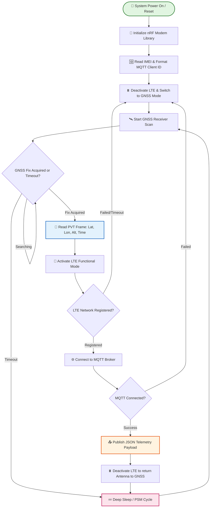
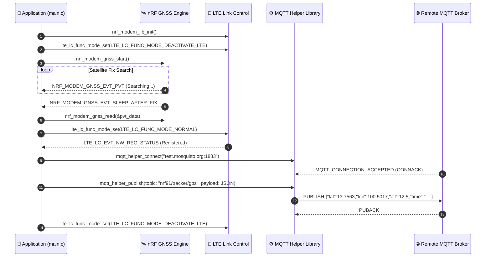
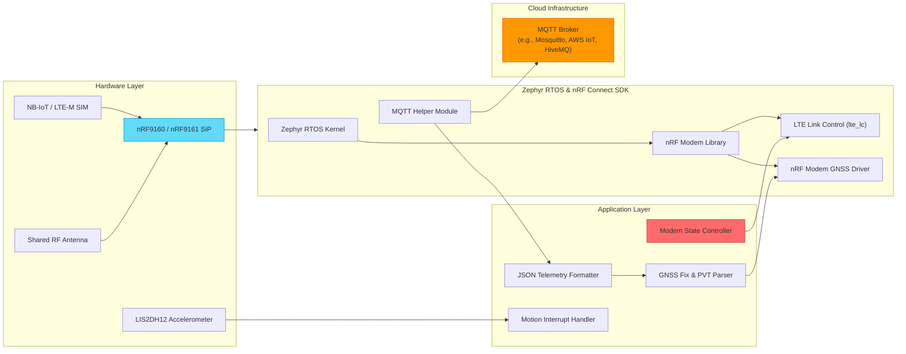

# Cellular NB-IoT / LTE-M Asset Tracker (nRF91 Series)

> A low-power, production-grade cellular IoT asset tracking system built on Nordic Semiconductor **nRF9160 / nRF9161** System-in-Package (SiP) using **Zephyr RTOS** and **nRF Connect SDK**. 

---

## 📋 Overview

This repository contains the complete firmware and educational modules for a cellular asset tracking system. The system captures precise GPS/GNSS satellite coordinates (Latitude, Longitude, Altitude, Accuracy, Timestamp) and securely transmits JSON telemetry payloads over **LTE-M / NB-IoT** networks to an **MQTT Broker** or **CoAP Server**.

To deliver multi-month/multi-year battery life, the application implements a **GPS-First Operation Protocol** with dynamic RF antenna switching, Power Saving Mode (PSM), extended Discontinuous Reception (eDRX), and optional movement-triggered GPS fix acquisition via an onboard **LIS2DH12 3-axis accelerometer**.

---

## 🌟 Key Features

* **🛰️ High-Precision GNSS Positioning**: Interfaces directly with `nrf_modem_gnss` for periodic location lock, PVT (Position, Velocity, Time) data parsing, and configurable accuracy thresholds.
* **📶 Flexible Cellular Telemetry**: Publishes formatted JSON telemetry via MQTT (`mqtt_helper`) or CoAP/DTLS over LTE-M and NB-IoT networks.
* **⚡ GPS-First Dynamic Antenna Management**: Solves RF co-existence and signal interference on shared antenna boards (e.g. nRF9160 DK, Thingy:91) by switching modem modes between GNSS acquisition (`LTE_LC_FUNC_MODE_DEACTIVATE_LTE`) and LTE connection (`LTE_LC_FUNC_MODE_NORMAL`).
* **🔋 Advanced Power Optimization**: Supports 3GPP Power Saving Mode (PSM) and eDRX, putting the modem into ultra-low-power sleep while maintaining network registration.
* **🆔 Automatic IMEI-Based Client ID**: Queries hardware IMEI via AT command (`AT+CGSN`) to auto-generate unique MQTT client identifiers (`nrf-<IMEI>`).
* **🏃 Motion-Triggered Wakeup (design target)**: The architecture reserves this behavior for a future LIS2DH12 integration; no accelerometer driver is present in the checked-in firmware yet.
* **📚 Modular Lab Curriculum**: Contains step-by-step modular lessons (`l2_LTE` to `l8_asset_tracking`) covering modem management, GNSS engine, MQTT, CoAP, and capstone tracking.

---

## 📐 System Operation Principles

### 1. Core Workflow Diagram



---

### 2. System Data Flow Sequence



---

### 3. Technical Architecture Diagram



---

## 🚀 Quick Start (Step-by-Step)

### Step 1: Prerequisites

Ensure you have the following software and hardware components ready:

#### Software Requirements
* **Nordic nRF Connect SDK (NCS)** v2.x or v3.x installed via nRF Connect Toolchain Manager.
* **Zephyr `west` toolchain** configured in your shell path.
* **Serial Terminal**: `minicom`, `screen`, `PuTTY`, or VS Code Serial Monitor (115200 8N1).
* **MQTT Client**: `mosquitto_sub` or MQTTX for verifying published data.

#### Hardware Requirements
* **Nordic Board**: nRF9160 DK (`nrf9160dk_nrf9160_ns`), Thingy:91 (`thingy91_nrf9160_ns`), or nRF9161 DK (`nrf9161dk_nrf9161_ns`).
* **Active SIM Card**: LTE-M or NB-IoT enabled nano-SIM card.
* **GNSS Antenna**: External GPS/GNSS antenna (if using nRF9160 DK).
* **Micro-USB / USB-C Cable**.

---

### Step 2: Clone & Workspace Setup

```bash
# Navigate to your workspace directory
cd /path/to/workspace

# Clone repository
git clone https://github.com/your-org/WildLifeTracking-NBIOT.git
cd WildLifeTracking-NBIOT
```

---

### Step 3: Configure Environment & Parameters

Configuration settings are managed through `prj.conf` and `Kconfig`. Modify settings according to your MQTT broker credentials:

```bash
# Navigate to the main project directory
cd myprojects/gps_mqtt_tracker
```

Edit `prj.conf` or use `west build -t menuconfig` to configure:

```ini
# MQTT Broker Settings
CONFIG_MQTT_BROKER_HOSTNAME="test.mosquitto.org"
CONFIG_MQTT_BROKER_PORT=1883
CONFIG_MQTT_PUB_TOPIC="nrf91/tracker/gps"

# GNSS Fix Interval & Timeout (Seconds)
CONFIG_TRACKER_PERIODIC_INTERVAL=120
CONFIG_TRACKER_PERIODIC_TIMEOUT=300
```

---

### Step 4: Build the Firmware

Build the target application using `west build` with the non-secure target (`_ns`):

#### For nRF9160 DK:
```bash
west build -b nrf9160dk_nrf9160_ns
```

#### For Thingy:91:
```bash
west build -b thingy91_nrf9160_ns
```

#### For nRF9161 DK:
```bash
west build -b nrf9161dk_nrf9161_ns
```

To clean and rebuild from scratch:
```bash
west build -b nrf9160dk_nrf9160_ns -p always
```

---

### Step 5: Flash to Target Board

Connect your board via USB, power it on, and execute:

```bash
west flash
```

---

### Step 6: Verify Operation via Serial Monitor

Connect to the board's COM/TTY port at **115200 baud**. Expected startup log output:

```text
*** Booting Zephyr OS build v3.x.x ***
[00:00:00.100,000] <inf> GPS_MQTT_Tracker: 🚀 GPS MQTT Asset Tracker Application Started
[00:00:00.200,000] <inf> GPS_MQTT_Tracker: Generated MQTT Client ID: nrf-354315xxxxxxxx
[00:00:00.300,000] <inf> GPS_MQTT_Tracker: GNSS initialized and started successfully
[00:00:05.000,000] <inf> GPS_MQTT_Tracker: Searching for GNSS Satellites...
[00:00:45.000,000] <inf> GPS_MQTT_Tracker: GNSS fix achieved! Reading PVT frame...
[00:00:45.010,000] <inf> GPS_MQTT_Tracker: 📍 GNSS Location Fix Acquired:
   Latitude:  13.756331°
   Longitude: 100.501765°
   Altitude:  12.5 m
   Accuracy:  3.2 m
[00:00:45.100,000] <inf> GPS_MQTT_Tracker: Activating LTE to send GPS payload over MQTT...
[00:00:48.200,000] <inf> GPS_MQTT_Tracker: 📶 LTE Registered (Home Network)
[00:00:48.300,000] <inf> GPS_MQTT_Tracker: ✅ Connected to MQTT Broker: test.mosquitto.org:1883
[00:00:48.400,000] <inf> GPS_MQTT_Tracker: 📤 Publishing GPS payload to topic 'nrf91/tracker/gps':
   {"lat":13.756331,"lon":100.501765,"alt":12.5,"acc":3.2,"time":"2026-08-01T14:00:00Z"}
[00:00:50.400,000] <inf> GPS_MQTT_Tracker: Deactivating LTE to return antenna control to GNSS...
```

---

### Step 7: Subscribe to MQTT Telemetry

On your development PC, monitor incoming messages using `mosquitto_sub`:

```bash
mosquitto_sub -h test.mosquitto.org -p 1883 -t "nrf91/tracker/gps" -v
```

Expected output:
```text
nrf91/tracker/gps {"lat":13.756331,"lon":100.501765,"alt":12.5,"acc":3.2,"time":"2026-08-01T14:00:00Z"}
```

---

## ⚙️ Configuration Reference

### Kconfig Options (`prj.conf` / `Kconfig`)

Below is the complete configuration matrix for customizing system behavior:

| Category | Kconfig Option | Type | Default Value | Description |
| :--- | :--- | :--- | :--- | :--- |
| **MQTT** | `CONFIG_MQTT_BROKER_HOSTNAME` | string | `"test.mosquitto.org"` | MQTT broker domain name or IP address |
| **MQTT** | `CONFIG_MQTT_BROKER_PORT` | int | `1883` | MQTT broker port (`1883` TCP / `8883` TLS) |
| **MQTT** | `CONFIG_MQTT_PUB_TOPIC` | string | `"nrf91/tracker/gps"` | Topic for publishing telemetry updates |
| **MQTT** | `CONFIG_MQTT_SUB_TOPIC` | string | `"nrf91/tracker/cmd"` | Topic for receiving remote commands |
| **MQTT** | `CONFIG_MQTT_CLIENT_ID` | string | `""` | Custom Client ID (Uses `nrf-<IMEI>` if blank) |
| **GNSS** | `CONFIG_TRACKER_PERIODIC_INTERVAL` | int | `120` | Interval between GNSS location scans (seconds) |
| **GNSS** | `CONFIG_TRACKER_PERIODIC_TIMEOUT` | int | `300` | Max search time for GNSS satellite fix (seconds) |
| **GNSS** | `CONFIG_GNSS_LOW_ACCURACY` | bool | `y` | Enables fast low-accuracy fixes for quick locks |
| **System** | `CONFIG_ENABLE_LEDS` | bool | `n` | Enables visual LED indicators (turn off for power saving) |
| **Network**| `CONFIG_LTE_NETWORK_MODE_LTE_M_NBIOT_GPS` | bool | `y` | Enables dual LTE-M / NB-IoT and GNSS mode |

---

## 📁 Repository Structure

```text
.
├── CONTEXT.md                    # Domain Model & Ubiquitous Language specification
├── cell-fund.yml                 # West manifest pinning nRF Connect SDK v3.3.0
├── docs/                         # Detailed curriculum documentation & ADRs
│   ├── AI_CODING_GUIDE.md        # Library catalog and rules for AI coding agents
│   ├── adr/                      # Architectural Decision Records
│   ├── l2.md                     # Lesson 2: LTE Link Controller & Network Registration
│   ├── l3.md                     # Lesson 3: nRF Modem Library Fundamentals
│   ├── l4.md                     # Lesson 4: MQTT Communication Setup
│   ├── l5.md                     # Lesson 5: Power Optimization (PSM & eDRX)
│   ├── l6.md                     # Lesson 6: GNSS Satellite Receiver Integration
│   ├── l7.md                     # Lesson 7: PSM/eDRX power optimization and secure CoAP
│   └── l8.md                     # Lesson 8: Capstone Tracker Design & Architecture
├── l2_LTE/                       # Hands-on Code: LTE link control exercises
├── l3_nRF_modem_lib/             # Hands-on Code: Modem initialization & AT commands
├── l4_MQTT/                      # Hands-on Code: MQTT helper integration exercises
├── l5/                           # Hands-on Code: Power saving PSM/eDRX exercises
├── l6_GNSS/                      # Hands-on Code: GNSS satellite fixing exercises
├── l7/                           # Hands-on Code: PSM/eDRX with secure CoAP
├── l8_asset_tracking/            # Hands-on Code: Tracker state machine capstone
└── myprojects/
    ├── LTE_n_MQTT/               # Focused LTE + MQTT publish-only test
    └── gps_mqtt_tracker/         # 🌟 Full Production Application
        ├── CMakeLists.txt        # Build system configuration
        ├── Kconfig               # Custom Kconfig options
        ├── prj.conf              # Project defaults
        ├── README.md             # Application README
        └── src/
            └── main.c            # Primary tracking application logic
```

For repository-wide dependency usage, API lifecycles, Kconfig ownership, and
instructions for coding agents, read **[AI Coding Guide](docs/AI_CODING_GUIDE.md)**.

---

## 🛠️ Common Troubleshooting

### 💡 Issue 1: GNSS Satellite Lock Failure (Infinite Search)
* **Cause**: Poor satellite line-of-sight indoors or active LTE interference on shared antenna.
* **Fix**: 
  1. Move the board near a window or outdoors.
  2. Ensure the GPS antenna is securely connected.
  3. Verify `LTE_LC_FUNC_MODE_DEACTIVATE_LTE` is called before starting GNSS scanning.

---

### 💡 Issue 2: LTE Network Registration Timeout
* **Cause**: Missing SIM card, inactive data plan, or weak network signal.
* **Fix**:
  1. Check SIM orientation and insertion.
  2. Verify SIM card supports LTE-M or NB-IoT bands in your region.
  3. Inspect modem logs using AT command `AT+CSQ` or `AT+CEREG?`.

---

### 💡 Issue 3: MQTT Connection Refused
* **Cause**: Incorrect broker hostname/port or firewall blocking port 1883.
* **Fix**:
  1. Test broker reachability using `ping test.mosquitto.org`.
  2. Ensure `CONFIG_NET_SOCKETS_OFFLOAD=y` is active in `prj.conf`.

---

## 📜 License & Acknowledgments

* **License**: SPDX-License-Identifier: `LicenseRef-Nordic-5-Clause`
* Built with **Zephyr RTOS** and **Nordic nRF Connect SDK**.
