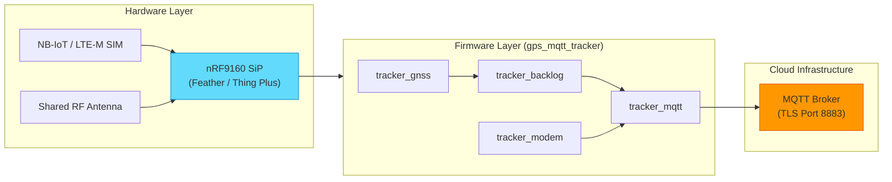

# Cellular NB-IoT / LTE-M Asset Tracker (nRF91 Series)

> A low-power, production-grade cellular IoT asset tracking system built on Nordic Semiconductor **nRF9160** System-in-Package (SiP) using **Zephyr RTOS** and **nRF Connect SDK v3.3.0** (pinned in [`cell-fund.yml`](cell-fund.yml)).

---

## 📋 Overview

This repository contains the complete firmware and educational modules for a cellular asset tracking system. The tracker application captures periodic GPS/GNSS satellite coordinates (Latitude, Longitude, Altitude, Accuracy, Timestamp) and securely transmits JSON telemetry payloads over **LTE-M / NB-IoT** networks to an **MQTT Broker** (with TLS and QoS 1 delivery).

To maximize battery life, the application implements a **GPS-First Operation Protocol** with dynamic RF antenna switching, Power Saving Mode (PSM), extended Discontinuous Reception (eDRX), and an in-memory backlog queue using **Adaptive Stride Sampling** ([ADR 0005](docs/adr/0005-adaptive-stride-backlog-retention.md)) to buffer fixes during cellular outages.

---

## 🌟 Key Features

* **🛰️ High-Precision GNSS Positioning**: Interfaces directly with `nrf_modem_gnss` for periodic location lock, PVT (Position, Velocity, Time) data parsing, and configurable accuracy thresholds.
* **📶 Secure Cellular Telemetry**: Publishes formatted JSON telemetry via MQTT over TLS (`mqtt_helper`) with QoS 1 confirmation over LTE-M and NB-IoT networks.
* **⚡ GPS-First Dynamic Antenna Management**: Solves RF co-existence on shared antenna hardware by deactivating LTE (`LTE_LC_FUNC_MODE_DEACTIVATE_LTE`) during GNSS acquisition and enabling LTE (`LTE_LC_FUNC_MODE_NORMAL`) only when uploading.
* **🔋 Advanced Power Optimization**: Supports 3GPP Power Saving Mode (PSM) and eDRX, with automatic fallback to LTE deactivation if PSM is not granted.
* **📦 Outage Backlog Retention**: Buffers un-sent fixes across cellular disconnects using adaptive stride sampling, flushing in chronological order upon reconnection.
* **🆔 Automatic IMEI-Based Client ID**: Queries hardware IMEI via AT command (`AT+CGSN`) to auto-generate unique MQTT client identifiers (`nrf-<IMEI>`).
* **📚 Modular Lab Curriculum**: Contains step-by-step educational practice exercises (`v3.3.3_practices/`) covering modem management, GNSS, MQTT, and CoAP.

---

## 📐 System Architecture

For detailed diagrams including the device state machine, data flow sequence, and runtime architecture, see:

> **[CODE_ARCHITECTURE.md](myprojects/gps_mqtt_tracker/CODE_ARCHITECTURE.md)** — State machine, module layout, and data flow diagrams

Below is a high-level overview of the system layers:




---

## 🚀 Quick Start

### Prerequisites

#### Software
* **Nordic nRF Connect SDK (NCS) v3.3.0** installed via nRF Connect Toolchain Manager (see [`cell-fund.yml`](cell-fund.yml)).
* **Zephyr `west` toolchain** configured in your shell path.
* **Serial Terminal**: `minicom`, `screen`, `PuTTY`, or VS Code Serial Monitor (115200 8N1).
* **MQTT Client**: `mosquitto_sub` or MQTTX for verifying published data.

#### Hardware
* **Supported Board**: Circuit Dojo Feather nRF9160 (`circuitdojo_feather/nrf9160/ns`) or SparkFun Thing Plus nRF9160 (`sparkfun_thing_plus/nrf9160/ns`).
* **Active SIM Card**: LTE-M or NB-IoT enabled nano-SIM card.
* **GNSS Antenna**: External GPS/GNSS antenna.
* **USB Cable**: Micro-USB or USB-C depending on board.

### Build, Flash & Verify

For complete step-by-step build instructions, configuration, flashing, and hardware verification:

> **[Tracker App README](myprojects/gps_mqtt_tracker/README.md)** — Build commands, configuration, TLS setup, and verification steps

---

## 📁 Repository Structure

```text
.
├── CONTEXT.md                        # Domain Model & Ubiquitous Language
├── cell-fund.yml                     # West manifest pinning NCS v3.3.0
│
├── docs/                             # Documentation & Curriculum
│   ├── AI_CODING_GUIDE.md            # Library catalog & rules for AI coding agents
│   ├── adr/                          # Architectural Decision Records
│   ├── experiments/                  # Comparison plans, evidence, and analysis
│   ├── hardware/                     # Hardware specifications (LIS2DH12, etc.)
│   └── l2.md – l8.md                # Lesson guides (LTE → GNSS → MQTT → Capstone)
│
├── v3.3.3_practices/                 # Hands-on exercise & solution code
│   ├── l2_LTE/                       # LTE link control exercises
│   ├── l3_nRF_modem_lib/             # Modem initialization & AT commands
│   ├── l4_MQTT/                      # MQTT helper integration
│   ├── l5/                           # Power saving PSM/eDRX
│   ├── l6_GNSS/                      # GNSS satellite fixing
│   ├── l7/                           # PSM/eDRX with secure CoAP
│   └── l8_asset_tracking/            # Tracker state machine capstone
│
├── samples/                          # Standalone hardware samples (accelerometer, battery, etc.)
│
└── myprojects/
    ├── gps_mqtt_tracker/             # 🌟 Main Tracker Application
    ├── mqtt_connection_test/         # MQTT connectivity diagnostic tool
    └── monitor-application/          # Companion monitoring tools
        ├── gps_monitoring/           # Live GPS map dashboard (Node.js)
        └── ESP32-power-monitor/      # Power monitor firmware (MicroPython)
```

---

## 📚 Documentation Navigation

| What you need | Go to |
| :--- | :--- |
| **Run the GPS tracker** | [Tracker App README](myprojects/gps_mqtt_tracker/README.md) |
| **Understand the code architecture** | [CODE_ARCHITECTURE.md](myprojects/gps_mqtt_tracker/CODE_ARCHITECTURE.md) |
| **Browse every function** | [CODE_FUNCTIONS.md](myprojects/gps_mqtt_tracker/CODE_FUNCTIONS.md) |
| **Thai-language guide** | [GUIDE_TH.md](myprojects/gps_mqtt_tracker/GUIDE_TH.md) |
| **Configure Kconfig options** | [`Kconfig`](myprojects/gps_mqtt_tracker/Kconfig) — SSOT for all defaults |
| **View GPS on a live map** | [GPS Monitoring](myprojects/monitor-application/gps_monitoring/README.md) |
| **Measure power consumption** | [ESP32 Power Monitor](myprojects/monitor-application/ESP32-power-monitor/README.md) |
| **Cellular IoT lessons** | [docs/l2–l8](docs/) |
| **Architectural decisions** | [ADR Records](docs/adr/) |
| **Plan and review experiments** | [Experiment Index](docs/experiments/README.md) |
| **Create an experiment record** | [Experiment Template](docs/experiments/TEMPLATE.md) |
| **Compare MQTT payload energy** | [MQTT Payload Size Plan](docs/experiments/0001-mqtt-payload-size/README.md) |
| **Hardware specifications** | [docs/hardware/](docs/hardware/) |
| **AI agent coding rules** | [AI_CODING_GUIDE](docs/AI_CODING_GUIDE.md) |
| **Domain glossary** | [CONTEXT.md](CONTEXT.md) |

---

## 🛠️ Troubleshooting

For common issues and solutions (GNSS lock failure, LTE registration timeout, MQTT connection refused), see:

> **[Tracker App README — Troubleshooting](myprojects/gps_mqtt_tracker/README.md)**

---

## 📜 License & Acknowledgments

* **License**: SPDX-License-Identifier: `LicenseRef-Nordic-5-Clause`
* Built with **Zephyr RTOS** and **Nordic nRF Connect SDK v3.3.0**.
