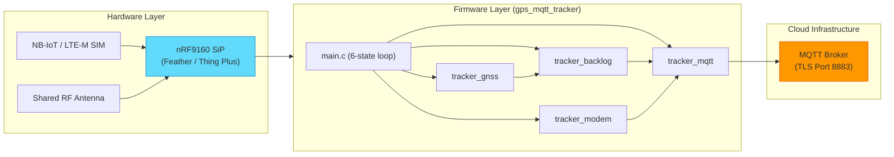

# Cellular NB-IoT / LTE-M Asset Tracker (nRF91 Series)

> A low-power cellular IoT asset tracking system built on the Nordic Semiconductor **nRF9160** SiP using **Zephyr RTOS** and **nRF Connect SDK v3.3.0** (pinned in [`cell-fund.yml`](cell-fund.yml)).

---

## Overview

This repository contains the tracker firmware, a manual state-control power-testing harness, companion host monitoring tools, and Nordic Cellular IoT course exercises. The primary application ([`myprojects/gps_mqtt_tracker`](myprojects/gps_mqtt_tracker/README.md)) acquires GNSS fixes (`latitude`, `longitude`, `altitude`, `accuracy`, UTC `time`), buffers fixes in RAM across outages using **Adaptive Stride Sampling** ([ADR 0005](docs/adr/0005-adaptive-stride-backlog-retention.md)), and publishes JSON payloads over **LTE-M / NB-IoT** to an **MQTT broker over TLS** (port `8883`, QoS 1).

To reduce power consumption and avoid LTE/GNSS radio contention on shared-antenna hardware, the firmware uses a **GPS-first** sequence: GNSS acquires a fix while LTE is deactivated, then LTE activates to connect and drain the backlog over MQTT before entering **PSM** (or falling back to `LTE_LC_FUNC_MODE_DEACTIVATE_LTE` if PSM is unavailable or times out).

---

## Implemented Features (Code Ground Truth)

* **GNSS Positioning (`tracker_gnss.c`)**: Configures `nrf_modem_gnss` for periodic fixes (`CONFIG_TRACKER_PERIODIC_INTERVAL=300`, `CONFIG_TRACKER_PERIODIC_TIMEOUT=300`), priority mode at startup, optional low-accuracy mode, and optional PVT/NMEA diagnostics over RTT.
* **GPS-First Radio Sequencing (`tracker_modem.c`)**: Deactivates LTE (`LTE_LC_FUNC_MODE_DEACTIVATE_LTE`) during GNSS acquisition and activates `LTE_LC_FUNC_MODE_NORMAL` only when fixes are ready to upload.
* **PSM with Radio-Off Fallback (`tracker_modem.c`)**: Requests 3GPP Power Saving Mode (`TAU=300s`, `active_time=0s`, entry wait `60s`) and deactivates LTE as a fallback if PSM is not granted or times out. (`eDRX` is disabled via `CONFIG_LTE_LC_EDRX_MODULE=n`.)
* **Outage Backlog (`tracker_backlog.c`)**: Retains up to `CONFIG_TRACKER_BACKLOG_CAPACITY` (default `40`) fixes in a static RAM array using adaptive stride sampling, evicting entries only after QoS 1 `PUBACK`.
* **MQTT over TLS (`tracker_mqtt.c`)**: Provisions the local `credentials/ca-cert.pem` into modem security tag `24`, authenticates with optional username/password, uses `CONFIG_MQTT_CLIENT_ID` (`"WLTK01"` by default, or `nrf-<IMEI>` via `AT+CGSN` when empty), and formats JSON payloads with `snprintf`.
* **8-State Manual Power Harness (`gps_mqtt_stateControl`)**: Button-stepped (`MODE` / `sw0`) test firmware isolating `GPS`, `FIX`, `LTE_NO_PSM`, `LTE_PSM`, `MQTT_CONNECT`, `MQTT_SENDING`, `MQTT_DISCONNECT`, and `LOW_POWER`.
* **Companion Host Tools (`monitor-application/`)**:
  * [`gps_monitoring`](myprojects/monitor-application/gps_monitoring/README.md): Node.js + Leaflet live MQTT map dashboard with JSONL and optional PostgreSQL storage.
  * [`ESP32-power-monitor`](myprojects/monitor-application/ESP32-power-monitor/README.md): MicroPython INA239 dual-channel power monitor + Python serial backend + InfluxDB 3 Core + browser analysis workspace.

---

## System Architecture

For state diagrams, module ownership, and synchronization details, see [`CODE_ARCHITECTURE.md`](myprojects/gps_mqtt_tracker/CODE_ARCHITECTURE.md).



---

## Quick Start

### Prerequisites

* **Nordic nRF Connect SDK (NCS) v3.3.0** (pinned in [`cell-fund.yml`](cell-fund.yml)) and Zephyr `west` toolchain.
* **Board**: SparkFun Thing Plus nRF9160 (`sparkfun_thing_plus/nrf9160/ns`) or Circuit Dojo Feather nRF9160 (`circuitdojo_feather/nrf9160/ns`).
* **Debugger / Logs**: SEGGER J-Link + RTT Viewer (both `gps_mqtt_tracker` and `gps_mqtt_stateControl` disable UART/serial console and log over SEGGER RTT only; `mqtt_connection_test` logs to UART).
* **Active SIM + LTE/GNSS Antennas** and an MQTT broker (e.g. `mosquitto_sub` or [`gps_monitoring`](myprojects/monitor-application/gps_monitoring/README.md)).

### Build & Flash

See [`myprojects/gps_mqtt_tracker/README.md`](myprojects/gps_mqtt_tracker/README.md) for local credential/CA setup and build commands, or use [`flash_gps_mqtt_tracker.sh`](flash_gps_mqtt_tracker.sh) to build and program the SparkFun Thing Plus target via `west` and `nrfutil`.

---

## Repository Structure

```text
.
├── CONTEXT.md                        # Domain glossary & implemented vs. planned scope
├── cell-fund.yml                     # West manifest pinning NCS v3.3.0
├── flash_gps_mqtt_tracker.sh         # Build & flash helper for SparkFun Thing Plus nRF9160
│
├── docs/                             # Guides, ADRs, experiments, hardware specs, and lessons
│   ├── AI_CODING_GUIDE.md            # Library catalog & rules for AI coding agents
│   ├── adr/                          # Architectural Decision Records (0001–0005)
│   ├── agents/                       # Issue tracker & triage conventions
│   ├── experiments/                  # Experiment plans, templates, and analysis
│   ├── hardware/                     # Hardware specs, solar prototype, power checklist
│   └── l2.md – l8.md                 # Cellular IoT lesson notes
│
├── v3.3.3_practices/                 # Course exercise & solution (_sol) apps
│   ├── l2_LTE/
│   ├── l3_nRF_modem_lib/
│   ├── l4_MQTT/
│   ├── l5/
│   ├── l6_GNSS/
│   ├── l7/
│   └── l8_asset_tracking/
│
├── samples/                          # Standalone hardware samples (LIS2DH, sleep, flash, etc.)
│
└── myprojects/
    ├── gps_mqtt_tracker/             # Primary periodic GNSS -> backlog -> MQTT/TLS tracker
    ├── gps_mqtt_stateControl/        # 8-state MODE-button power-testing harness
    ├── mqtt_connection_test/         # Standalone LTE + TLS + MQTT connectivity test
    └── monitor-application/
        ├── gps_monitoring/           # Live MQTT map dashboard (Node.js + Leaflet)
        └── ESP32-power-monitor/      # INA239 dual-channel power monitor + InfluxDB UI
```

---

## Documentation Navigation

| What you need | Go to |
| :--- | :--- |
| **Run the primary GPS tracker** | [Tracker App README](myprojects/gps_mqtt_tracker/README.md) |
| **Understand tracker architecture** | [CODE_ARCHITECTURE.md](myprojects/gps_mqtt_tracker/CODE_ARCHITECTURE.md) |
| **Browse tracker functions** | [CODE_FUNCTIONS.md](myprojects/gps_mqtt_tracker/CODE_FUNCTIONS.md) |
| **Cold-start & external power troubleshooting** | [POWER_SOURCE_STARTUP_TROUBLESHOOTING.md](myprojects/gps_mqtt_tracker/POWER_SOURCE_STARTUP_TROUBLESHOOTING.md) |
| **Configure tracker Kconfig options** | [`Kconfig`](myprojects/gps_mqtt_tracker/Kconfig) |
| **Run the 8-state power test harness** | [State-Control README](myprojects/gps_mqtt_stateControl/README.md) & [Power Testing](myprojects/gps_mqtt_stateControl/docs/power-testing.md) |
| **Verify MQTT/TLS credentials isolated** | [MQTT Connection Test README](myprojects/mqtt_connection_test/README.md) |
| **View GPS fixes on a live map** | [GPS Monitoring README](myprojects/monitor-application/gps_monitoring/README.md) |
| **Measure power consumption** | [ESP32 Power Monitor README](myprojects/monitor-application/ESP32-power-monitor/README.md) |
| **Architectural decisions** | [ADR Records](docs/adr/) |
| **Experiments & hardware docs** | [Experiment Index](docs/experiments/README.md) & [docs/hardware/](docs/hardware/) |
| **AI agent coding rules** | [AI_CODING_GUIDE.md](docs/AI_CODING_GUIDE.md) |
| **Domain glossary** | [CONTEXT.md](CONTEXT.md) |

---

## License

* **SPDX-License-Identifier**: `LicenseRef-Nordic-5-Clause`
* Built with **Zephyr RTOS** and **Nordic nRF Connect SDK v3.3.0**.
