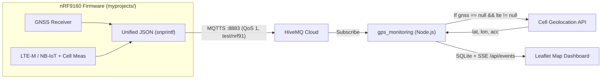

# Firmware and Software (`myprojects/`)

Complete catalog of all **nRF Connect SDK v3.3.0** firmware applications and **host monitoring software** under `myprojects/`.

## 1. Firmware Applications (nRF9160 / Zephyr RTOS)

All tracker and sleep-mode firmware targets `sparkfun_thing_plus/nrf9160/ns` (and `circuitdojo_feather/nrf9160/ns`) with `--sysbuild`, logs via **SEGGER RTT**, connects over **MQTTS `:8883`** (`sec_tag = 24`, QoS 1), and publishes the [[api-contract/mqtt-payload-schema|Unified MQTT JSON Payload Schema]].

| Application | Note | Positioning | Sleep / Wake Policy | Backlog |
| :--- | :--- | :--- | :--- | :---: |
| `gps_mqtt_tracker` | [[firmware-and-software/gps-mqtt-tracker\|GPS MQTT Tracker]] | GNSS (GPS-first) | PSM + fallback `DEACTIVATE_LTE` | RAM (40) |
| `gps_mqtt_stateControl` | [[firmware-and-software/gps-mqtt-state-control\|GPS MQTT State Control]] | GNSS | Manual `MODE` 8-state stepping | Single |
| `lte_mqtt_tracker` | [[firmware-and-software/lte-mqtt-tracker\|LTE Cell MQTT Tracker]] | LTE Cell-ID | Periodic `k_sleep` + PSM | RAM (40) |
| `lte_vs_gnss_compare` | [[firmware-and-software/lte-vs-gnss-compare\|LTE vs GNSS Compare]] | Stage 1 LTE + Stage 2 GNSS | Instant `MODE` abort → Sleep → `MODE` next stage | Single |
| `sleep_mode_psm` | [[firmware-and-software/sleep-mode-psm\|Sleep Mode 1 (PSM)]] | LTE Cell-ID | System ON Idle + PSM/fallback (30 s timer or `MODE`) | Single |
| `sleep_mode_sys_off` | [[firmware-and-software/sleep-mode-sys-off\|Sleep Mode 2 (System OFF)]] | LTE Cell-ID | `sys_poweroff()` (`MODE` cold-boot wake) | None |
| `mqtt_connection_test` | [[firmware-and-software/mqtt-connection-test\|MQTT Connection Test]] | None (smoke test) | None (UART console) | None |

## 2. Host & Monitoring Software (`myprojects/monitor-application/`)

| Application | Note | Stack | Role |
| :--- | :--- | :--- | :--- |
| `gps_monitoring` | [[firmware-and-software/gps-monitoring\|GPS Monitoring]] | Node.js + SQLite + Leaflet | Live MQTT subscriber, Cell Geolocation resolver, map UI (`npm test` 18/18 passing) |
| `ESP32-power-monitor` | [[firmware-and-software/esp32-power-monitor\|ESP32 Power Monitor]] | MicroPython + Python + SQLite | Dual-channel INA239 serial power profiler & web graph |

## 3. System Data Flow



## 4. Build & J-Link RTT Quick Reference

```bash
# Development build (RTT enabled)
west build -p always -b sparkfun_thing_plus/nrf9160/ns myprojects/<app> --sysbuild

# Release / low-power measurement build (no RTT, no LED)
west build -p always -b sparkfun_thing_plus/nrf9160/ns myprojects/<app> --sysbuild -- -DEXTRA_CONF_FILE=release.conf

# Stream J-Link RTT Channel 0
/Applications/SEGGER/JLink/JLinkRTTLogger -Device nRF9160_xxAA -If SWD -Speed 4000 -RTTChannel 0 /tmp/nrf9160_rtt.log
```

---
Back to [[README|Documentation Hub]]
