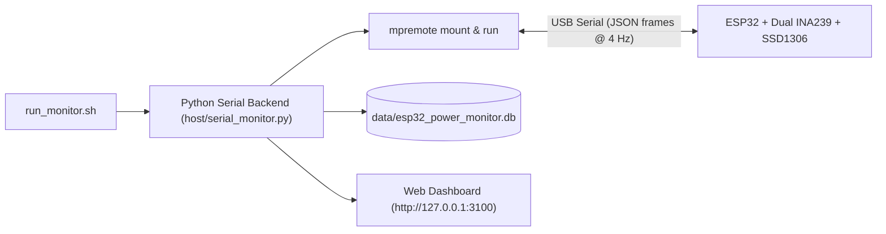

# ESP32 Power Monitor (`myprojects/monitor-application/ESP32-power-monitor/`)

MicroPython firmware for an **ESP32** reading two **INA239** current/power channels over SPI (250 ms / 4 Hz cadence) paired with a local Python serial backend, SQLite WAL storage, and browser graphing dashboard.

## Architecture



## Key Features & Measurement Boundaries

- Reads 24-bit unsigned INA239 `POWER` register and checks `DIAG_ALRT` before/after each sample (rejects overflow/checksum faults).
- Stores timestamped readings and manual operation labels (`GPS finding`, `LTE init`, etc.) in SQLite WAL (`data/esp32_power_monitor.db`) plus JSONL backups under `logs/`.
- **Limitations:** Targets ~4 Hz with 0.001 W rounding — suitable for macro state power averages, **not** for resolving sub-mW deep-sleep currents or fast LTE TX burst peaks (use a µA-capable profiler such as PPK2 for sleep floor).
- **Note:** `main.py` does not connect to Wi-Fi/MQTT or parse tracker location JSON.

## Run & Test

```bash
# Run host driver regression tests
python3 -m unittest discover -s myprojects/monitor-application/ESP32-power-monitor/tests -v

# Launch serial backend + web dashboard (default port /dev/cu.usbserial-0001)
./myprojects/monitor-application/ESP32-power-monitor/run_monitor.sh
# Open http://127.0.0.1:3100
```

## Related Notes
- [[experiments/0004-state-control-power/README|Experiment 0004: Energy by Tracker State]]
- [[experiments/0006-lte-vs-gnss-and-sleep-power/README|Experiment 0006: LTE vs GNSS & Sleep Power]]
- [[firmware-and-software/README|Firmware and Software Catalog]]
