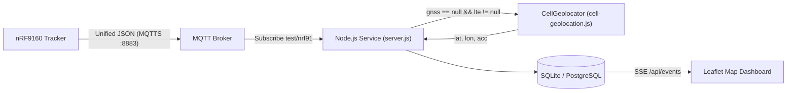

# GPS Monitoring (`myprojects/monitor-application/gps_monitoring/`)

Local Node.js web application for subscribing to tracker MQTT payloads, resolving LTE Cell-IDs to coordinates, storing location history in SQLite (and optional PostgreSQL), and plotting live positions on a Leaflet map.

## Architecture



## Unified Payload Support & Resolution Rule

Supports the **Unified Tracker MQTT Payload Schema (v1)** ([[api-contract/mqtt-payload-schema|MQTT Payload Schema]]) plus backward compatibility with legacy flat GNSS (`{"lat":...}`) and legacy flat LTE (`{"mcc":...}`) payloads:
- **`gnss != null`** (`source: "gnss"` or `"hybrid"`) → plots `gnss.lat`, `gnss.lon`, `gnss.acc` directly with **0** Cell Geolocation calls.
- **`gnss == null && lte != null`** (`source: "lte"`) → resolves via `cell-geolocation.js` (Google Geolocation / UnwiredLabs / OpenCelliD / nRF Cloud).
- Persists `device_id` and `source` in SQLite (`data/locations.sqlite`) and renders `GNSS` / `LTE` / `HYBRID` badges in the UI ledger.

## Quick Start & Tests

```bash
cd myprojects/monitor-application/gps_monitoring
npm install
npm test      # 18/18 unit tests passing
npm start     # http://127.0.0.1:13000
```

> [!info]
> Broker settings are saved locally in git-ignored `data/mqtt-config.json` and passwords are never returned to the browser. See [[api-contract/README|API Contract]] for all REST and SSE endpoints.

## Related Notes
- [[api-contract/README|API Contract]]
- [[api-contract/mqtt-payload-schema|Unified MQTT Payload Schema]]
- [[firmware-and-software/README|Firmware and Software Catalog]]
