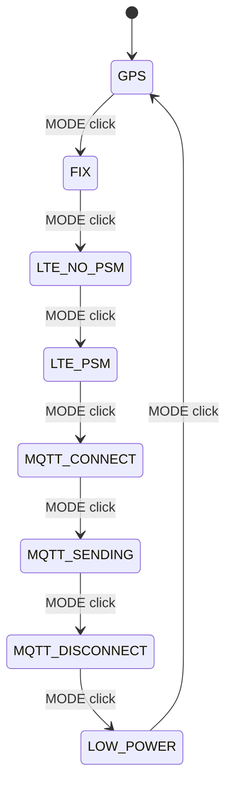

# GPS MQTT State Control (`myprojects/gps_mqtt_stateControl/`)

8-state `MODE`-button power-characterization harness for isolating per-state current and energy on `sparkfun_thing_plus/nrf9160/ns`.

## 8-State Cycle (Manual `MODE` Button Advance)



- **`GPS`:** Acquires GNSS fix (180 s timeout; stays in state until `MODE` advances).
- **`FIX`:** Displays valid GNSS fix or `FIX: null`.
- **`LTE_NO_PSM` / `LTE_PSM`:** Isolates LTE registration without and with PSM requested.
- **`MQTT_CONNECT` → `MQTT_SENDING` → `MQTT_DISCONNECT`:** Publishes unified JSON (`source: "gnss"`, `lte: null`, or `gnss: null` when no fix) to `test/nrf91` (TLS `:8883`, QoS 1).
- **`LOW_POWER`:** Deactivates LTE, cancels LED work (`led0` dark), and waits in System ON until `MODE` restarts `GPS`.

## Build & Host Tests

```bash
# Build firmware
west build -p always -b sparkfun_thing_plus/nrf9160/ns \
  myprojects/gps_mqtt_stateControl --sysbuild

# Run host-stub verification tests
python3 myprojects/gps_mqtt_stateControl/tests/test_state_control.py
python3 myprojects/gps_mqtt_stateControl/tests/test_gnss_session.py
python3 myprojects/gps_mqtt_stateControl/tests/test_tracker_ui.py
```

## Related Notes
- [[experiments/0004-state-control-power/README|Experiment 0004: Energy by Tracker State]]
- [[api-contract/mqtt-payload-schema|Unified MQTT Payload Schema]]
- [[firmware-and-software/README|Firmware and Software Catalog]]
