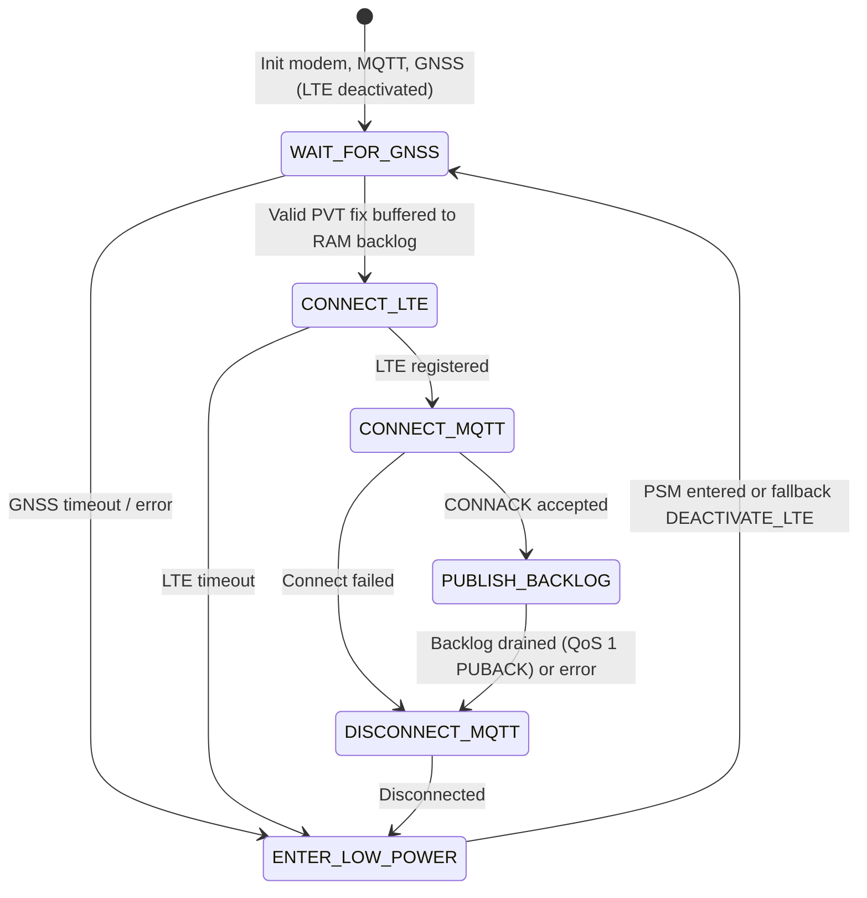

# GPS MQTT Tracker (`myprojects/gps_mqtt_tracker/`)

Primary GNSS-to-MQTT/TLS asset tracker running on `sparkfun_thing_plus/nrf9160/ns` and `circuitdojo_feather/nrf9160/ns` (NCS v3.3.0).

## Architecture & State Machine



## Key Modules (`src/`)

| File | Responsibility |
| :--- | :--- |
| `main.c` | Six-state tracker loop (`WAIT_FOR_GNSS` → `CONNECT_LTE` → `CONNECT_MQTT` → `PUBLISH_BACKLOG` → `DISCONNECT_MQTT` → `ENTER_LOW_POWER`). |
| `tracker_gnss.c` | Periodic GNSS PVT acquisition (`CONFIG_TRACKER_PERIODIC_INTERVAL`, `CONFIG_TRACKER_PERIODIC_TIMEOUT`), stale frame purge, `FIX_VALID` check. |
| `tracker_modem.c` | GPS-first radio sequencing (`DEACTIVATE_LTE` during GNSS, `NORMAL` for upload), PSM negotiation with `DEACTIVATE_LTE` fallback. |
| `tracker_backlog.c` | Fixed-capacity RAM buffer (default 40) with adaptive stride sampling ([[adr/0005-adaptive-stride-backlog-retention|ADR 0005]]). |
| `tracker_mqtt.c` | TLS CA provisioning (`sec_tag = 24`), `mqtt_helper` client, QoS 1 `PUBACK` wait, unified JSON formatting ([[api-contract/mqtt-payload-schema|MQTT Payload Schema]]). |
| `tracker_ui.c` | Blink-group indicator on `led0` (2 blinks = GNSS, 3 = LTE, 4 = MQTT, off = init/sleep). |
| `circuitdojo_gnss.c` | Drives `P0.13` low at boot for SparkFun/Circuit Dojo GNSS antenna power. |

## MQTT Payload

Publishes to `test/nrf91` (`WLTK01`, TLS port `8883`, QoS 1) using the unified schema (`source: "gnss"`, `lte: null`). See [[api-contract/mqtt-payload-schema|Unified MQTT Payload Schema]].

## Build & Local Setup

```bash
cp myprojects/gps_mqtt_tracker/config/mqtt-credentials.conf.example \
   myprojects/gps_mqtt_tracker/config/mqtt-credentials.conf
# Place broker root CA at myprojects/gps_mqtt_tracker/credentials/ca-cert.pem

west build -p always -b sparkfun_thing_plus/nrf9160/ns \
  myprojects/gps_mqtt_tracker --sysbuild
```

## Related Notes
- [[firmware-and-software/README|Firmware and Software Catalog]]
- [[hardware/power-source-startup-troubleshooting|External Power & Power-Latch]]
- [[adr/0005-adaptive-stride-backlog-retention|ADR 0005: Adaptive Stride Backlog]]
- [[adr/0006-unified-telemetry-json-schema|ADR 0006: Unified Telemetry JSON]]
