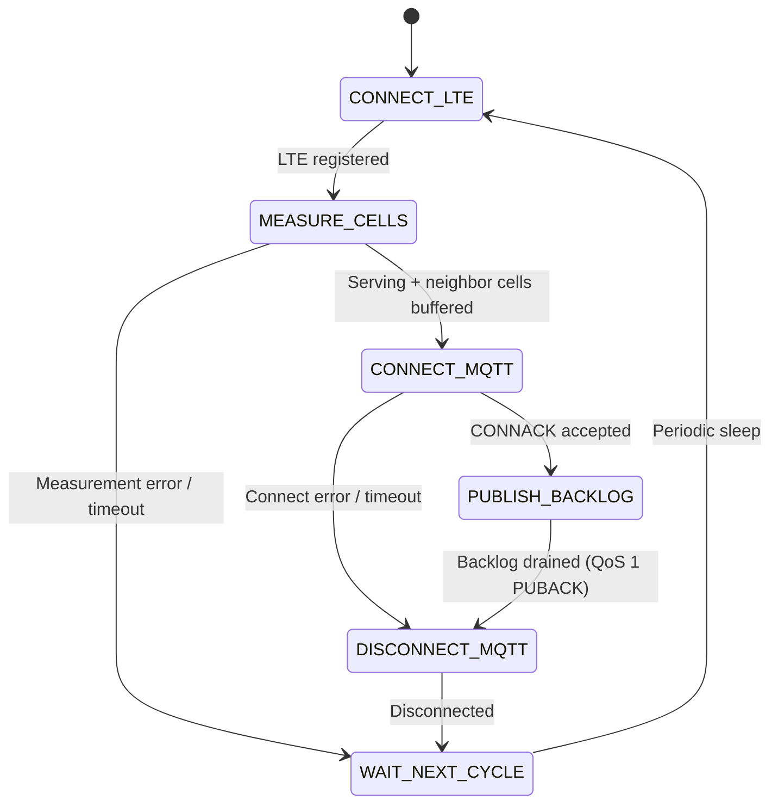

# LTE Cell MQTT Tracker (`myprojects/lte_mqtt_tracker/`)

Cellular asset tracker that uses **LTE serving and neighbor cell measurements** (`lte_lc_neighbor_cell_measurement()`) instead of GNSS as its primary positioning input.

## State Machine



- **Backlog:** Fixed-capacity RAM buffer (40 entries, adaptive stride sampling).
- **MQTT Payload:** Unified schema (`source: "lte"`, `gnss: null`, `lte: { mcc, mnc, tac, cid, earfcn, pci, rsrp, rsrq, ncells }`). See [[api-contract/mqtt-payload-schema|Unified MQTT Payload Schema]].
- **Status LED (`led0`):** 2 blinks = LTE registration, 3 = cell scan, 4 = MQTT upload, off = sleep.

## Build

```bash
west build -p always -b sparkfun_thing_plus/nrf9160/ns \
  myprojects/lte_mqtt_tracker --sysbuild
```

## Related Notes
- [[api-contract/mqtt-payload-schema|Unified MQTT Payload Schema]]
- [[firmware-and-software/gps-monitoring|GPS Monitoring Web App]]
- [[experiments/0006-lte-vs-gnss-and-sleep-power/README|Experiment 0006: LTE vs GNSS & Sleep Power]]
