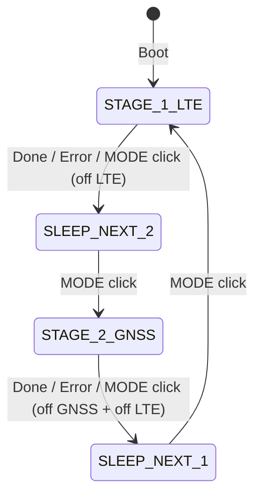

# LTE vs GNSS Comparison Firmware (`myprojects/lte_vs_gnss_compare/`)

Single firmware combining **Stage 1 (LTE Cell-ID)** and **Stage 2 (GPS-first GNSS)** with instant `MODE` button (`sw0`, `P0.12`, 250 ms debounce) control for side-by-side power comparison.

## State Machine



- **Stage 1 (`led0` slow blink 500 ms):** `START -> open LTE -> connect LTE (30 s) -> get cell location -> MQTT send (source: "lte", gnss: null) -> off LTE -> SLEEP`
- **Stage 2 (`led0` fast blink 150 ms):** `START -> open GNSS (LTE off) -> get GNSS fix (300 s) -> off GNSS -> connect LTE (30 s) -> MQTT send (source: "gnss", lte: null) -> off LTE -> SLEEP`
- **SLEEP (`led0` off):** Both radios deactivated, `W25Q32JV` flash in DPD, `LIS2DH12` ODR=0; waits in System ON Idle until `MODE` is clicked, then wakes into the next stage.
- **Instant abort:** Clicking `MODE` mid-stage uses Zephyr `k_poll` to cancel LTE, cell scan, GNSS, or MQTT immediately and clean up into `SLEEP`.

## Build

```bash
# Development build (J-Link RTT + LED stage blinks)
west build -p always -b sparkfun_thing_plus/nrf9160/ns \
  myprojects/lte_vs_gnss_compare --sysbuild

# Low-power measurement build (no RTT, no logs, no LED)
west build -p always -b sparkfun_thing_plus/nrf9160/ns \
  myprojects/lte_vs_gnss_compare --sysbuild -- -DEXTRA_CONF_FILE=release.conf
```

## Related Notes
- [[experiments/0006-lte-vs-gnss-and-sleep-power/README|Experiment 0006: LTE vs GNSS & Sleep Power]]
- [[api-contract/mqtt-payload-schema|Unified MQTT Payload Schema]]
- [[firmware-and-software/README|Firmware and Software Catalog]]
