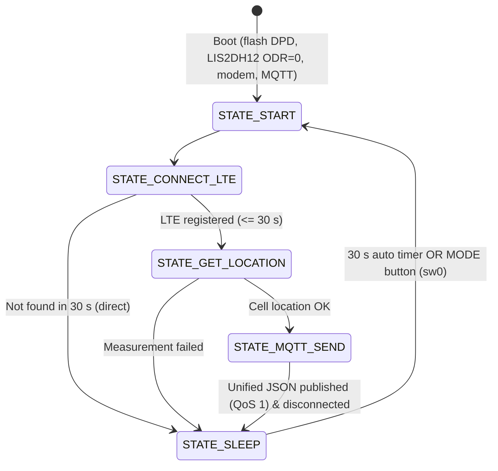

# Sleep Mode 1: System ON Idle + Modem PSM (`myprojects/sleep_mode_psm/`)

System 1 low-power firmware combining **Zephyr System ON Idle** with **LTE Modem PSM** (and automatic `LTE_LC_FUNC_MODE_DEACTIVATE_LTE` fallback when the carrier refuses PSM).

## State Flow



- **Wake sources:** **30-second internal timer** or early **`MODE` button (`sw0`, `P0.12`)** (`LIS2DH12` powered down `ODR=0` by default).
- **Peripheral power hygiene:** `W25Q32JV` flash suspended in DPD (`CONFIG_PM_DEVICE=y`, `CONFIG_SPI_NOR=y`), `LIS2DH12` ODR=0, `led0` blinks during LTE search and turns off synchronously before sleep.
- **MQTT Payload:** Unified schema (`source: "lte"`, `gnss: null`). See [[api-contract/mqtt-payload-schema|Unified MQTT Payload Schema]].

## Bench Observations

Recorded in [[experiments/0006-lte-vs-gnss-and-sleep-power/README|Experiment 0006]]:
- Carrier (`MCC=520, MNC=3`, roaming) returned `TAU=3600 s, active_time=-1 s` (`Network did not grant PSM`), triggering the `DEACTIVATE_LTE` fallback.
- Preliminary user-reported averages: **~150 mW / ~5 s** for LTE connect + cell location; **~23 mW** in `STATE_SLEEP` (re-measurement with `release.conf` and J-Link unplugged pending).

## Build

```bash
west build -p always -b sparkfun_thing_plus/nrf9160/ns \
  myprojects/sleep_mode_psm --sysbuild

# Release / microamp measurement build
west build -p always -b sparkfun_thing_plus/nrf9160/ns \
  myprojects/sleep_mode_psm --sysbuild -- -DEXTRA_CONF_FILE=release.conf
```

## Related Notes
- [[experiments/0006-lte-vs-gnss-and-sleep-power/README|Experiment 0006: LTE vs GNSS & Sleep Power]]
- [[firmware-and-software/sleep-mode-sys-off|Sleep Mode 2: System OFF]]
- [[hardware/README|Hardware Specification]]
