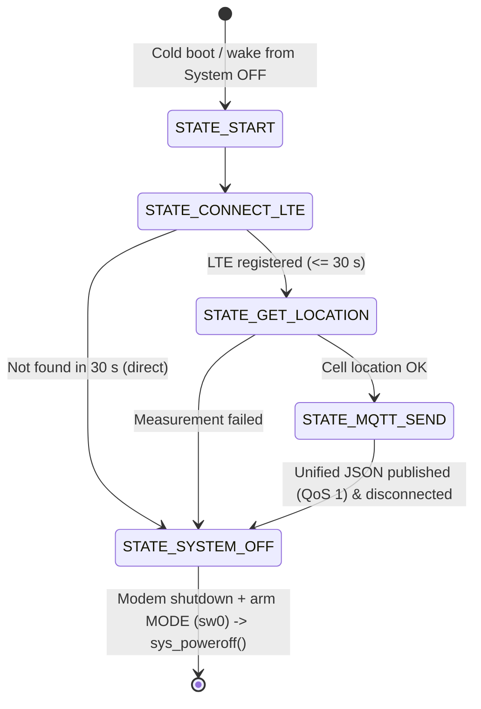

# Sleep Mode 2: nRF9160 System OFF (`myprojects/sleep_mode_sys_off/`)

System 2 deep-sleep firmware entering **nRF9160 System OFF** via `sys_poweroff()` (`CONFIG_POWEROFF=y`) after each LTE Cell-ID + MQTT upload cycle.

> [!important]
> **System OFF constraints:** All internal timers and RAM contents are cleared on `sys_poweroff()`. Wake-up performs a full cold boot (`RESET_LOW_POWER_WAKE`). By default, wake-up is armed on the **`MODE` button (`sw0`, `P0.12`)** with `LIS2DH12` powered down (`ODR=0`). Using on-board `LIS2DH12` (`P0.29`) instead requires `JMP2 = Always on` on SparkFun Thing Plus nRF9160 (see [[hardware/power-source-startup-troubleshooting|External Power & Power-Latch]]).

## State Flow



- **Clean shutdown:** `lte_lc_power_off()` → `nrf_modem_lib_shutdown()` → `W25Q32JV` flash DPD → `LIS2DH12` ODR=0 → waits for `MODE` button release → arms `GPIO_INT_LEVEL_ACTIVE` on `sw0` (`P0.12`) → `sys_poweroff()`.
- **MQTT Payload:** Unified schema (`source: "lte"`, `gnss: null`). See [[api-contract/mqtt-payload-schema|Unified MQTT Payload Schema]].

## Build

```bash
west build -p always -b sparkfun_thing_plus/nrf9160/ns \
  myprojects/sleep_mode_sys_off --sysbuild

# Release / microamp measurement build
west build -p always -b sparkfun_thing_plus/nrf9160/ns \
  myprojects/sleep_mode_sys_off --sysbuild -- -DEXTRA_CONF_FILE=release.conf
```

## Related Notes
- [[firmware-and-software/sleep-mode-psm|Sleep Mode 1: System ON Idle + PSM]]
- [[hardware/power-source-startup-troubleshooting|External Power & Power-Latch]]
- [[experiments/0006-lte-vs-gnss-and-sleep-power/README|Experiment 0006: LTE vs GNSS & Sleep Power]]
