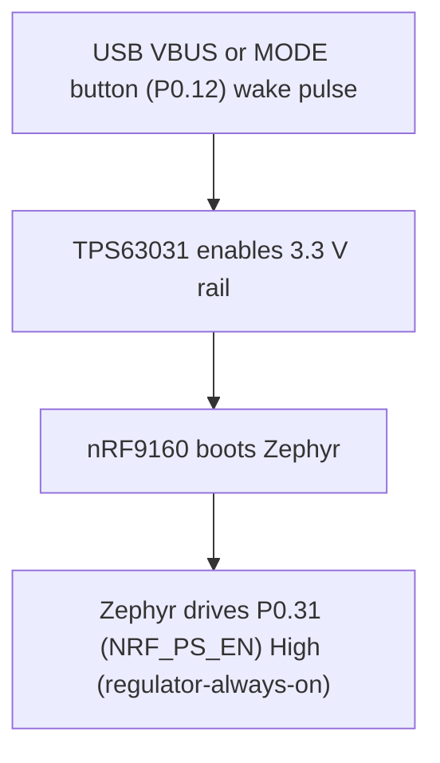

# External Power Startup & Power-Latch Behavior (SparkFun Thing Plus nRF9160)

Applies to all firmware built for `sparkfun_thing_plus/nrf9160/ns` on nRF Connect SDK v3.3.0 (WRL-17354 / BRD-0016).

## Confirmed Hardware Behavior

- **Via USB-C:** Boots automatically because `VBUS` triggers the on-board `TPS63031` power-latch circuit.
- **Via external supply, LiPo battery, or JTAG/SWD debugger power:** Does **not** auto-start on power application alone. **Press the `MODE` button (`sw0`, `P0.12`) once** to send a wake pulse to the buck/boost power latch; once Zephyr boots, it drives `P0.31` (`NRF_PS_EN`) High to latch the 3.3 V supply (`regulator-always-on`).

> [!caution]
> On the WRL-17354 PCB, **`J4` is the LTE U.FL antenna connector** and **`J5` is the LiPo battery connector**. Verify silkscreen and polarity before connecting any power source.

## Power-Latch Sequence

## Operating Without Modifying Hardware

1. Supply 2.8 – 5.5 V to `J5` (LiPo ≥ 300 mAh recommended for LTE TX bursts) or USB-C.
2. Press **`MODE`** once to wake the 3.3 V rail.
3. If `D7` (`led0`) stays solid (MCUboot bootloader mode), press **`RESET`** once without holding `MODE`.
4. Monitor runtime logs via J-Link SEGGER RTT (UART/serial console is disabled in tracker builds).

## Optional `JMP2` Always-On Hardware Modification

> [!warning]
> Disconnect USB, battery, and programmer before cutting or soldering `JMP2`. This modification has **not** been tested on project hardware.

Bridging `JMP2` to **Always on** (center pad to right pad after cutting the default trace):
- Auto-starts the board immediately when battery/external power is applied.
- Keeps 3.3 V powered during nRF9160 **System OFF** (required if waking from System OFF via on-board `LIS2DH12` on `P0.29`).
- Disables software shutdown of the 3.3 V rail via `P0.31` (`PS_EN`).

## Related Notes
- [[hardware/README|Hardware Specification]]
- [[firmware-and-software/sleep-mode-sys-off|Sleep Mode 2: System OFF]]
- [[hardware/solar-power-prototype/README|Solar Power Prototype]]
