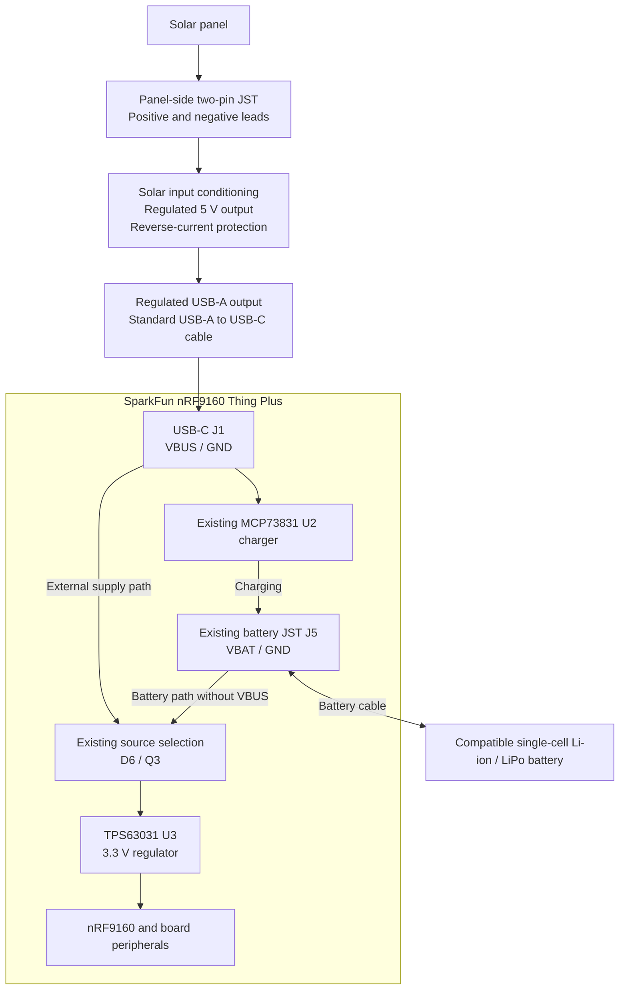

[Back to project README](../../README.md) | [Tracker mass constraint](tracker-mass-constraint.md)

# Solar Power Wiring, Design Constraints, and Panel References

Checked: 2026-10-17. Status: External manufacturer specifications and supplied
schematic review; no panel has been selected, weighed, or tested by this project.

The Himalayan Vulture tracker has a provisional **240 g total installed mass
budget**, including solar hardware. See [the mass constraint](tracker-mass-constraint.md).

For a concrete proposed bench assembly, see the [prototype BOM, wire list and
editable schematic](solar-power-prototype/README.md). It is not validated for
deployment or PCB fabrication.

## Proposed external wiring diagram

**Proposed interface, not a validated construction schematic.** The solar input
conditioner has not been selected. It must support the panel's worst-case
open-circuit voltage and provide regulated 5 V with suitable weak-source behavior.
The diagram reuses the board's charger and source-selection circuitry.



| External connection | Destination | Required check |
| --- | --- | --- |
| Panel positive and negative through its dedicated JST | Conditioner IN+ and IN- | Connector series, pitch, polarity, panel Voc and current ratings |
| Conditioned 5 V USB-A output | Board USB-C J1 through a standard cable | Output regulation, current budget, source behavior, cable loss |
| Battery positive and negative | Board battery JST J5 | Battery chemistry, charge voltage, current rating and polarity |

All supply returns share the intended circuit ground. Connector pin numbers
are deliberately unspecified until the actual mating parts are selected.
Do not infer polarity from wire color or connector fit. Do not connect a panel
to J5. Use a compliant USB power interface and cable; a custom USB-C source
also needs correct CC implementation, not just VBUS/GND wires.

With adequate VBUS, the external source supplies the system and charges the
battery. Without VBUS, the battery supplies the system. Under weak or fluctuating
solar input, verify the transition experimentally: this source selector is not
a guarantee that the battery seamlessly supplements an inadequate solar source.

## Design constraints and precautions

These requirements are **proposed or externally referenced**, not measured results.

| Area | Constraint or precaution |
| --- | --- |
| Installed mass | User-reported baseline is 120 g including battery and onboard charger, excluding solar. Panel, conditioner, cables and all remaining mounting/enclosure parts must fit the remaining 120 g under the provisional 240 g total limit. Weigh the final assembly. |
| Panel input | Rate the conditioner for worst-case Voc, including cold-weather increase and tolerances, plus current and transients. A nominal 5 V or 6 V panel label is insufficient. |
| Board input | Target regulated 5 V at USB-C VBUS. The MCP73831's 6 V operating maximum does not establish the allowed limit for every other component on VBUS. Do not use absolute maximum ratings as operating targets. |
| Charge current | R12 = 2 kΩ sets approximately 500 mA. Budget source current for charging plus the operating board and losses. Changing firmware duty cycle does not change this hardware setting. |
| Small-panel operation | A regulator alone is not MPPT or input power management. Check startup, panel collapse and repeated restarts under shade; choose suitable input power control or adjust the charge setting when needed. |
| Battery compatibility | Confirm the exact MCP73831 variant and its charge voltage against the pack. Use suitable overcharge, overdischarge, overcurrent and short-circuit protection. Charger thermal regulation does not replace pack protection. |
| Temperature | Follow the battery manufacturer's charging temperature limits. MCP73831 does not directly monitor battery temperature; add a suitable temperature-based charge inhibit when required. Verify behavior in both a sun-heated enclosure and cold conditions. |
| USB and external supplies | This diagram occupies the board's USB-C port with one supply. Do not add another VBUS source without isolation or a reviewed source selector; prevent backfeeding the computer or conditioner. |
| Charging topology | This wiring uses the onboard charger only. Adding an external charger across the same pack requires a separate review of simultaneous charging and charge termination with the system load. |
| Battery depletion | Establish a battery-specific cutoff and recovery strategy with hysteresis. The regulator's minimum input voltage is not a safe battery discharge limit. |
| Mechanical and radio integration | Provide strain relief, secure insulation, moisture protection and rounded mounting surfaces. Check panel position and switching-converter noise against GNSS/LTE reception and antenna clearance. Mass compliance alone does not validate flight effects. |

The [MCP73831 datasheet](https://www.microchip.com/content/dam/mchp/documents/APID/ProductDocuments/DataSheets/MCP73831-Family-Data-Sheet-DS20001984H.pdf)
supports the charger limits and programmable current; system-load isolation
and termination considerations are described in [Microchip's load-sharing reference](https://www.microchip.com/en-us/development-tool/MCP7383XRD-PPM).
This document does not select a final conditioner, panel, battery or deployment design.

## Hardware verification checklist

All checks remain **not performed**. Record conditions and raw evidence before
claiming charging reliability, daily energy balance or deployment suitability.

- [ ] Confirm the physical board revision and continuity against the linked schematic.
- [ ] Confirm JST series, pitch and polarity with a meter before connecting the battery or panel.
- [ ] Verify conditioned VBUS at no load, startup, full load, shade transitions and panel disconnection; check overshoot and reverse current.
- [ ] Verify battery charge voltage, current, full-charge termination and recharge with the board operating and idle.
- [ ] Observe VBUS, VBAT, VSYS and 3.3 V during GNSS and LTE activity with sufficient bandwidth to detect dips and resets.
- [ ] Verify night operation, low-battery cutoff, and autonomous recovery after sunlight returns without repeated boot cycles.
- [ ] Verify temperature-based charging inhibition and charger/enclosure heating within component and battery limits.
- [ ] Measure usable solar energy and complete system consumption in Wh/day at defined boundaries; account for losses without double counting. Include actual shading, orientation and weather conditions.
- [ ] Check GNSS fix acquisition and LTE upload after integrating the panel and conditioner.
- [ ] Weigh the complete installed assembly and review attachment fit before deployment.

For controlled comparisons or performance claims, use the
[experiment template and evidence workflow](../experiments/README.md).

## Updated electrical and connector constraints

**The Voltaic shortlist below is superseded as a direct-connect shortlist.**
The existing MCP73831 charger uses a 2 kΩ PROG resistor. The user requires a
two-pin JST connection; the panel-side connector series, pitch and polarity
remain to be confirmed. A battery connector on VBAT is not a charging input.

## Verified SparkFun board routing

The [official SparkFun nRF9160 Thing Plus schematic, sheet 1, revision 1](https://cdn.sparkfun.com/assets/5/7/c/a/c/nRF9160_Thing_Plus.pdf)
shows J5 on VBAT/GND, USB-C J1 on VBUS, and MCP73831 U2 charging VBAT from VBUS.
D6 feeds VSYS from VBUS. Q3 supplies VSYS from VBAT when VBUS is absent;
VBUS drives Q3's gate to disconnect that battery path when external power is
present. VSYS feeds TPS63031 U3, producing 3.3 V. Therefore regulated solar
on VBUS powers the board directly while charging; this is not strictly
solar-to-battery-to-board operation.

J2 pin 1 exposes VBAT. J2 pin 3 exposes VCC_5V0 after D5 (VBUS to VCC_5V0),
so it is not a VBUS charger input. USB-C VBUS and charger input share a net:
external injection needs source isolation or mutually exclusive USB/solar use.
Verify the physical board revision and continuity before wiring.

```text
Regulated solar -> VBUS -> D6 -> VSYS -> U3 -> 3.3 V board supply
                    |            ^
                    U2 -> VBAT -> Q3 (battery path enabled without VBUS)
                           |
                       J5 battery
```

[TI specifies TPS63031 input as 1.8–5.5 V](https://www.ti.com/product/TPS63031);
its minimum input is not a permissible battery discharge threshold. Select
battery undervoltage protection from the battery specifications and verify
radio-burst supply stability.

The [Microchip MCP73831 datasheet, page 3](https://www.microchip.com/content/dam/mchp/documents/APID/ProductDocuments/DataSheets/MCP73831-Family-Data-Sheet-DS20001984H.pdf)
specifies a maximum operating input of 6 V and an absolute maximum of 7 V;
the latter is a stress limit, not an operating target. A 2 kΩ programming
resistor sets approximately 500 mA charge current. All three Voltaic panels
below list 7.28 V open-circuit output, exceeding even the charger's absolute
maximum: **do not connect their raw output directly to MCP73831 VBUS**.

No factory-JST panel meeting both the electrical and mechanical requirements
has been verified. Seeed's [0.5 W panel](https://wiki.seeedstudio.com/0.5w_Solar_Panel_55x70/)
and [1 W panel](https://wiki.seeedstudio.com/1w_Solar_Panel_80x100/) are not
validated direct-connect alternatives; a connector match alone is insufficient.

## Panel specifications retained for reference

Values below use the current Voltaic product pages, specifically their nominal
output and size/weight sections. Product names retain older wattage labels.

| Model / marketed rating | Listed nominal peak power | Size (mm) | Panel mass | Peak voltage / open-circuit voltage | Illustrative mass remaining: 240 g minus panel | Primary source |
| --- | --- | --- | --- | --- | --- | --- |
| P122 / 0.3 W, 6 V | 0.40 W | 52 × 52 × 2.6 | 8.0 g | 6.23 V / 7.28 V | 232.0 g | [Voltaic P122](https://voltaicsystems.com/0-3-watt-6-volt-solar-panel-etfe/) |
| P123 / 0.6 W, 6 V | 0.71 W | 66 × 66 × 2.6 | 14.4 g | 6.23 V / 7.28 V | 225.6 g | [Voltaic P123](https://voltaicsystems.com/0-6-watt-6-volt-solar-panel-etfe/) |
| P124 / 1.2 W, 6 V | 1.35 W | 66 × 113 × 2.6 | 31.6 g | 6.23 V / 7.28 V | 208.4 g | [Voltaic P124](https://voltaicsystems.com/1-watt-6-volt-solar-panel-etfe/) |

The user reports an existing device mass including battery and MCP73831 charger
of **120 g**, excluding solar hardware; this is not independently measured.
After that baseline plus one
panel, the illustrative allowance is **112.0 g (P122)**, **105.6 g (P123)**, or
**88.4 g (P124)** for all remaining installed parts. Confirm whether the baseline
already includes antennas, enclosure, and harness before treating them as covered.

The table's remaining mass is arithmetic only. It must cover the battery, tracker PCB,
antennas, enclosure, harness, charger, wires, connectors, mounting materials,
waterproofing, and all other installed parts. It does not prove that a complete
assembly fits within 240 g. Listed panel masses are not project measurements.

## Regulated-output reference and proposed interface

[DFRobot FIT0601](https://www.dfrobot.com/product-1774.html) lists regulated
5 V USB output, maximum operating current 1 A, mass 90 g, and dimensions
275 × 170 × 2.5 mm. It also lists 7.2 V open-circuit panel voltage: use only
the regulated output for evaluating a 5 V charger input, not the raw panel.
It is not factory JST. With the reported 120 g device it leaves an illustrative
30 g for adapters and all other missing parts. Its large area makes it unsuitable
as a final bird-mounted recommendation without a separate fit assessment.

A promising interface to investigate is a small panel, a regulated 5 V supply,
and a dedicated correctly wired two-pin JST connection to VBUS/GND, separate
from J5. This reuses the board's existing source selection and charger. It is a
proposed path, not a verified circuit. Reduce the programmed charge current to match the
available solar supply and battery limits; validate regulation, startup, shading,
charger heating, charge termination under device load, and USB/solar source
interaction on the bench before use. Adapter, regulator and mounting masses
must fit the remaining budget. The user will adapt device power usage to solar
availability; no energy-autonomy target is selected here.

If the requirement is strictly that the battery always supplies the board,
an external solar charger feeding the battery/J5 is a different architecture.
It needs battery-compatible CC/CV limits, load-aware termination or a suitable
power-path design, and isolation from the onboard charger during USB use.
Simultaneous device load at a charger's battery output can prevent the current
from reaching its termination threshold; do not assume two independent chargers
can share the pack without a reviewed charging strategy. The existing VBUS
route instead separates the main board load from the battery while powered.

Reference checks before selecting hardware: compatible battery charge voltage,
current and temperature limits; regulated output under no load, startup and
shade; no reverse current into USB or panel; JST polarity and strain relief;
charge termination and recharge with the board active; VSYS/3.3 V during LTE
bursts; battery undervoltage cutoff; and complete installed mass below 240 g.
These are unverified requirements, not recorded test results.

## Source consistency and open requirements

The linked April 2023 datasheets report different electrical specifications
and, for P122/P123, different thicknesses: [P122 datasheet](https://voltaicsystems.com/content/P122_ds.pdf),
[P123 datasheet](https://voltaicsystems.com/content/P123_ds.pdf), and
[P124 datasheet](https://voltaicsystems.com/content/P124_ds.pdf).
Confirm the supplied hardware revision and matching drawing/electrical ratings
with the manufacturer before PCB or enclosure release; this note provisionally
uses the current product-page values rather than combining document versions.

Unknown project inputs: battery chemistry, capacity and mass; tracker daily
energy consumption; GNSS/upload schedule; deployment location and season;
available mounting area; shading and orientation; panel-side JST interface; and the final
regulated interface and charge-current setting.
Nominal peak watts do not establish daily harvested energy or continuous
operation. None of the panels is validated for charging, outdoor durability,
attachment, or flight effects in this project. No firmware changed, so no
application build was required.

## See also

- [Project README](../../README.md)
- [Tracker mass constraint](tracker-mass-constraint.md)
- [SparkFun hookup guide](https://learn.sparkfun.com/tutorials/nrf9160-thing-plus-hookup-guide)
