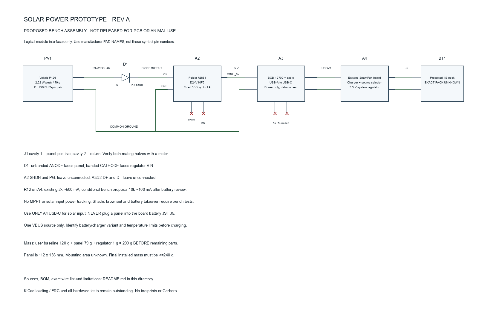
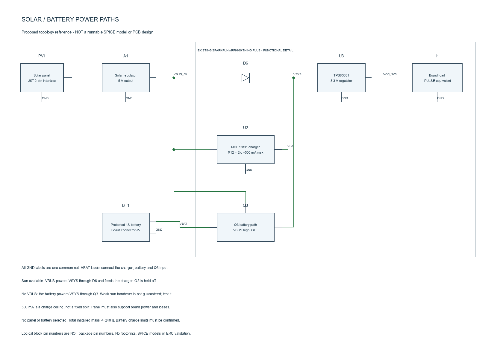

[Project README](../../../README.md) | [Solar design constraints](../solar-panel-shortlist.md)

# Solar Power Prototype: BOM, Wiring, and Schematic

Date: 2026-10-17. Revision: A. Status: **Proposed bench prototype only**.
Evidence: **External references** and schematic connectivity checks; no measured
electrical, thermal, charging, radio, or mechanical results.

The user has not identified the battery or available mounting area. This is a
module-level assembly design, not a released PCB or an approved bird attachment.
Do not connect a battery until its chemistry, charge voltage, protection and
permitted charge current are confirmed against the actual board's charger variant.

## Files and scope

- [Power-path reference schematic](power-paths-reference.kicad_sch) and
  [matching image](power-paths-reference.png): expanded functional view of the
  onboard charger, battery source-selection path and 3.3 V regulator. See the
  explanation below. This reference does not contain runnable SPICE models.
- [Schematic image](schematic.png): readable without KiCad.
- [Vector schematic](schematic.svg): scalable drawing of the same assembly.
- [Editable KiCad schematic](solar-power-prototype.kicad_sch): self-contained
  module symbols; open with KiCad Schematic Editor. Symbol pin numbers are logical
  interface identifiers, not component package pad numbers. Wire using the named
  manufacturer pads in the table below. No PCB footprints are assigned.
- This page contains the BOM and wire list. KiCad is not installed in the current
  environment, so editor loading and ERC have **not** been verified.

## Expanded power-path reference

Date: 2026-10-18. Status: **Proposed topology reference**, based on the
[SparkFun board schematic](https://cdn.sparkfun.com/assets/5/7/c/a/c/nRF9160_Thing_Plus.pdf).
The panel, external regulator and battery remain to be selected for the intended
load, charge target and mounting constraints; this view does not endorse a
particular panel for 500 mA charging.

Open `power-paths-reference.kicad_sch` in KiCad Schematic Editor. The drawing
contains self-contained functional symbols with logical interface pins, not
package pin assignments. The expanded symbols represent parts already on the
board; do not add a second charger or bypass the existing battery connector.

- External regulated 5 V enters the board's USB-C VBUS input. D6 feeds VSYS,
  and VSYS feeds the onboard TPS63031 regulator and 3.3 V board load.
- The same VBUS feeds MCP73831 VIN. Its battery terminal connects to the
  protected battery through the existing J5 connector. The existing R12 of
  2 kohm sets approximately 500 mA when input power, battery state and thermal
  conditions permit. This is a ceiling, not a fixed current allocation.
- The battery also connects to VSYS through Q3. VBUS controls this PMOS path:
  adequate VBUS holds it off; absent VBUS permits battery operation. Partial
  VBUS during shade requires hardware verification and may need additional
  source control in the external supply.
- All GND labels share one return net. Both VBAT labels share one battery net.
  There is no direct wire from VBUS to VBAT; the charger separates them.
- The load block represents a possible IPULSE equivalent at the **3.3 V rail**.
  Its current values must describe that rail; they are not automatically the
  same as battery-side or 5 V input current. Conversion losses matter.

This corrects the earlier teaching circuit in which a solar source, series
resistance and diode connected directly to the ideal battery source. That
circuit demonstrated current sharing but omitted charge control and source
selection. Rsolar and Rsource are model parameters, not additional assembly
resistors to install.

The reference omits IC support components, battery state-of-charge dynamics and
regulator/charger simulation models. Do not run it as a SPICE circuit or use it
to infer runtime or charge time. Syntax, pin attachment and image layout were
checked; native KiCad loading, ERC, simulation and hardware behavior remain
unverified. The existing `../Schematic-sim.kicad_sch` exercise is unchanged.

## Bill of materials

Quantities describe one bench assembly. Candidates are not purchase approval;
confirm actual revisions, battery compatibility and mounting dimensions first.

| Reference | Qty | Part / specification | Status and source |
| --- | --- | --- | --- |
| PV1 | 1 | Voltaic P126 ETFE panel; marketed 2 W / 6 V | Bench candidate. Current nominal peak 2.62 W, Vmp 7.48 V, Voc 8.74 V, Imp 350 mA; 112 × 136 × 2.7 mm, 79 g. [Manufacturer](https://voltaicsystems.com/P126/) |
| J1 | 1 pair | Mating JST-PH two-pin 2.0 mm harness, insulated and keyed | Proposed interface. Use a genuine mating pair rated for the actual current; assign cavity 1 positive and cavity 2 ground, then verify continuity and polarity. [Example pigtail](https://www.adafruit.com/product/261), [mating pigtail](https://www.adafruit.com/product/3814) |
| D1 | 1 | Vishay SS14 Schottky diode, 1 A / 40 V, SMA | Series input protection; banded cathode faces regulator VIN. [Manufacturer datasheet](https://www.vishay.com/docs/88746/ss12.pdf) |
| A2 | 1 | Pololu D24V10F5, item 2831, fixed 5 V buck module | Up to 1 A subject to input/thermal limits; input 5.1–36 V at light load, about 5.8 V minimum at 1 A; 1.0 g without headers. [Manufacturer specs](https://www.pololu.com/product/2831/specs) |
| J2 | 1 | SparkFun USB Type-A Female Breakout, BOB-12700 | Connect only VCC and GND for this power-only prototype. [Manufacturer](https://www.sparkfun.com/sparkfun-usb-type-a-female-breakout.html) |
| W1 | 1 | Short compliant USB-A male to USB-C male cable | Connect J2 to the SparkFun board USB-C port. Keep the complete cable and its USB-C configuration intact. Do not replace it with a bare USB-C receptacle. |
| A4 | 1 | Existing SparkFun nRF9160 Thing Plus | Reuse the onboard charger and source-selection circuit. [Schematic](https://cdn.sparkfun.com/assets/5/7/c/a/c/nRF9160_Thing_Plus.pdf) |
| BT1 | 1 | Existing protected single-cell Li-ion / LiPo pack | **Identification pending; not a selected part.** Exact pack and onboard charger variant must match. Do not substitute LiFePO4 on the basis of cell count alone. |
| R12 on A4 | 1 existing | Existing 2 kΩ charger programming resistor | Approximately 500 mA; too little panel margin to assume this setting works. Conditional bench starting value: 10 kΩ, 1%, approximately 100 mA, only after pack limits and actual resistor package are confirmed. [Charger datasheet](https://www.microchip.com/content/dam/mchp/documents/APID/ProductDocuments/DataSheets/MCP73831-Family-Data-Sheet-DS20001984H.pdf) |
| Assembly materials | As needed | Short flexible insulated wire, perfboard for D1/connections, heat shrink, strain relief and enclosure | Sizes, insulation, attachment and masses remain to be selected and measured. No exposed diode leads or unsupported solder joints. |

P126 has a factory barrel connector, **not JST**. Meet the requested JST interface
using a correctly wired barrel-to-JST harness or reterminate its cable after
checking manufacturer guidance. Preserve polarity and weather sealing; do not
assume the modified cable remains IP67. Do not connect the raw panel to the board.

## Exact connection table

The PV1 symbol includes the J1 harness: cavity 1 passes panel positive and
cavity 2 passes return through the mating pair. Physically each half has two
contacts. A3 abstracts the USB-A breakout and complete USB cable; it is not an
IC or a PCB footprint. All ground connections below are the same return net.

| Net / connection | From | To |
| --- | --- | --- |
| SOLAR_RAW | PV1 positive output | J1 input cavity 1 |
| Solar return | PV1 negative output | J1 input cavity 2 |
| SOLAR_JST | J1 mating output cavity 1 | D1 anode, unbanded end |
| GND | J1 mating output cavity 2 | A2 GND and J2 GND |
| SOLAR_PROTECTED | D1 cathode, banded end | A2 VIN |
| REGULATED_5V | A2 VOUT | J2 VCC |
| Unused module controls | A2 SHDN and PG | Leave disconnected for this bench revision; SHDN is enabled by the module's pull-up |
| Unused data | J2 D+ and D- | Leave disconnected; no USB data connection is provided |
| USB power | J2 USB-A receptacle | W1 cable, then A4 USB-C J1 |
| Battery | BT1 positive and negative | Existing A4 battery connector J5, matching actual polarity |

Do not feed the board's VCC_5V0 header instead: its diode routing is not the
charger VBUS input. Local references J1/J2 belong to this assembly; A4.J1 is
the original board USB-C connector and A4.J5 is its battery connector.

## Charge setting and behavior

The board runs from VBUS when supplied and from its battery when VBUS is absent.
The existing load-sharing path means energy does not always pass through the
battery before powering the board.

The charger setting follows approximately `Icharge_mA = 1000 / RPROG_kohm`.
The proposed 100 mA starting point is not a verified optimum or permission to
charge an unidentified battery. Changing it requires hardware rework on A4;
firmware power settings do not change R12. A technician should first confirm
the board revision, charger suffix, resistor footprint and pack specifications.

A 500 mA charging input at 5 V alone requires about 2.5 W, before board load
and conversion losses; a nominal 2.62 W panel is not a supported 500 mA charging
source for the complete running system. The module's 1 A rating is an output
capability with a suitable source, not a promise that this panel produces 1 A.

**This assembly has no MPPT, input power tracking, external output overvoltage
shutdown, or added battery-temperature charge inhibit.** It is not the finished
outdoor power system. D1 protects against a reversed panel and blocks the normal
reverse path toward the panel; it does not isolate USB sources or prove reverse
blocking at A2 VOUT. Do not hot-plug another supply onto the same VBUS.

The buck's SHDN stays enabled. Shade may collapse the panel, cause repeated
regulator startups, or prevent clean battery takeover while VBUS remains
partially raised. A successful bright-light test does not resolve this case.
If observed, stop using this revision and design input power control with
hysteresis and coordinated source selection before field operation.

## Mass budget

| Item | Mass basis | Mass |
| --- | --- | --- |
| Existing device including battery and onboard charger | User-reported, not independently measured | 120 g |
| P126 | Manufacturer nominal | 79 g |
| D24V10F5 without headers | Manufacturer nominal | 1 g |
| Subtotal | Illustrative arithmetic, not assembled measurement | 200 g |
| Remaining for D1, connectors, cable, perfboard, sealing and all missing attachment parts | 240 g minus subtotal | 40 g |

Do not count parts already in the 120 g baseline twice. The final total must be
weighed and remain at or below 240 g. The 11.2 × 13.6 cm panel has not been
shown to fit the animal or enclosure. See [the individual-bird mass constraint](../tracker-mass-constraint.md).

## Bring-up and release boundaries

1. With everything unpowered, check diode orientation, continuity, no short
   between supply/ground, and both JST halves' cavity assignments.
2. Test the frontend without the SparkFun board or battery. Start with a
   current-limited bench source at panel-like voltage; verify 5 V polarity and
   regulation at J2, startup overshoot and load response. Do not apply raw
   bench voltage through the USB cable to bypass A2.
3. Identify the pack and charger, establish battery protection and permitted
   temperatures, then select the charge setting before connecting BT1.
4. Confirm board power and charging separately. Observe VBUS, VBAT, VSYS and
   3.3 V during GNSS/LTE activity with an oscilloscope; record resets and failures.
5. Use the real panel for repeated shade/unshade and day/night transitions.
   Test charge termination/recharge, low-battery cutoff and autonomous recovery.
6. Verify thermal behavior, battery-temperature charge inhibition, input source
   isolation and fault protection before enclosing or deploying the system.
7. Record daily energy, radio behavior, final mass and attachment fit. If making
   a performance comparison, use the [experiment workflow](../../experiments/README.md).

No PCB routing, Gerbers, firmware changes, radio tests or hardware qualification
are included. Native KiCad loading/ERC remain outstanding; structural checks
and the rendered image cannot substitute for electrical review.

## See also

- [Solar wiring and constraints](../solar-panel-shortlist.md)
- [Tracker mass constraint](../tracker-mass-constraint.md)
- [Pololu module connections](https://www.pololu.com/product/2831)
