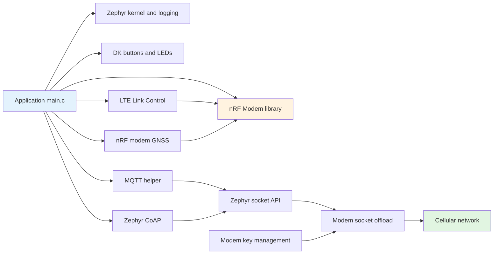

# AI Coding Guide: Libraries, Architecture, and Repository Conventions

This is the source-of-truth document for humans and AI coding agents working in
this repository. It describes the libraries that the checked-in applications
actually use, their required configuration, correct initialization order, and
the safest examples to copy.

The workspace is based on **nRF Connect SDK (NCS) v3.3.0**, pinned by
`cell-fund.yml`. NCS supplies Zephyr RTOS, Nordic modem libraries, networking,
MQTT, CoAP, and the build system. There is no package manager or standalone
third-party dependency directory in this repository.

> [!IMPORTANT]
> Treat source code, `Kconfig`, and `prj.conf` as authoritative. Some top-level
> prose describes planned features. There is currently no LIS2DH12 driver and
> no cJSON library in the code. JSON in `gps_mqtt_tracker` is built with
> `snprintf`.

## 1. Repository map

| Path | Purpose | Best reference |
| --- | --- | --- |
| `v3.3.3_practices/l2_LTE/` | Modem initialization and LTE registration | `l2_e2_sol` |
| `v3.3.3_practices/l3_nRF_modem_lib/` | DNS and UDP sockets over modem offload | `l3_e1_sol` |
| `v3.3.3_practices/l4_MQTT/` | MQTT, subscriptions, TLS certificates | `l4_e1_sol`, `l4_e2_sol` |
| `v3.3.3_practices/l5/` | CoAP over UDP and secure CoAP over DTLS | `l5_e1_sol`, `l5_e2_sol` |
| `v3.3.3_practices/l6_GNSS/` | GNSS PVT fixes and LTE/GNSS coexistence | `l6_e2_sol` |
| `v3.3.3_practices/l7/` | PSM/eDRX with secure CoAP | `l7_e1_sol` |
| `v3.3.3_practices/l8_asset_tracking/l8_sol/` | Integrated GNSS-to-CoAP tracker | Capstone reference |
| `myprojects/gps_mqtt_tracker/` | Integrated GNSS-to-MQTT application | Primary application |
| `docs/adr/` | Architectural decisions and constraints | Read before changing protocols |

Folders without `_sol` are course exercises and may contain intentional gaps.
Do not use them as proof that an API sequence is complete. When implementing a
feature, compare the exercise with its `_sol` sibling.

For the full repository structure tree, see the [root README](../README.md).

## 2. Runtime architecture



> For the device state machine and data flow sequence, see [CODE_ARCHITECTURE.md](../myprojects/gps_mqtt_tracker/CODE_ARCHITECTURE.md).

The application core and modem core are separate. Zephyr runs the application;
the nRF modem firmware owns cellular radio, GNSS, and offloaded sockets. This is
why `CONFIG_NET_NATIVE=n` and `CONFIG_NET_SOCKETS_OFFLOAD=y` are paired.

## 3. Library catalog

### 3.1 Zephyr kernel

- Header: `<zephyr/kernel.h>`
- Configuration: always supplied by Zephyr; tune stack/heap with
  `CONFIG_MAIN_STACK_SIZE` and `CONFIG_HEAP_MEM_POOL_SIZE`.
- Used APIs: `K_SEM_DEFINE`, `k_sem_take`, `k_sem_give`, `k_sleep`,
  `k_uptime_get`, `k_work_init_delayable`, and `k_work_reschedule`.
- Examples: LTE registration semaphore in `v3.3.3_practices/l2_LTE/l2_e2_sol/src/main.c`;
  delayed CoAP receive work in `v3.3.3_practices/l7/l7_e1_sol/src/main.c`.

Use semaphores to pass events from LTE, GNSS, and MQTT callbacks to the main
thread. Keep callbacks short: update state, log briefly, and signal work. Do not
perform a long DNS lookup, socket receive, or indefinite wait inside a callback.
Check `k_sem_take` results whenever a finite timeout is used.

### 3.2 Zephyr logging and console output

- Header: `<zephyr/logging/log.h>`
- Configuration: `CONFIG_LOG=y`; `CONFIG_LOG_PRINTK=y` only when `printk`
  output must be routed through logging.
- Used APIs: `LOG_MODULE_REGISTER`, `LOG_DBG`, `LOG_INF`, `LOG_WRN`, `LOG_ERR`.

Register one module per C file and prefer `LOG_*` over `printf`/`printk`.
Do not include secrets, PSKs, passwords, or complete certificates in logs.
`release.conf` deliberately disables logging, console, assertions, and thread
names for the Lesson 8 release build.

### 3.3 Nordic DK buttons and LEDs

- Header: `<dk_buttons_and_leds.h>`
- Configuration: `CONFIG_DK_LIBRARY=y`.
- Used APIs: `dk_leds_init`, `dk_buttons_init`, `dk_set_led_on`,
  `dk_set_led_off`; constants such as `DK_LED1` and `DK_BTN1_MSK`.
- Examples: button-driven UDP in Lesson 3 and status LEDs in Lesson 8.

Initialize LEDs/buttons before use and check the returned error. In
`gps_mqtt_tracker`, this library is optional and off by default (`DK_LIBRARY`
has no `default` of its own, so it stays `n` unless something selects it).
`CONFIG_ENABLE_LEDS` (that app's `Kconfig`) declares `select DK_LIBRARY`, so
turning LEDs on pulls the library in automatically — do not also hardcode
`CONFIG_DK_LIBRARY=n` in a `.conf` fragment, as that fights the selection.
Calls are guarded with `IS_ENABLED(CONFIG_ENABLE_LEDS)`; any new LED code in
that application must use the same compile-time guard.

The tracker board LED is separate from the optional DK indicators.
`CONFIG_STARTUP_LED` enables `led0` blink groups: two while waiting for GNSS,
three while preparing LTE registration, and four during MQTT upload after LTE
registration is confirmed. Initialization and low-power preparation keep it off.
`CONFIG_WORKING_LED_BLINK_INTERVAL_MS` sets the pulse on time and the off time
inside each group (200 ms by default); `CONFIG_WORKING_LED_GROUP_PAUSE_MS` sets
the dark gap between groups and at state changes (1000 ms by default).

### 3.4 nRF Modem library

- Header: `<modem/nrf_modem_lib.h>`
- Configuration: `CONFIG_NRF_MODEM_LIB=y`.
- Used APIs: `nrf_modem_lib_init`, `nrf_modem_lib_shutdown`.

Call `nrf_modem_lib_init()` once before AT, LTE, GNSS, or modem-offloaded socket
operations. Abort the dependent flow if initialization fails. Use shutdown only
when the application deliberately powers down modem services; after shutdown,
reinitialize before making modem API calls.

### 3.5 LTE Link Control

- Header: `<modem/lte_lc.h>`
- Configuration: `CONFIG_LTE_LINK_CONTROL=y` plus one network mode, normally
  `CONFIG_LTE_NETWORK_MODE_LTE_M_NBIOT=y` or
  `CONFIG_LTE_NETWORK_MODE_LTE_M_NBIOT_GPS=y`.
- Used APIs: `lte_lc_connect_async`, `lte_lc_func_mode_set`,
  `lte_lc_psm_req`, `lte_lc_edrx_req`, and `lte_lc_power_off`.
- Important events: `LTE_LC_EVT_NW_REG_STATUS`, `LTE_LC_EVT_RRC_UPDATE`,
  `LTE_LC_EVT_PSM_UPDATE`, `LTE_LC_EVT_EDRX_UPDATE`, `LTE_LC_EVT_CELL_UPDATE`.

`lte_lc_connect_async(handler)` starts registration but does not mean that the
device is registered. Wait until the handler receives home or roaming status.
Use a semaphore to unblock the main thread.

The tracker uses shared-radio, GPS-first sequencing:

```text
DEACTIVATE_LTE -> acquire GNSS fix -> NORMAL -> wait for registration
-> upload -> disconnect/close socket -> DEACTIVATE_LTE
```

Networks negotiate PSM and eDRX; requested values are not guaranteed. Enable
`CONFIG_LTE_LC_PSM_MODULE` and `CONFIG_LTE_LC_EDRX_MODULE`, call
`lte_lc_psm_req(true)` / `lte_lc_edrx_req(true)` before connecting, and inspect
the update events for granted values.

### 3.6 nRF modem AT commands and AT Host

- Direct command header: `<nrf_modem_at.h>`
- Direct API: `nrf_modem_at_cmd`.
- AT Host configuration: `CONFIG_AT_HOST_LIBRARY=y` and
  `CONFIG_UART_INTERRUPT_DRIVEN=y`.

These are related but different facilities. `nrf_modem_at_cmd()` lets firmware
issue a command; `AT_HOST_LIBRARY` exposes an interactive serial AT interface.
The MQTT tracker uses `AT+CGSN` to derive a client ID from IMEI. Size the response
buffer for the modem response, validate the return code, explicitly terminate
parsed strings, and never assume every AT response has the same line endings.

### 3.7 Zephyr networking and modem-offloaded sockets

- Header: `<zephyr/net/socket.h>`
- Required configuration:

```ini
CONFIG_NETWORKING=y
CONFIG_NET_NATIVE=n
CONFIG_NET_SOCKETS=y
CONFIG_NET_SOCKETS_OFFLOAD=y
```

- Used APIs: `zsock_getaddrinfo`, `zsock_freeaddrinfo`, `zsock_inet_ntop`,
  `zsock_socket`, `zsock_connect`, `zsock_setsockopt`, `zsock_send`,
  `zsock_recv`, and `zsock_close`.

Use this lifecycle:

1. Resolve the hostname and verify both the return code and result pointer.
2. Copy the address into owned storage and call `zsock_freeaddrinfo`.
3. Create a socket (`SOCK_DGRAM` for UDP/CoAP).
4. For TLS/DTLS, set all security options before connecting.
5. Connect, send/receive while checking negative returns and `errno`.
6. Close the socket on success and on every error path after creation.

Plain UDP uses `IPPROTO_UDP`; secure CoAP uses `IPPROTO_DTLS_1_2`. Lesson 3 is
the minimal UDP reference. Lessons 5, 7, and 8 demonstrate DTLS.

### 3.8 MQTT Helper

- Header: `<net/mqtt_helper.h>`
- Configuration: `CONFIG_MQTT_HELPER=y`, usually
  `CONFIG_MQTT_CLEAN_SESSION=y`.
- Used APIs: `mqtt_helper_init`, `mqtt_helper_connect`,
  `mqtt_helper_subscribe`, `mqtt_helper_publish`, and
  `mqtt_helper_msg_id_get`.
- Primary examples: `v3.3.3_practices/l4_MQTT/l4_e1_sol/src/main.c` and
  `myprojects/gps_mqtt_tracker/src/main.c`.

Correct lifecycle:

1. Initialize the modem and obtain LTE registration.
2. Fill `struct mqtt_helper_cfg` with connection, disconnect, publish, and
   subscription callbacks; call `mqtt_helper_init` once.
3. Keep hostname and client-ID buffers alive while the connection uses them.
4. Fill `struct mqtt_helper_conn_params`, including its optional `user_name`
   and `password` byte spans, and call `mqtt_helper_connect`. In NCS v3.3.0 a
   password requires a non-empty username.
5. Wait for an accepted CONNACK before subscribing or publishing.
6. Use a unique message ID for QoS 1 operations.

`struct mqtt_helper_buf` values are byte spans, not guaranteed NUL-terminated
strings. Log them with `%.*s` and their length. MQTT publish payload buffers must
remain valid for the duration expected by the helper/API. Check `snprintf`
truncation before publishing. Never log authentication values, and keep real
credentials in an ignored local overlay rather than tracked defaults.

For MQTT over TLS, also enable:

```ini
CONFIG_MQTT_LIB_TLS=y
CONFIG_MBEDTLS=y
CONFIG_TLS_CREDENTIALS=y
CONFIG_MODEM_KEY_MGMT=y
CONFIG_MQTT_HELPER_SEC_TAG=24
```

Port `1883` is plaintext; port `8883` conventionally uses TLS. Changing only the
port does not enable TLS.

### 3.9 Zephyr CoAP

- Header: `<zephyr/net/coap.h>`
- Configuration: `CONFIG_COAP=y`.
- Used APIs: `coap_packet_init`, `coap_packet_append_option`,
  `coap_append_option_int`, `coap_packet_append_payload_marker`,
  `coap_packet_append_payload`, `coap_packet_parse`,
  `coap_header_get_token`, `coap_header_get_code`,
  `coap_packet_get_payload`, and `coap_next_id`.
- Examples: `v3.3.3_practices/l5/l5_e1_sol/src/main.c` for UDP and
  `v3.3.3_practices/l5/l5_e2_sol/src/main.c` for DTLS.

CoAP builds and parses messages; sockets perform transport. Initialize a packet,
append URI options, add a payload marker only when a payload follows, append the
payload, then send `request.data` for `request.offset` bytes. On response,
validate parsing, token, code, and payload length before consuming data. Payloads
are byte spans and may not be NUL-terminated.

### 3.10 Modem key management and TLS credentials

- Headers: `<modem/modem_key_mgmt.h>` and, where socket TLS types are needed,
  `<zephyr/net/tls_credentials.h>`.
- Configuration: `CONFIG_MODEM_KEY_MGMT=y`; TLS samples also use
  `CONFIG_MBEDTLS=y` and `CONFIG_TLS_CREDENTIALS=y`.
- Used APIs: `modem_key_mgmt_exists`, `modem_key_mgmt_cmp`,
  `modem_key_mgmt_write`.

On nRF91 modem-offloaded networking, credentials are stored in the modem under a
numeric security tag. The tag provisioned by key management must equal the tag
passed through `TLS_SEC_TAG_LIST` or configured for MQTT Helper.

Certificate-based MQTT samples convert `credentials/ca-cert.pem` into a generated
include with `generate_inc_file_for_target` in `CMakeLists.txt`. DTLS CoAP samples
write a PSK identity and key. Do not commit real private keys, passwords, or
production PSKs. Placeholder credentials in course samples must be replaced
outside version control for deployment.

### 3.11 nRF modem GNSS

- Header: `<nrf_modem_gnss.h>`
- Configuration: `CONFIG_LTE_NETWORK_MODE_LTE_M_NBIOT_GPS=y`; floating-point
  logs also require `CONFIG_NEWLIB_LIBC=y`,
  `CONFIG_NEWLIB_LIBC_FLOAT_PRINTF=y`, and `CONFIG_FPU=y`.
- Used APIs: `nrf_modem_gnss_event_handler_set`,
  `nrf_modem_gnss_fix_interval_set`, `nrf_modem_gnss_fix_retry_set`,
  `nrf_modem_gnss_use_case_set`, `nrf_modem_gnss_timing_source_set`,
  `nrf_modem_gnss_start`, `nrf_modem_gnss_prio_mode_enable`, and
  `nrf_modem_gnss_read`.

Configure the handler, use case/timing source, interval, and retry timeout before
starting GNSS. Read `NRF_MODEM_GNSS_DATA_PVT` after a fix event and only publish
validated PVT data. Low-accuracy mode trades precision for faster fixes; TCXO
timing can improve accuracy at a power cost. LTE activity can block GNSS on
shared-radio hardware, so preserve the GPS-first state transition.

### 3.12 Zephyr random API

- Header: `<zephyr/random/random.h>`
- Used API: `sys_rand32_get` for initial CoAP tokens.

This API is appropriate for protocol correlation tokens in these samples. Do not
assume it is a cryptographic key generator unless the selected Zephyr API and
configuration explicitly guarantee cryptographic entropy.

### 3.13 C library, Newlib, floating point, and NCS version

- Headers: `<stdio.h>`, `<string.h>`, and `<ncs_version.h>`.
- Configuration: `CONFIG_NEWLIB_LIBC=y` for Newlib;
  `CONFIG_NEWLIB_LIBC_FLOAT_PRINTF=y` and `CONFIG_FPU=y` for `%f` formatting.

Use `snprintf` and verify `result < 0 || result >= buffer_size`. Use explicit
lengths for network buffers. `ncs_version.h` exposes SDK version metadata used by
course banners; it is not a runtime service.

## 4. Configuration ownership

Each application is a separate Zephyr app:

- `CMakeLists.txt` locates Zephyr and adds `src/main.c`.
- `Kconfig` defines application-owned `CONFIG_*` symbols and then sources
  `Kconfig.zephyr`.
- `prj.conf` and any application-owned fragments loaded by `CMakeLists.txt`
  select project defaults and library features.
- `release.conf` is an optional overlay for release-specific settings.
- `sample.yaml` describes supported boards and build-only test metadata.

Do not add an application symbol only to `prj.conf`. Define it in that app's
`Kconfig`, give it a type, range/default, and help text, then select or override
it in `prj.conf`. Do not hand-edit generated files under `build/`.

Important configuration groups:

| Group | Symbols |
| --- | --- |
| Modem | `NRF_MODEM_LIB`, `LTE_LINK_CONTROL`, one `LTE_NETWORK_MODE_*` |
| Sockets | `NETWORKING`, `NET_NATIVE=n`, `NET_SOCKETS`, `NET_SOCKETS_OFFLOAD` |
| MQTT | `MQTT_HELPER`, `MQTT_CLEAN_SESSION`; TLS options when secure |
| CoAP | `COAP` plus app-defined host, port, and resource symbols |
| GNSS | GPS-capable network mode, interval/timeout, Newlib float support |
| Power | `LTE_LC_PSM_MODULE`, `LTE_LC_EDRX_MODULE`, request settings |
| Hardware UI | `DK_LIBRARY`; app-specific `ENABLE_LEDS` where present |

## 5. Build, verify, and inspect

Run commands from an initialized NCS west workspace. The manifest revision is
v3.3.0. Use the board identifiers found in `sample.yaml`; NCS 3.x uses slash
qualified targets.

```bash
# Build one application for CircuitDojo Feather using sysbuild
west build -p always -b circuitdojo_feather/nrf9160/ns \
  myprojects/gps_mqtt_tracker --sysbuild

# Flash the most recent build
west flash

# Inspect resolved configuration after a successful build
west build -t menuconfig

# Build a lesson solution
west build -p always -b sparkfun_thing_plus/nrf9160/ns \
  v3.3.3_practices/l4_MQTT/l4_e1_sol --sysbuild
```

Other declared platforms include `nrf9151dk/nrf9151/ns`,
`nrf9161dk/nrf9161/ns`, `thingy91x/nrf9151/ns`, and
`thingy91/nrf9160/ns`. A successful compile verifies API/config integration; LTE,
GNSS, MQTT, CoAP, TLS, and power behavior still require target hardware, a SIM,
radio coverage, and reachable servers.

Expected verification layers:

1. Build with no Kconfig warnings or compiler errors.
2. Flash and confirm modem initialization in serial logs.
3. Confirm home/roaming registration before network operations.
4. For GNSS, test outdoors with a suitable antenna and verify a valid PVT fix.
5. For MQTT, observe CONNACK/SUBACK and verify the published topic externally.
6. For CoAP, verify response token and response code.
7. For TLS/DTLS, test both a valid credential and an expected validation failure.

## 6. AI implementation rules

Before editing:

1. Identify the exact application directory; do not assume a root-level build.
2. Read its `CMakeLists.txt`, `Kconfig`, `prj.conf`, and `src/main.c` together.
3. Read the corresponding `_sol` sample and relevant ADR.
4. Confirm that an API exists in NCS v3.3.0 headers before introducing it.

While editing:

- Preserve asynchronous callback-to-semaphore flow.
- Preserve modem initialization before LTE, GNSS, AT, sockets, or credentials.
- Preserve GPS-first LTE/GNSS radio sequencing in tracker applications.
- Check every modem, socket, MQTT, CoAP, and formatting return value.
- Close sockets and release DNS results on all reachable error paths.
- Keep security tags consistent across provisioning and socket/MQTT config.
- Keep network payloads length-aware; do not assume NUL termination.
- Put tunable hostnames, ports, topics, intervals, and feature flags in Kconfig,
  then select them in `prj.conf` or an application-owned config fragment.
- Never embed production credentials in source, Kconfig defaults, logs, or PEM
  files committed to Git.
- Avoid adding a new library when an existing NCS/Zephyr facility already solves
  the requirement.

After editing:

1. Rebuild the changed app with `-p always`.
2. Review Kconfig warnings, not only the final build exit code.
3. State which hardware-only behavior remains unverified.
4. Update this guide if a library, lifecycle, or configuration contract changes.

## 7. Known boundaries and caveats

- `v3.3.3_practices/l4/` and `v3.3.3_practices/l4_MQTT/` overlap. Prefer `v3.3.3_practices/l4_MQTT/` unless a task explicitly names
  the other tree.
- Exercise directories may intentionally fail or omit steps; `_sol` directories
  are the completed learning references.
- `gps_mqtt_tracker` currently uses plaintext MQTT defaults. It must gain the TLS
  configuration and credential-provisioning flow before production deployment.
- The tracker manually formats JSON; there is no JSON parser/serializer library.
- No accelerometer source/header/devicetree integration exists despite motion
  detection appearing in high-level descriptions.
- Remote course brokers and CoAP endpoints are external dependencies and may not
  always be reachable.
- Hardware and carrier behavior cannot be fully validated by a build-only test.

## 8. Related documentation

- `README.md` — project overview and quick start
- `CONTEXT.md` — domain language
- `docs/l2.md` through `docs/l8.md` — lesson explanations
- `docs/adr/` — protocol, security, GNSS, and network-mode decisions
- `myprojects/gps_mqtt_tracker/README.md` — primary application usage
