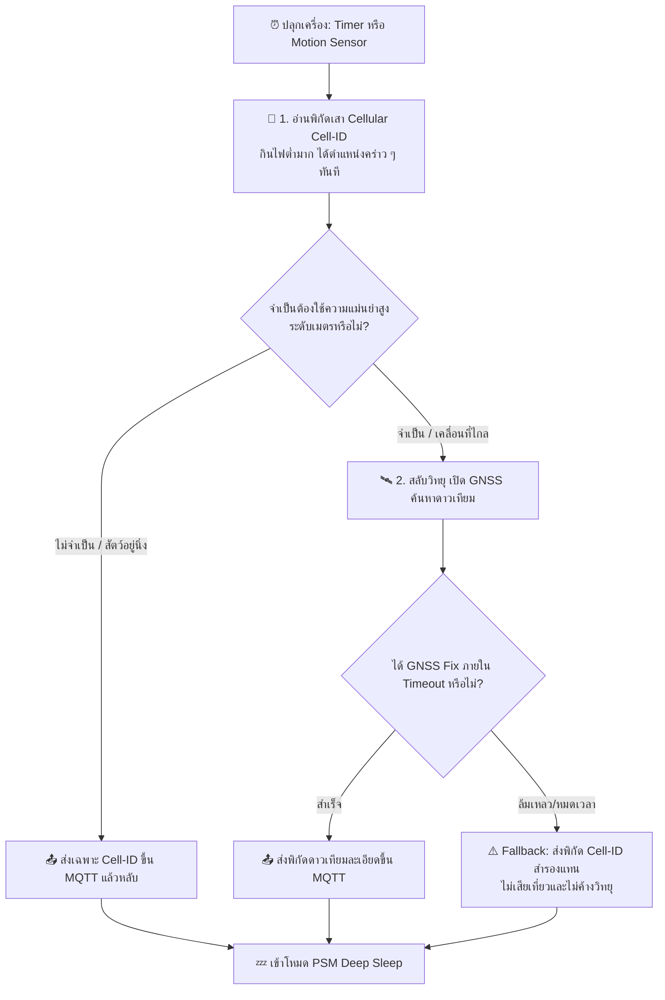

# Checklist การตรวจวัดและเปรียบเทียบการใช้พลังงาน (LTE vs GNSS Power Measurement Checklist)

เอกสารขั้นตอนและรายการตรวจสอบ (Checklist) สำหรับการวัดและเปรียบเทียบการใช้พลังงานจริงบนฮาร์ดแวร์ระหว่าง **สัญญาณเซลลูลาร์ (LTE / Cell-ID)** และ **ดาวเทียม (GNSS / GPS)** เพื่อเป็นข้อมูลเชิงประจักษ์ในการตัดสินใจเลือกวิธีการระบุตำแหน่งหลักของระบบ Cellular Asset Tracker

---

## 🎯 วัตถุประสงค์ (Objectives)

1. วัดปริมาณพลังงานจริงที่ระบบใช้ในแต่ละขั้นตอน (หน่วยเป็น mJ หรือ mWh)
2. เปรียบเทียบความคุ้มค่าด้านพลังงาน (Energy per Fix) เทียบกับความแม่นยำ (Accuracy) ที่ได้รับ
3. ประเมินอายุการใช้งานแบตเตอรี่จริงในสภาวะการทำงานแบบต่าง ๆ (Clear Sky, Canopy, Indoor)
4. กำหนดเงื่อนไขของ **Hybrid Positioning Strategy** (การสลับใช้ Cell-ID และ GNSS ตามสถานการณ์)

---

## 🛠️ หมวดที่ 1: การเตรียมอุปกรณ์และสภาพแวดล้อมการวัด (Test Bench Setup)

- [ ] **1.1 เตรียมเครื่องมือวัดกระแสและพลังงาน**
  - [ ] ใช้ **Nordic Power Profiler Kit II (PPK2)** หรือชุดวัดไฟของโปรเจกต์ ([`ESP32-power-monitor`](../../myprojects/monitor-application/ESP32-power-monitor/README.md) + INA239 + การบันทึกผ่าน Serial)
  - [ ] ตรวจสอบการ Calibrate Shunt Resistor และ Zero-offset กระแสก่อนเริ่มวัด
  - [ ] ตั้งค่า Sampling Rate ให้เพียงพอต่อการจับ TX Burst Peak ของ LTE ($\ge 1\text{ kHz}$)
- [ ] **1.2 ตัดสัญญาณรบกวนภายนอก (Isolation)**
  - [ ] **ปิดไฟ LED ทั้งหมด**: กำหนด `CONFIG_STARTUP_LED=n` และ `CONFIG_ENABLE_LEDS=n` ในไฟล์ config เพื่อตัดกระแสคงที่ของ LED (~2–5 mA)
  - [ ] **ตัดการต่อสาย USB / UART / Debugger (SWD/JTAG)** ออกจากคอมพิวเตอร์ระหว่างทดสอบ หรือใช้ Optocoupler/USB Isolator เพื่อป้องกันไฟรั่วไหลย้อนเข้าบอร์ด (Backpowering) ผ่านไดโอดกันไฟย้อนของขา I/O
  - [ ] ป้อนไฟเลี้ยงระดับแรงดันคงที่เทียบเท่าแบตเตอรี่จริง เช่น **3.7 V (LiPo Nominal)** หรือ **3.8 V**
  - [ ] ตรวจสอบวงจร Power-latch และปุ่ม MODE ตามคู่มือ [`POWER_SOURCE_STARTUP_TROUBLESHOOTING_TH.md`](../../myprojects/gps_mqtt_tracker/POWER_SOURCE_STARTUP_TROUBLESHOOTING_TH.md)

---

## 📶 หมวดที่ 2: Checklist การวัดพลังงาน LTE (Cellular Subsystem)

วัดพลังงานในแต่ละสถานะของโมเด็ม LTE-M / NB-IoT เพื่อทราบต้นทุนพลังงานในการดึงพิกัดเสาสัญญาณ (Cell-ID) และการส่งข้อมูล

### 2.1 สเตจการเชื่อมต่อและลงทะเบียนเครือข่าย
- [ ] **Cold Attach / First Boot**:
  - [ ] วัดพลังงานตั้งแต่เริ่มเปิดวิทยุ LTE จนกระทั่งลงทะเบียนเครือข่ายสำเร็จ (`LTE_LC_EVT_NW_REG_STATUS`)
  - [ ] บันทึก: ระยะเวลา (Time, วินาที), กระแสเฉลี่ย ($I_{avg}$, mA), กระแสสูงสุด (Peak TX, mA), พลังงานรวม (mJ หรือ mWh)
- [ ] **Tracking Area Update (TAU) ในโหมด PSM**:
  - [ ] วัดพลังงานรอบการตื่นมาส่งสัญญาณแจ้งตำแหน่งเสากับเครือข่าย (TAU signaling เทียบกับช่วงเวลา `CONFIG_TRACKER_PSM_PERIODIC_TAU_SECONDS`)
  - [ ] บันทึก: ระยะเวลา ($1–3$ วินาที), พลังงานรวมที่ใช้ในการทำ TAU หนึ่งครั้ง
- [ ] **Mobility Cell Handover**:
  - [ ] เคลื่อนย้ายอุปกรณ์ข้ามเขตเสาสัญญาณจริงเพื่อดูพลังงานที่ใช้เมื่ออุปกรณ์ต้องเปลี่ยนสถานีฐาน (Cell Re-selection / Handover)

### 2.2 สเตจการอ่านข้อมูลพิกัดเสาสัญญาณ (Cell-ID Positioning)
- [ ] **Serving Cell-ID Acquisition**:
  - [ ] วัดพลังงานและเวลาที่ใช้ในการอ่านค่า MCC, MNC, TAC, Cell ID, RSRP ผ่านคำสั่ง AT (`AT+CEREG?` หรือ `AT%XMONITOR`)
  - [ ] *หมายเหตุ*: ปกติโมเด็มมีข้อมูลนี้อยู่ในหน่วยความจำขณะต่อสัญญาณอยู่แล้ว จึงแทบไม่กินเวลาหรือพลังงานเพิ่ม ($< 1\text{ ms}$)
- [ ] **Neighbor Cell Search (Multi-cell Location - กรณีทดสอบเพิ่มเติม)**:
  - [ ] วัดพลังงานในการสั่งสแกนเสาสัญญาณข้างเคียงเพื่อใช้ทำ Triangulation

### 2.3 สเตจการส่งข้อมูล (MQTT Publish) และการหลับ (Sleep)
- [ ] **TCP/TLS Handshake & MQTT Connect**:
  - [ ] วัดพลังงานช่วงสร้าง Socket และ Handshake TLS (พอร์ต 8883)
- [ ] **MQTT Publish (Payload Transmission)**:
  - [ ] วัดพลังงานในการส่ง JSON พิกัดขนาด ~100 bytes (เปรียบเทียบระหว่าง QoS 0 และ QoS 1 ที่ต้องรอ PUBACK)
- [ ] **RRC Inactive Tail Time**:
  - [ ] วัดระยะเวลาที่โมเด็มยังค้างอยู่ในสถานะ RRC Connected ก่อนที่เครือข่ายจะสั่งตัดเข้าสู่ Idle / PSM (มักอยู่ที่ 5–20 วินาที ขึ้นอยู่กับโอเปอเรเตอร์)
- [ ] **Floor Current (PSM Deep Sleep)**:
  - [ ] วัดกระแสต่ำสุดขณะอุปกรณ์หลับอยู่ในโหมด PSM (เกณฑ์ปกติของ nRF9160 ควรอยู่ที่ประมาณ $2.7–4\ \mu\text{A}$)

---

## 🛰️ หมวดที่ 3: Checklist การวัดพลังงาน GNSS (Satellite Subsystem)

วัดพลังงานที่ใช้ในการค้นหาและล็อกพิกัดดาวเทียมในสภาพแวดล้อมต่าง ๆ

- [ ] **3.1 GNSS Cold Start (เปิดค้นหาครั้งแรก / ไม่มีข้อมูลวงโคจร Ephemeris)**:
  - [ ] ทดสอบในพื้นที่โล่งแจ้ง (Clear Sky View)
  - [ ] ยืนยันว่าปิดวิทยุ LTE ก่อน (`LTE_LC_FUNC_MODE_DEACTIVATE_LTE`) ตามกฎ GPS-First
  - [ ] วัดระยะเวลา Time-to-First-Fix (TTFF) (ปกติอยู่ที่ 30–60 วินาทีขึ้นไป)
  - [ ] บันทึก: กระแสเฉลี่ยขณะสแกน (~40–48 mA), พลังงานรวมที่ใช้ต่อ 1 Fix (mWh)
- [ ] **3.2 GNSS Warm / Hot Start (มี Ephemeris อยู่แล้ว / ทำงานรอบต่อเนื่อง)**:
  - [ ] ทดสอบรอบที่สองหลังจากได้ Fix แรกไปแล้วไม่เกิน 1–2 ชั่วโมง
  - [ ] วัดระยะเวลา TTFF (ควรลดลงเหลือประมาณ 2–10 วินาที)
  - [ ] บันทึก: พลังงานรวมที่ใช้ต่อ 1 Fix เปรียบเทียบกับ Cold Start
- [ ] **3.3 GNSS Contention & Priority Mode (ตาม [Ticket 08](../../.scratch/tracker-hardening/issues/08-gnss-priority-mode-every-cycle.md))**:
  - [ ] วัดพลังงานเปรียบเทียบระหว่าง:
    * รอบที่เปิด `nrf_modem_gnss_prio_mode_enable()`
    * รอบที่ปล่อยให้แชร์เวลากับ LTE ตามปกติ
- [ ] **3.4 GNSS Timeout & Obstruction (สภาพแวดล้อมอับสัญญาณ / Worst Case)**:
  - [ ] ทดสอบในอาคาร ใต้ร่มไม้หนาแน่น หรือคว่ำเสาอากาศลง
  - [ ] ตรวจจับเวลาจนกว่าระบบจะหมดเวลาค้นหา (`CONFIG_TRACKER_PERIODIC_TIMEOUT` เช่น 120 หรือ 300 วินาที)
  - [ ] คำนวณพลังงานที่สูญเปล่าไปทั้งหมด (Wasted Energy) เมื่อค้นหาดาวเทียมไม่สำเร็จ ก่อนที่ระบบจะตัดเข้าโหมดประหยัดพลังงาน
- [ ] **3.5 คุณภาพความแม่นยำ (Accuracy vs Energy Trade-off)**:
  - [ ] เปรียบเทียบการเปิด `CONFIG_GNSS_LOW_ACCURACY=y` (ได้ Fix เร็วขึ้น แต่ความคลาดเคลื่อนสูงขึ้น) กับการรอ High Accuracy Fix

---

## 📊 หมวดที่ 4: ตารางบันทึกผลการทดสอบ (Measurement Record Template)

บันทึกผลลงในตารางนี้เพื่อนำไปสร้างกราฟและคำนวณ Energy Budget ในรายงานโปรเจกต์:

| สเตจการทำงาน | แรงดัน (V) | กระแสเฉลี่ย (mA) | Peak (mA) | เวลา (วินาที) | พลังงาน ($E = V \times I \times t$) | ความแม่นยำที่ได้ |
| :--- | :---: | :---: | :---: | :---: | :---: | :---: |
| **LTE Cold Attach** | 3.7 V | | | | mWh | - |
| **LTE TAU (PSM Wakeup)** | 3.7 V | | | | mWh | ระบุ Cell-ID |
| **LTE Read Cell-ID** | 3.7 V | | | | mWh | 500 ม. – 5 กม. |
| **MQTT Publish (QoS 1)** | 3.7 V | | | | mWh | - |
| **PSM Sleep (Floor)** | 3.7 V | | | N/A | $\mu\text{W}$ | - |
| **GNSS Cold Start (Fix)** | 3.7 V | | | | mWh | 2 – 5 เมตร |
| **GNSS Hot Start (Fix)** | 3.7 V | | | | mWh | 2 – 5 เมตร |
| **GNSS Timeout (No Fix)** | 3.7 V | | | | mWh | หาพิกัดไม่ได้ |

---

## ⚖️ หมวดที่ 5: เกณฑ์การตัดสินใจเลือกเทคโนโลยีหลัก (Decision Framework)

นำผลการทดสอบจากหมวดที่ 4 มาวิเคราะห์ตาม 3 ดัชนีหลัก:

### 1. อัตราส่วนพลังงานต่อ 1 ตำแหน่ง (Energy Ratio)
$$\text{Energy Ratio} = \frac{E_{\text{GNSS Fix}}}{E_{\text{Cell-ID Fix}}}$$
* หาก $E_{\text{GNSS}}$ สูงกว่า $E_{\text{Cell-ID}}$ เกิน **30–50 เท่า** การเปิดค้นหา GNSS ทุกรอบจะทำให้อายุแบตเตอรี่สั้นลงอย่างมีนัยสำคัญ

### 2. อัตราความสำเร็จในการค้นหาพิกัด (Fix Success Rate)
$$\text{Success Rate (\%)} = \left(\frac{N_{\text{Fix Success}}}{N_{\text{Total Attempts}}}\right) \times 100$$
* ประเมินในพื้นที่ปฏิบัติงานจริง (เช่น แนวป่า หรือถ้ำ) หาก Success Rate ต่ำกว่า 60% พลังงานส่วนใหญ่จะสูญเสียไปกับ GNSS Timeout

### 3. การประเมินอายุการใช้งานของแบตเตอรี่ (Battery Lifetime Estimation)
$$\text{Estimated Days} = \frac{\text{Battery Capacity (mAh)}}{\text{Average Daily Consumption (mAh/day)}}$$
* จำลองเปรียบเทียบ 3 กรณี:
  * **กรณี A (Pure GNSS)**: อัปเดตพิกัดดาวเทียมทุก 1 ชั่วโมง
  * **กรณี B (Pure Cellular)**: อัปเดตพิกัด Cell-ID ทุก 1 ชั่วโมง
  * **กรณี C (Hybrid)**: ตรวจสอบการเคลื่อนที่ด้วย Accelerometer ก่อน หากไม่ขยับส่งเฉพาะ Cell-ID หากขยับจึงเปิด GNSS

---

## 💡 หมวดที่ 6: ผังการทำงานแบบไฮบริดที่แนะนำ (Recommended Hybrid Strategy)

---

## 🔗 เอกสารและเครื่องมือที่เกี่ยวข้อง (Related Links)

* [เฟิร์มแวร์ ESP32 Power Monitor](../../myprojects/monitor-application/ESP32-power-monitor/README.md)
* [คู่มือการแก้ปัญหาไฟเลี้ยงและการบูตบอร์ด](../../myprojects/gps_mqtt_tracker/POWER_SOURCE_STARTUP_TROUBLESHOOTING_TH.md)
* [Field Test Checklist](../../.scratch/tracker-hardening/FIELD_TEST_CHECKLIST.md)
* [Ticket 08: GNSS Priority Mode Analysis](../../.scratch/tracker-hardening/issues/08-gnss-priority-mode-every-cycle.md)
