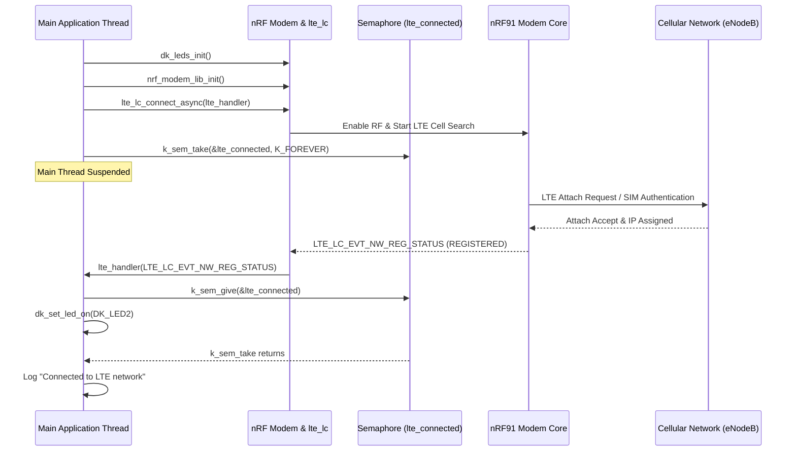

# Lesson 2: Getting a Cellular Connection (LTE-M / NB-IoT)

This document provides system documentation for **Lesson 2 (`l2_LTE`)**, covering modem library initialization, asynchronous cellular network registration, semaphore synchronization, and serial AT command interface debugging.

---

## 📋 Objectives & Scope
* **nRF Modem Library Initialization:** Configure and initialize `nrf_modem_lib`.
* **Asynchronous LTE Link Control:** Use `lte_lc_connect_async()` for non-blocking network connection.
* **Network Registration Callback:** Handle `LTE_LC_EVT_NW_REG_STATUS` and `LTE_LC_EVT_RRC_UPDATE` events.
* **Thread Synchronization:** Synchronize main thread execution with cellular registration using Zephyr semaphores (`k_sem_take` / `k_sem_give`).
* **AT Host Debugging Interface:** Enable `CONFIG_AT_HOST_LIBRARY=y` to interact directly with the modem using serial AT commands (`AT+CFUN?`, `AT+CESQ`, `AT+CEREG?`).

---

## 🏗️ System Operation Flow



---

## ⚙️ Configuration Setup (`prj.conf`)

```ini
# Logging System
CONFIG_LOG=y

# Button and LED support
CONFIG_DK_LIBRARY=y

# Network configuration
CONFIG_NETWORKING=y
CONFIG_NET_NATIVE=n                # Disable Zephyr native IP stack (modem offloading)
CONFIG_NET_SOCKETS=y               # Enable socket API support
CONFIG_NET_SOCKETS_OFFLOAD=y       # Offload socket operations to the modem

# System Memory
CONFIG_HEAP_MEM_POOL_SIZE=4096
CONFIG_MAIN_STACK_SIZE=4096

# nRF Modem Library
CONFIG_NRF_MODEM_LIB=y

# LTE Link Control
CONFIG_LTE_LINK_CONTROL=y

# AT Host interface for serial debugging
CONFIG_AT_HOST_LIBRARY=y
CONFIG_UART_INTERRUPT_DRIVEN=y
```

---

## 💻 Code Highlights (`v3.3.3_practices/l2_LTE/l2_e2/src/main.c`)

```c
#include <modem/nrf_modem_lib.h>
#include <modem/lte_lc.h>

static K_SEM_DEFINE(lte_connected, 0, 1);

static void lte_handler(const struct lte_lc_evt *const evt)
{
	switch (evt->type) {
	case LTE_LC_EVT_NW_REG_STATUS:
		if ((evt->nw_reg_status != LTE_LC_NW_REG_REGISTERED_HOME) &&
			(evt->nw_reg_status != LTE_LC_NW_REG_REGISTERED_ROAMING)) {
			break;
		}
		LOG_INF("Network registration status: %s",
				evt->nw_reg_status == LTE_LC_NW_REG_REGISTERED_HOME ?
				"Connected - home network" : "Connected - roaming");
		k_sem_give(&lte_connected);
		dk_set_led_on(DK_LED2);
		break;
	case LTE_LC_EVT_RRC_UPDATE:
		LOG_INF("RRC mode: %s", evt->rrc_mode == LTE_LC_RRC_MODE_CONNECTED ?
				"Connected" : "Idle");
		break;
	default:
		break;
	}
}

static int modem_configure(void)
{
	int err;

	LOG_INF("Initializing modem library");
	err = nrf_modem_lib_init();
	if (err) {
		LOG_ERR("Failed to initialize the modem library: %d", err);
		return err;
	}
	
	LOG_INF("Connecting to LTE network");
	err = lte_lc_connect_async(lte_handler);
	if (err) {
		LOG_ERR("Error in lte_lc_connect_async: %d", err);
		return err;
	}
	return 0;
}

int main(void)
{
	dk_leds_init();
	modem_configure();

	k_sem_take(&lte_connected, K_FOREVER);
	LOG_INF("Connected to LTE network");
	return 0;
}
```

---

## 🔍 Verification & Debugging

1. Build and flash the board:
   ```bash
   west build -b nrf9160dk/nrf9160/ns v3.3.3_practices/l2_LTE/l2_e2
   west flash
   ```
2. Open **LTE Link Monitor** at `115200` baud.
3. Observe terminal output and confirm **LED2** turns solid green upon registration.
