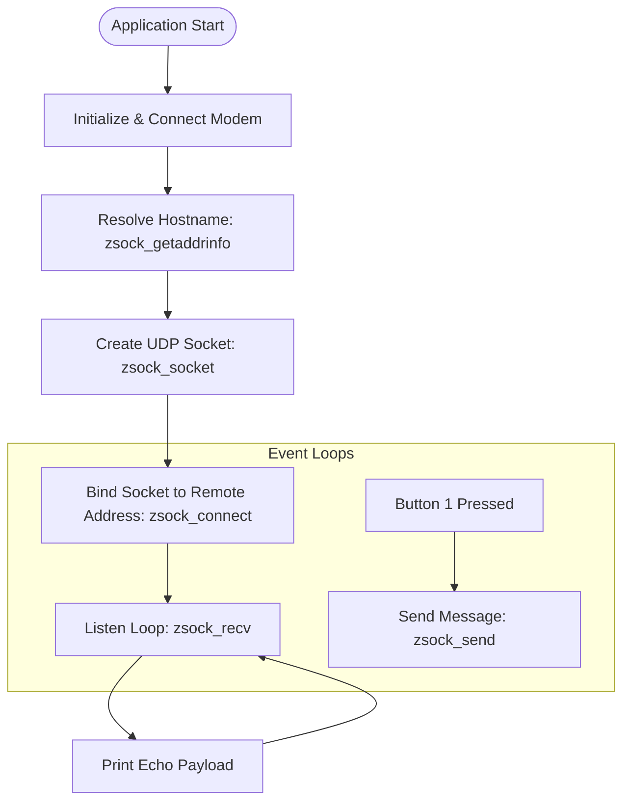

# Lesson 3: IP Sockets and UDP Communication

This lesson introduces the BSD Sockets API implementation in Zephyr (`zsock_*`) and walks through resolving hostname addresses, establishing a UDP socket, sending packets upon button triggers, and receiving echo responses.

---

## 📋 Objectives
*   **DNS Hostname Resolution:** Resolve domain names asynchronously to IPv4 addresses using `zsock_getaddrinfo()`.
*   **UDP Client Setup:** Configure and open a UDP socket (`AF_INET`, `SOCK_DGRAM`, `IPPROTO_UDP`).
*   **Connecting Sockets:** Link the socket to a resolved remote address.
*   **Sending Data:** Use the `zsock_send()` API to transmit messages triggered by a hardware button press.
*   **Receiving Data:** Listen for incoming packets continuously in a thread loop using `zsock_recv()`.

---

## 🏗️ Execution Flow



---

## ⚙️ Configuration Setup (`prj.conf`)

Add socket support configurations on top of the basic LTE setup:

```ini
# Logging System
CONFIG_LOG=y

# Button and LED support
CONFIG_DK_LIBRARY=y

# Network Configurations
CONFIG_NETWORKING=y
CONFIG_NET_NATIVE=n                # Disable native IP (use offloading)
CONFIG_NET_SOCKETS=y               # Enable Socket layer compatibility
CONFIG_NET_SOCKETS_OFFLOAD=y       # Route sockets through modem core

# Memory Allocations
CONFIG_HEAP_MEM_POOL_SIZE=4096
CONFIG_MAIN_STACK_SIZE=4096

# nRF Modem & LTE Library
CONFIG_NRF_MODEM_LIB=y
CONFIG_LTE_LINK_CONTROL=y
```

---

## 💻 Code Highlights (`src/main.c`)

### 1. Header Imports
```c
#include <zephyr/net/socket.h> // Includes BSD socket wrappers (zsock_*)
```

### 2. DNS Hostname Resolution
Hostname resolution translates server domain names into numeric IP addresses:
```c
#define SERVER_HOSTNAME "udp-echo.nordicsemi.academy"
#define SERVER_PORT "2444"

static struct sockaddr_storage server;

static int server_resolve(void)
{
	int err;
	struct zsock_addrinfo *result;
	struct zsock_addrinfo hints = {
		.ai_family = AF_INET,       // Force IPv4
		.ai_socktype = SOCK_DGRAM   // Datagram sockets (UDP)
	};

	err = zsock_getaddrinfo(SERVER_HOSTNAME, SERVER_PORT, &hints, &result);
	if (err != 0) {
		LOG_ERR("DNS lookup failed: %d", err);
		return -EIO;
	}

	/* Copy IPv4 address details to destination structure */
	struct sockaddr_in *server4 = ((struct sockaddr_in *)&server);
	server4->sin_addr.s_addr = ((struct sockaddr_in *)result->ai_addr)->sin_addr.s_addr;
	server4->sin_family = AF_INET;
	server4->sin_port = ((struct sockaddr_in *)result->ai_addr)->sin_port;

	char ipv4_addr[NET_IPV4_ADDR_LEN];
	zsock_inet_ntop(AF_INET, &server4->sin_addr.s_addr, ipv4_addr, sizeof(ipv4_addr));
	LOG_INF("Resolved IPv4 Address: %s", ipv4_addr);

	zsock_freeaddrinfo(result); // Must free allocated result structure
	return 0;
}
```

### 3. Socket Initialization & Connection
```c
static int sock;

static int server_connect(void)
{
	int err;
    
	/* Open a UDP Socket */
	sock = zsock_socket(AF_INET, SOCK_DGRAM, IPPROTO_UDP);
	if (sock < 0) {
		LOG_ERR("Failed to create socket: %d", errno);
		return -errno;
	}

	/* Set socket parameters to point to the remote address */
	err = zsock_connect(sock, (struct sockaddr *)&server, sizeof(struct sockaddr_in));
	if (err < 0) {
		LOG_ERR("Connect failed: %d", errno);
		return -errno;
	}
	LOG_INF("Socket client setup complete");
	return 0;
}
```

### 4. Sending and Receiving Loops
```c
#define MESSAGE_TO_SEND "Hi from nRF91 Series device"
#define MESSAGE_SIZE 256
static uint8_t recv_buf[MESSAGE_SIZE];

static void button_handler(uint32_t button_state, uint32_t has_changed)
{
	if ((has_changed & DK_BTN1_MSK) && (button_state & DK_BTN1_MSK)) {
		int err = zsock_send(sock, MESSAGE_TO_SEND, sizeof(MESSAGE_TO_SEND) - 1, 0);
		if (err < 0) {
			LOG_ERR("Failed to send, error: %d", errno);
			return;
		}
		LOG_INF("Sent payload: %s", MESSAGE_TO_SEND);
	}
}

// In main loop:
while (1) {
	/* Block until a new packet is received */
	int received = zsock_recv(sock, recv_buf, sizeof(recv_buf) - 1, 0);
	if (received < 0) {
		LOG_ERR("Socket error: %d", errno);
		break;
	} else if (received == 0) {
		LOG_INF("Received empty datagram");
		continue;
	}

	recv_buf[received] = '\0'; // Terminate string
	LOG_INF("Echo response received: (%s)", recv_buf);
}
zsock_close(sock);
```

---

## 🔍 Verification & Debugging
1.  Connect the board to a terminal (e.g., LTE Link Monitor) at 115200 baud.
2.  Wait for cellular connection logs (`Connected to LTE network` and LED2 illumination).
3.  DNS resolution log will print: `Resolved IPv4 Address: <ip_address>`.
4.  Press **Button 1** on the development kit.
5.  Check output logs to confirm message transmission: `Sent payload: Hi from nRF91 Series device`.
6.  The server `udp-echo.nordicsemi.academy` will immediately echo the payload back. Confirm the log: `Echo response received: (Hi from nRF91 Series device)`.
