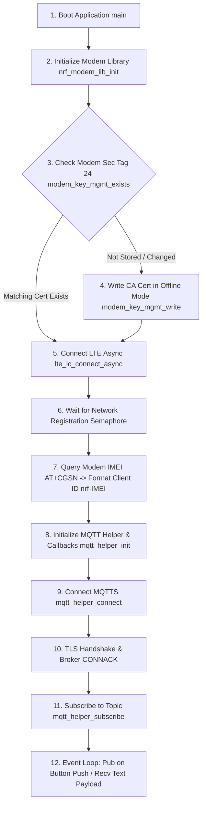

# Lesson 4: Application Layer Protocols — MQTT, MQTTS (TLS), & Authenticated MQTT

This document provides system documentation for **Lesson 4 (`l4`)**, covering MQTT client configuration, dynamic IMEI-based Client ID generation, secure TLS root certificate provisioning to modem flash, and client username/password authentication.

---

## 📋 Objectives & Scope
* **MQTT Helper Initialization:** Configure MQTT helper library parameters (`mqtt_helper_cfg`, `mqtt_helper_conn_params`).
* **Unique Client ID:** Retrieve modem IMEI (`AT+CGSN`) to format unique Client IDs (`nrf-<IMEI>`).
* **TLS Security & Provisioning:** Store CA root certificates to modem security tag `24` using `modem_key_mgmt`.
* **Client Authentication:** Authenticate with MQTT brokers using username and password credentials.
* **Topic Pub/Sub:** Subscribe to command topics and publish telemetry/messages on hardware button triggers.

---

## 🏗️ System Execution & MQTTS Flow



---

## ⚙️ Configuration Setup (`prj.conf`)

```ini
# Logging and Button/LED Support
CONFIG_LOG=y
CONFIG_DK_LIBRARY=y

# Networking Stack & Modem Offloading
CONFIG_NETWORKING=y
CONFIG_NET_NATIVE=n
CONFIG_NET_SOCKETS=y
CONFIG_NET_SOCKETS_OFFLOAD=y

# Memory Allocation
CONFIG_HEAP_MEM_POOL_SIZE=4096
CONFIG_MAIN_STACK_SIZE=4096

# Modem and Key Management
CONFIG_NRF_MODEM_LIB=y
CONFIG_LTE_LINK_CONTROL=y
CONFIG_MODEM_KEY_MGMT=y

# MQTT Helper Configuration
CONFIG_MQTT_HELPER=y
CONFIG_MQTT_CLEAN_SESSION=y
CONFIG_MQTT_SAMPLE_BROKER_HOSTNAME="mqtt.nordicsemi.academy"
CONFIG_MQTT_SAMPLE_PUB_TOPIC="devacademy/publish/topic"
CONFIG_MQTT_SAMPLE_SUB_TOPIC="devacademy/subscribe/topic"

# TLS Configuration (For MQTTS / Exercise 2 & 3)
CONFIG_MQTT_LIB_TLS=y
CONFIG_MBEDTLS=y
CONFIG_TLS_CREDENTIALS=y
CONFIG_MQTT_HELPER_SEC_TAG=24

# Broker Authentication (For Exercise 3 Personal)
CONFIG_MQTT_SAMPLE_USERNAME="your_username"
CONFIG_MQTT_SAMPLE_PASSWORD="your_password"
```

---

## 💻 Code Highlights (`l4/l4_e3_personal/src/main.c`)

### 1. Offline TLS Certificate Provisioning
```c
#include <modem/modem_key_mgmt.h>

static const unsigned char ca_certificate[] = {
#include "ca-cert.pem"
};

int certificate_provision(void)
{
	int err;
	bool exists;

	err = modem_key_mgmt_exists(CONFIG_MQTT_HELPER_SEC_TAG,
				    MODEM_KEY_MGMT_CRED_TYPE_CA_CHAIN,
				    &exists);
	if (err) return err;

	if (exists) {
		err = modem_key_mgmt_cmp(CONFIG_MQTT_HELPER_SEC_TAG,
					 MODEM_KEY_MGMT_CRED_TYPE_CA_CHAIN,
					 ca_certificate,
					 sizeof(ca_certificate) - 1);
		if (err == 0) {
			LOG_INF("Matching CA Certificate already stored");
			return 0;
		}
	}

	return modem_key_mgmt_write(CONFIG_MQTT_HELPER_SEC_TAG,
				   MODEM_KEY_MGMT_CRED_TYPE_CA_CHAIN,
				   ca_certificate,
				   sizeof(ca_certificate) - 1);
}
```

### 2. Client ID & Authenticated Connection
```c
struct mqtt_helper_conn_params conn_params = {
	.hostname.ptr = CONFIG_MQTT_SAMPLE_BROKER_HOSTNAME,
	.hostname.size = strlen(CONFIG_MQTT_SAMPLE_BROKER_HOSTNAME),
	.device_id.ptr = (char *)client_id,
	.device_id.size = strlen(client_id),
};

if (strlen(CONFIG_MQTT_SAMPLE_USERNAME) > 0) {
	conn_params.user_name.ptr = CONFIG_MQTT_SAMPLE_USERNAME;
	conn_params.user_name.size = strlen(CONFIG_MQTT_SAMPLE_USERNAME);
}

if (strlen(CONFIG_MQTT_SAMPLE_PASSWORD) > 0) {
	conn_params.password.ptr = CONFIG_MQTT_SAMPLE_PASSWORD;
	conn_params.password.size = strlen(CONFIG_MQTT_SAMPLE_PASSWORD);
}

err = mqtt_helper_connect(&conn_params);
```

---

## 🔍 Verification & Testing

1. Build and flash `l4_e3_personal`:
   ```bash
   west build -b nrf9160dk/nrf9160/ns l4/l4_e3_personal
   west flash
   ```
2. Open terminal at `115200` baud. Verify output:
   `Connected to MQTT broker`, `Authenticated User: your_username`.
3. Test using **MQTT Explorer** (TLS Port `8883` with CA cert, Username & Password).
