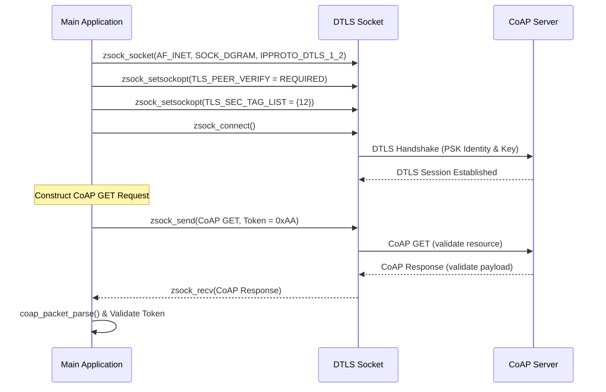

# Lesson 5: Constrained Application Protocol - CoAP and CoAP over DTLS

This lesson introduces the **Constrained Application Protocol (CoAP)** library in Zephyr for transmitting resource-constrained telemetry. It details how to format CoAP request headers, write/receive GET and PUT request payloads, and secure datagram channels using **DTLS (Datagram TLS)** socket configuration options.

---

## 📋 Objectives
*   **CoAP Library Integration:** Build and format binary request payloads using Zephyr's `<zephyr/net/coap.h>` APIs.
*   **Method Implementations:** Implement CoAP `GET` (for fetching remote resource status) and `PUT` (for uploading data) operations.
*   **DTLS Socket Configuration:** Set up security options (`SOL_TLS`) such as peer verification and secure hostnames on UDP sockets.
*   **PSK Security Provisioning:** Provision Pre-Shared Key (PSK) credentials (identities and keys) into the modem using the key management interface.
*   **Keep-Alive Handling:** Implement scheduled work handlers (`k_work_delayable`) to continuously poll server resources.

---

## 🏗️ Asynchronous DTLS CoAP Transaction Flow



---

## ⚙️ Configuration Setup (`prj.conf`)

Add these switches to enable CoAP and DTLS configurations:

```ini
# Logging and Library support
CONFIG_LOG=y
CONFIG_DK_LIBRARY=y
CONFIG_NEWLIB_LIBC=y

# Networking
CONFIG_NETWORKING=y
CONFIG_NET_NATIVE=n
CONFIG_NET_SOCKETS=y
CONFIG_NET_SOCKETS_OFFLOAD=y

# Memory Allocations
CONFIG_HEAP_MEM_POOL_SIZE=4096
CONFIG_MAIN_STACK_SIZE=4096

# Modem and Cryptography
CONFIG_NRF_MODEM_LIB=y
CONFIG_LTE_LINK_CONTROL=y
CONFIG_MODEM_KEY_MGMT=y           # Required for DTLS PSK storage (Exercise 2)

# CoAP Configuration
CONFIG_COAP=y
CONFIG_COAP_SERVER_HOSTNAME="californium.eclipseprojects.io"
CONFIG_COAP_TX_RESOURCE="large-update"
CONFIG_COAP_RX_RESOURCE="validate"

# Exercise 2: DTLS specific options
CONFIG_COAP_SERVER_PORT=5684       # DTLS port (default CoAP UDP is 5683)
CONFIG_COAP_DEVICE_NAME="nrf91-client"
CONFIG_COAP_SERVER_PSK="secret_key"
```

---

## 💻 Code Highlights (`src/main.c`)

### 1. Constructing a CoAP GET Request
```c
#include <zephyr/net/coap.h>
#define APP_COAP_VERSION 1
#define APP_COAP_MAX_MSG_LEN 1280
static uint8_t coap_buf[APP_COAP_MAX_MSG_LEN];
static uint16_t next_token;

static int client_get_send(void)
{
	struct coap_packet request;
	next_token = sys_rand32_get(); // Generate random transaction token

	/* Initialize CoAP packet */
	int err = coap_packet_init(&request, coap_buf, sizeof(coap_buf),
				   APP_COAP_VERSION, COAP_TYPE_NON_CON,
				   sizeof(next_token), (uint8_t *)&next_token,
				   COAP_METHOD_GET, coap_next_id());
	if (err < 0) return err;

	/* Append the resource path to the header option list */
	err = coap_packet_append_option(&request, COAP_OPTION_URI_PATH,
					(uint8_t *)CONFIG_COAP_RX_RESOURCE,
					strlen(CONFIG_COAP_RX_RESOURCE));
	if (err < 0) return err;

	/* Transmit over socket */
	err = zsock_send(sock, request.data, request.offset, 0);
	if (err < 0) return -errno;

	LOG_INF("CoAP GET request sent: Token 0x%04x", next_token);
	return 0;
}
```

### 2. Creating a Secure DTLS Socket (Exercise 2)
```c
static int client_init(void)
{
	int err;

	/* 1. Open socket using IPPROTO_DTLS_1_2 protocol mapping */
	sock = zsock_socket(AF_INET, SOCK_DGRAM, IPPROTO_DTLS_1_2);
	if (sock < 0) return -errno;

	/* 2. Configure Peer Verification to Required */
	int verify = 2; // REQUIRED
	err = zsock_setsockopt(sock, SOL_TLS, TLS_PEER_VERIFY, &verify, sizeof(verify));
	if (err) return -errno;

	/* 3. Set Destination Hostname */
	err = zsock_setsockopt(sock, SOL_TLS, TLS_HOSTNAME, 
                           CONFIG_COAP_SERVER_HOSTNAME, 
                           strlen(CONFIG_COAP_SERVER_HOSTNAME));
	if (err) return -errno;

	/* 4. Link Socket to the provisioned Security Tag list */
	sec_tag_t sec_tag_list[] = { 12 };
	err = zsock_setsockopt(sock, SOL_TLS, TLS_SEC_TAG_LIST, sec_tag_list,
			       sizeof(sec_tag_t) * ARRAY_SIZE(sec_tag_list));
	if (err) return -errno;

	/* 5. Connect Socket */
	err = zsock_connect(sock, (struct sockaddr *)&server, sizeof(struct sockaddr_in));
	if (err < 0) return -errno;

	return 0;
}
```

### 3. Parsing CoAP Responses
```c
static int client_handle_response(uint8_t *buf, int received)
{
	struct coap_packet reply;
	uint8_t token[8];
	uint16_t token_len;
	const uint8_t *payload;
	uint16_t payload_len;

	/* Parse binary packet from receive buffer */
	int err = coap_packet_parse(&reply, buf, received, NULL, 0);
	if (err < 0) return err;

	/* Extract and validate the Token */
	token_len = coap_header_get_token(&reply, token);
	if ((token_len != sizeof(next_token)) ||
	    (memcmp(&next_token, token, sizeof(next_token)) != 0)) {
		LOG_ERR("Invalid token received");
		return 0;
	}

	/* Retrieve string payload */
	payload = coap_packet_get_payload(&reply, &payload_len);
	LOG_INF("Response payload: %.*s", payload_len, payload);
	return 0;
}
```

---

## 🔍 Verification & Debugging
1.  Verify the device is connected to the LTE network.
2.  Press **Button 1** on the development kit to initiate a `GET` request. 
3.  Observe output logs to confirm the request token transmission: `CoAP GET request sent: Token 0x1234`.
4.  Confirm response matching logs: `CoAP response: Code 0x45, Token 0x3412, Payload: <response_content>`.
5.  Press **Button 2** on the development kit to send a `PUT` request containing `"Hi from nRF91 Series device"`. Check that the remote Californium server returns a valid response payload.
