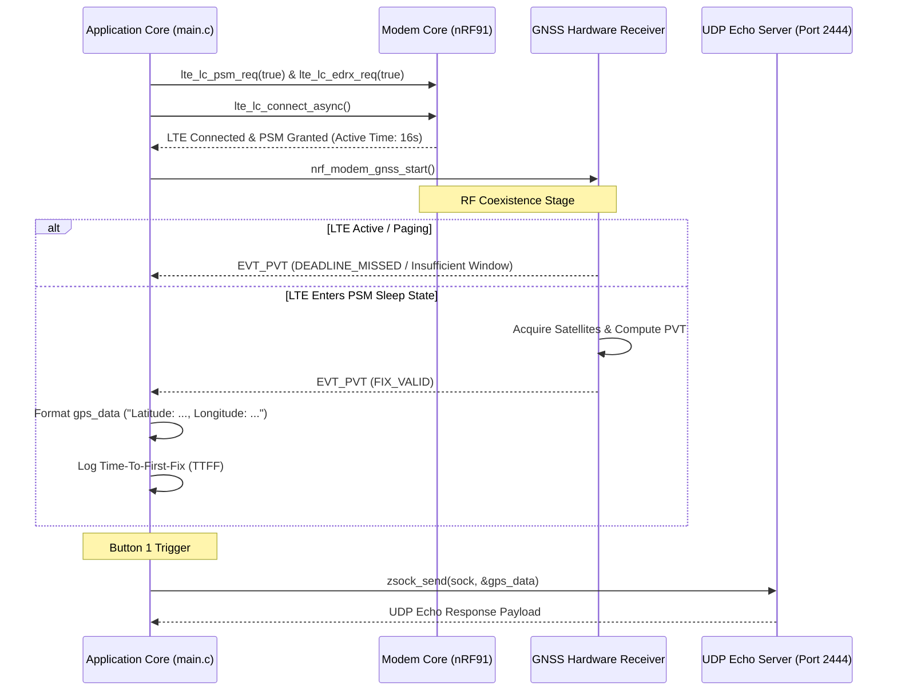

# Lesson 6: Requesting Location Using GNSS & UDP Telemetry

This document provides system documentation for **Lesson 6 (`l6`)**, covering GNSS receiver initialization, Position Velocity Time (PVT) data structure processing, Time-To-First-Fix (TTFF) measurement, LTE & GNSS RF coexistence, Power Saving Mode (PSM) & eDRX configuration, and UDP socket coordinate transmission.

---

## 📋 Objectives & Scope
* **GNSS Driver API:** Use `nrf_modem_gnss.h` interface to control the nRF91 GNSS hardware receiver.
* **PVT Frame Processing:** Handle `struct nrf_modem_gnss_pvt_data_frame` and verify valid fix flags (`NRF_MODEM_GNSS_PVT_FLAG_FIX_VALID`).
* **TTFF Measurement:** Measure uptime elapsed from GNSS start to first fix using `k_uptime_get()`.
* **RF Coexistence Management:** Monitor GNSS flags (`DEADLINE_MISSED`, `NOT_ENOUGH_WINDOW_TIME`) to detect LTE RF blocking.
* **PSM & eDRX Configuration:** Configure LTE Power Saving Mode (`CONFIG_LTE_PSM_REQ_RPTAU`, `CONFIG_LTE_PSM_REQ_RAT`) to put modem in deep sleep so GNSS can acquire satellite locks freely.
* **UDP Telemetry:** Transmit acquired latitude and longitude coordinates to a remote UDP server (`udp-echo.nordicsemi.academy:2444`) on button push.

---

## 🏗️ System Execution & Coexistence Flow



---

## ⚙️ Configuration Setup (`prj.conf`)

```ini
# Logging and Button/LED BSP
CONFIG_LOG=y
CONFIG_DK_LIBRARY=y

# Floating Point Formatting
CONFIG_NEWLIB_LIBC=y
CONFIG_NEWLIB_LIBC_FLOAT_PRINTF=y
CONFIG_FPU=y

# Networking Stack & Modem Offloading
CONFIG_NETWORKING=y
CONFIG_NET_NATIVE=n
CONFIG_NET_SOCKETS=y
CONFIG_NET_SOCKETS_OFFLOAD=y

# Memory Allocation
CONFIG_HEAP_MEM_POOL_SIZE=4096
CONFIG_MAIN_STACK_SIZE=4096

# Modem Driver & System Mode
CONFIG_NRF_MODEM_LIB=y
CONFIG_LTE_LINK_CONTROL=y
CONFIG_LTE_NETWORK_MODE_LTE_M_NBIOT_GPS=y

# PSM and eDRX Settings (Exercise 2)
CONFIG_LTE_LC_EDRX_MODULE=y
CONFIG_LTE_LC_PSM_MODULE=y
CONFIG_LTE_EDRX_REQ=y
CONFIG_LTE_PSM_REQ_RPTAU="00101000"
CONFIG_LTE_PSM_REQ_RAT="00001000"
```

---

## 💻 Code Highlights (`l6/l6_e2/src/main.c`)

```c
#include <nrf_modem_gnss.h>

static struct nrf_modem_gnss_pvt_data_frame pvt_data;
static uint8_t gps_data[256];

static void print_fix_data(struct nrf_modem_gnss_pvt_data_frame *pvt_data)
{
	LOG_INF("Latitude:       %.06f", pvt_data->latitude);
	LOG_INF("Longitude:      %.06f", pvt_data->longitude);
	LOG_INF("Altitude:       %.01f m", (double)pvt_data->altitude);

	snprintf(gps_data, sizeof(gps_data), 
		 "Latitude: %.06f, Longitude: %.06f", 
		 pvt_data->latitude, pvt_data->longitude);
}

static void gnss_event_handler(int event)
{
	switch (event) {
	case NRF_MODEM_GNSS_EVT_PVT:
		nrf_modem_gnss_read(&pvt_data, sizeof(pvt_data), NRF_MODEM_GNSS_DATA_PVT);
		if (pvt_data.flags & NRF_MODEM_GNSS_PVT_FLAG_FIX_VALID) {
			dk_set_led_on(DK_LED1);
			print_fix_data(&pvt_data);
			return;
		}
		if (pvt_data.flags & NRF_MODEM_GNSS_PVT_FLAG_DEADLINE_MISSED) {
			LOG_INF("GNSS blocked by LTE activity");
		} else if (pvt_data.flags & NRF_MODEM_GNSS_PVT_FLAG_NOT_ENOUGH_WINDOW_TIME) {
			LOG_INF("Insufficient GNSS time window");
		}
		break;
	}
}
```

---

## 🔍 Verification & Testing

1. Build and flash `l6_e2`:
   ```bash
   west build -b nrf9160dk/nrf9160/ns l6/l6_e2
   west flash
   ```
2. Terminal output shows PSM active time granted (16s), followed by GNSS fix acquisition.
3. Press Button 1 to send coordinates to `udp-echo.nordicsemi.academy:2444`. Confirm UDP echo response logged.
