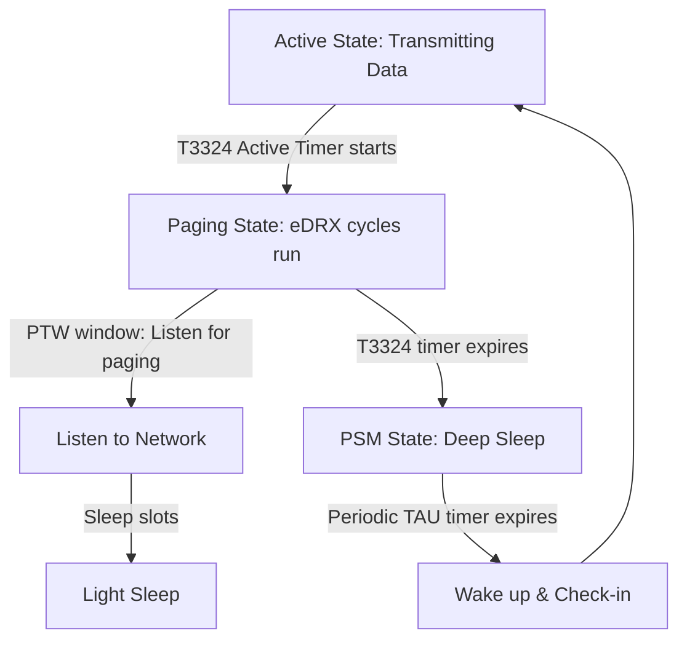

# Lesson 7: Cellular Power Optimization - PSM and eDRX

This lesson covers implementing power optimization parameters on cellular IoT connections using **Power Saving Mode (PSM)** and **extended Discontinuous Reception (eDRX)**. It details configuring Tracking Area Update (TAU) intervals, Active Time parameters, eDRX paging parameters, and handling event callbacks when the network negotiates these settings.

---

## 📋 Objectives
*   **Power Optimization Concepts:** Understand how PSM and eDRX parameters reduce average battery current down to microamps.
*   **TAU & Active Time Configuration:** Configure parameters using binary helper strings in Kconfig.
*   **Asynchronous Requests:** Trigger PSM and eDRX configuration requests using the LTE link controller APIs.
*   **Negotiation Event Callback Handling:** Capture network negotiation parameters (`LTE_LC_EVT_PSM_UPDATE` and `LTE_LC_EVT_EDRX_UPDATE`) in the callback loop.
*   **Secure CoAP Transaction:** Conduct DTLS-secured CoAP communication while transitioning in and out of power-saving sleep cycles.

---

## 🏗️ PSM and eDRX Power State Transition Flow



---

## ⚙️ Configuration Setup (`prj.conf`)

Add these options to request specific sleep intervals from your cellular carrier:

```ini
# Logging and Library support
CONFIG_LOG=y
CONFIG_DK_LIBRARY=y

# Networking Stack
CONFIG_NETWORKING=y
CONFIG_NET_NATIVE=n
CONFIG_NET_SOCKETS=y
CONFIG_NET_SOCKETS_OFFLOAD=y

# Modem and Power Saving Modes
CONFIG_NRF_MODEM_LIB=y
CONFIG_MODEM_KEY_MGMT=y
CONFIG_LTE_LINK_CONTROL=y

# 1. Enable power management module wrappers in LTE Link Controller
CONFIG_LTE_LC_EDRX_MODULE=y
CONFIG_LTE_LC_PSM_MODULE=y

# 2. Automatically request parameters during connection setup
CONFIG_LTE_EDRX_REQ=y
CONFIG_LTE_PSM_REQ=y

# 3. Configure PSM parameters (Format: GPRS Timer 3 strings)
# Periodic TAU (T3412): "00101000" (Base 1 hour * multiplier 8 = 8 hours)
CONFIG_LTE_PSM_REQ_RPTAU="00101000"
# Active Time (T3324): "00001000" (Base 2 seconds * multiplier 8 = 16 seconds)
CONFIG_LTE_PSM_REQ_RAT="00001000"

# CoAP and DTLS settings
CONFIG_COAP=y
CONFIG_COAP_SERVER_HOSTNAME="californium.eclipseprojects.io"
CONFIG_COAP_TX_RESOURCE="large-update"
CONFIG_COAP_RX_RESOURCE="validate"
CONFIG_COAP_SERVER_PORT=5684
```

> [!NOTE]
> **Understanding the PSM Binary Format (GPRS Timer 3 / RFC 24.008)**:
> The requested value is an 8-bit bitmask where the first 3 bits represent the time unit (multiplier) and the remaining 5 bits represent the value:
> *   `RPTAU (Periodic TAU)`: `001` = multiplier of 1 hour. Value `01000` = 8. (8 hours).
> *   `RAT (Active Time)`: `000` = multiplier of 2 seconds. Value `01000` = 8. (16 seconds).

---

## 💻 Code Highlights (`src/main.c`)

### 1. Requesting PSM and eDRX from the Modem
Configure the LTE Link Controller library to request the configured parameters during the network handshake:
```c
static int modem_configure(void)
{
	int err;

	err = nrf_modem_lib_init();
	if (err) return err;

	/* Provision PSK Identity and Key for CoAP DTLS communication */
	modem_key_mgmt_write(SEC_TAG, MODEM_KEY_MGMT_CRED_TYPE_IDENTITY, 
                         CONFIG_COAP_DEVICE_NAME, strlen(CONFIG_COAP_DEVICE_NAME));
	modem_key_mgmt_write(SEC_TAG, MODEM_KEY_MGMT_CRED_TYPE_PSK, 
                         CONFIG_COAP_SERVER_PSK, strlen(CONFIG_COAP_SERVER_PSK));

	/* Request PSM and eDRX parameter negotation */
	err = lte_lc_psm_req(true);
	if (err) LOG_ERR("Failed to request PSM parameters: %d", err);

	err = lte_lc_edrx_req(true);
	if (err) LOG_ERR("Failed to request eDRX parameters: %d", err);

	err = lte_lc_connect_async(lte_handler);
	return err;
}
```

### 2. Handling Parameter Negotiation Events
Since the base station (network operator) has the final decision, it may reject or modify the requested sleep parameters. Your application must monitor these updates in the callback event handler:
```c
static void lte_handler(const struct lte_lc_evt *const evt)
{
	switch (evt->type) {
	case LTE_LC_EVT_NW_REG_STATUS:
		if ((evt->nw_reg_status == LTE_LC_NW_REG_REGISTERED_HOME) ||
			(evt->nw_reg_status == LTE_LC_NW_REG_REGISTERED_ROAMING)) {
			k_sem_give(&lte_connected);
		}
		break;

	/* Captured when the network negotiates PSM parameters */
	case LTE_LC_EVT_PSM_UPDATE:
		LOG_INF("PSM Negotiated values - TAU: %d s, Active Time: %d s",
			evt->psm_cfg.tau, evt->psm_cfg.active_time);
		if (evt->psm_cfg.active_time == -1) {
			LOG_WRN("Network rejected PSM configuration");
		}
		break;

	/* Captured when the network negotiates eDRX parameters */
	case LTE_LC_EVT_EDRX_UPDATE:
		LOG_INF("eDRX Negotiated values - eDRX: %f s, PTW: %f s",
			(double)evt->edrx_cfg.edrx, (double)evt->edrx_cfg.ptw);
		break;

	case LTE_LC_EVT_RRC_UPDATE:
		LOG_INF("RRC Mode Change: %s", 
                evt->rrc_mode == LTE_LC_RRC_MODE_CONNECTED ? "Connected" : "Idle");
		break;
	default:
		break;
	}
}
```

---

## 🔍 Verification & Debugging
1.  Compile and flash the firmware to your device.
2.  Open **LTE Link Monitor** and observe the serial console.
3.  Look for connection event logs. When the handshake negotiates:
    *   `PSM Negotiated values - TAU: 28800 s, Active Time: 16 s`
    *   `eDRX Negotiated values - eDRX: 20.48 s, PTW: 5.12 s`
4.  *Note:* The values might differ from requests depending on carrier support. If the carrier doesn't support PSM, it will return `Active Time: -1` or fall back to defaults.
5.  Send a CoAP packet. After transmission, watch the RRC state:
    *   `RRC Mode Change: Connected` (during data transmission).
    *   *16 seconds of inactivity later (matching T3324 Active Time)*: `RRC Mode Change: Idle`.
    *   The modem immediately shuts down receiver circuits and enters deep sleep.
