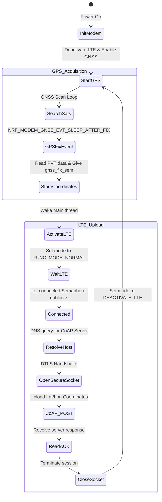

# Lesson 8: Capstone Project - Simple Cellular Tracker

This document describes the capstone project of the course: a **Simple Cellular Asset Tracker**. It demonstrates the design pattern of combining GNSS positioning, dynamic modem state-switching (GPS-First logic), DTLS security, and CoAP POST payload updates to upload coordinates while maximizing battery life.

---

## 📋 Objectives
*   **System Integration:** Combine GPS positioning, LTE connectivity, and secure socket layers into a single robust application.
*   **GPS-First Operation:** Deactivate the LTE transmitter during GPS scanning to avoid RF noise interference and accelerate satellite acquisition.
*   **Dynamic Mode Switching:** Dynamically switch the modem between `LTE_LC_FUNC_MODE_DEACTIVATE_LTE` (GPS mode) and `LTE_LC_FUNC_MODE_NORMAL` (LTE transmit mode).
*   **Multi-Semaphore Coordination:** Use multiple semaphores (`lte_connected` and `gnss_fix_sem`) to manage state transitions across tasks.
*   **Payload Formatting & Transmission:** Format float coordinates (Latitude, Longitude) and accuracy parameters into a CoAP POST payload and transmit it over a secure DTLS channel.

---

## 🏗️ State Machine and Operational Flow



---

## ⚙️ Configuration Setup (`prj.conf`)

Compile configuration settings combining GNSS, low-power features, DTLS, and CoAP modules:

```ini
# Logging and LED libraries
CONFIG_LOG=y
CONFIG_DK_LIBRARY=y

# Networking Stack
CONFIG_NETWORKING=y
CONFIG_NET_NATIVE=n
CONFIG_NET_SOCKETS=y
CONFIG_NET_SOCKETS_OFFLOAD=y

# Memory Configurations
CONFIG_HEAP_MEM_POOL_SIZE=4096
CONFIG_MAIN_STACK_SIZE=4096

# Modem and Cryptography Libraries
CONFIG_NRF_MODEM_LIB=y
CONFIG_MODEM_KEY_MGMT=y
CONFIG_LTE_LINK_CONTROL=y

# Power Management Module Wrappers
CONFIG_LTE_LC_EDRX_MODULE=y
CONFIG_LTE_LC_PSM_MODULE=y
CONFIG_LTE_EDRX_REQ=y
CONFIG_LTE_PSM_REQ=y

# CoAP and DTLS Configuration
CONFIG_COAP=y
CONFIG_COAP_SERVER_HOSTNAME="californium.eclipseprojects.io"
CONFIG_COAP_POST_RESOURCE="tracker"
CONFIG_COAP_SERVER_PORT=5684

# Tracker Application Version
CONFIG_TRACKER_VERSION_MAJOR=1
CONFIG_TRACKER_VERSION_MINOR=0
CONFIG_TRACKER_VERSION_PATCH=0
CONFIG_TRACKER_PERIODIC_INTERVAL=120  # GPS search interval in seconds
CONFIG_TRACKER_PERIODIC_TIMEOUT=60    # GPS scan timeout in seconds
```

---

## 💻 Code Highlights (`src/main.c`)

### 1. State Semaphores & PVT Buffers
```c
#include <nrf_modem_gnss.h>
#include <zephyr/net/coap.h>

static K_SEM_DEFINE(lte_connected, 0, 1);
static K_SEM_DEFINE(gnss_fix_sem, 0, 1);

static struct nrf_modem_gnss_pvt_data_frame current_pvt;
static struct nrf_modem_gnss_pvt_data_frame last_pvt;
```

### 2. GNSS Event Callback Handler
```c
static void gnss_event_handler(int event)
{
	int err;
	switch (event) {
	case NRF_MODEM_GNSS_EVT_PVT:
		LOG_INF("Searching for GNSS Satellites...");
		break;
	case NRF_MODEM_GNSS_EVT_SLEEP_AFTER_FIX:
		LOG_INF("GNSS fix achieved!");
		err = nrf_modem_gnss_read(&last_pvt, sizeof(last_pvt), NRF_MODEM_GNSS_DATA_PVT);
		if (err == 0){
			current_pvt = last_pvt;
			k_sem_give(&gnss_fix_sem); // Signal main thread that GPS coordinates are ready
		}
		break;
	case NRF_MODEM_GNSS_EVT_SLEEP_AFTER_TIMEOUT:
		LOG_WRN("GNSS search timeout reached without lock");
		break;
	}
}
```

### 3. Connection and Coordinate Upload (CoAP POST)
```c
static uint8_t coap_buf[APP_COAP_MAX_MSG_LEN];
static uint8_t coap_sendbug[64];

static int client_post_send(void)
{
	int err, ret;
	struct coap_packet request;
	next_token++;

	err = coap_packet_init(&request, coap_buf, sizeof(coap_buf),
			       APP_COAP_VERSION, COAP_TYPE_CON,
			       sizeof(next_token), (uint8_t *)&next_token,
			       COAP_METHOD_POST, coap_next_id());
	if (err < 0) return err;

	err = coap_packet_append_option(&request, COAP_OPTION_URI_PATH,
					(uint8_t *)CONFIG_COAP_POST_RESOURCE,
					strlen(CONFIG_COAP_POST_RESOURCE));
	if (err < 0) return err;

	err = coap_append_option_int(&request, COAP_OPTION_CONTENT_FORMAT,
                                 COAP_CONTENT_FORMAT_TEXT_PLAIN);
	if (err < 0) return err;

	/* Append the plain text formatted coordinates */
	ret = snprintf(coap_sendbug, sizeof(coap_sendbug), "%.06f,%.06f",
                   current_pvt.latitude, current_pvt.longitude);
	
	err = coap_packet_append_payload_marker(&request);
	err = coap_packet_append_payload(&request, (uint8_t *)coap_sendbug, ret);
	if (err < 0) return err;

	err = zsock_send(sock, request.data, request.offset, 0);
	return err;
}
```

### 4. Main Application Loop (The State Machine)
```c
int main(void)
{
	int err, received;

	dk_leds_init();
	modem_configure();     // Prepares DTLS credentials & offline status
	gnss_init_and_start(); // Registers callback and starts GNSS engine

	while (1) {
		/* 1. Wait for GPS fix */
		k_sem_take(&gnss_fix_sem, K_FOREVER);

		/* 2. Switch modem to online LTE mode to upload coordinates */
		err = lte_lc_func_mode_set(LTE_LC_FUNC_MODE_NORMAL);
		if (err) {
			LOG_ERR("Failed to enable LTE");
			break;
		}

		/* 3. Wait until network registration completes */
		k_sem_take(&lte_connected, K_FOREVER);

		/* 4. Resolve address and initiate connection */
		server_resolve();
		server_connect(); // Performs DTLS handshake

		/* 5. Transmit formatted CoAP payload */
		client_post_send();

		/* 6. Read Server ACK Response */
		received = zsock_recv(sock, coap_buf, sizeof(coap_buf), 0);
		if (received > 0) {
			client_handle_get_response(coap_buf, received);
		}

		/* 7. Close Socket and revert to GPS mode */
		zsock_close(sock);
		err = lte_lc_func_mode_set(LTE_LC_FUNC_MODE_DEACTIVATE_LTE);
		if (err) {
			LOG_ERR("Failed to deactivate LTE");
			break;
		}
	}
	return 0;
}
```

---

## 🔍 Verification & Debugging
1.  Verify the GPS antenna and active LTE-M SIM card are installed on the board.
2.  Power on the board and connect to a serial monitor at `115200` baud.
3.  Ensure the device starts searching for satellites: `Starting GNSS...` and `Searching for GNSS Satellites...`.
4.  Once a valid satellite fix occurs, the logs will show:
    *   `GNSS fix achieved!`
    *   `Latitude: <lat>, Longitude: <lon>`
5.  Immediately after, the modem activates LTE:
    *   `Network registration status: Connected`
    *   `Sending Data over LTE`
    *   `CoAP request sent: token 0x1234`
6.  The server validates the payload and returns an acknowledgment: `CoAP response: Code 0x44, Token 0x3412, Payload: ACK`.
7.  The board logs `RRC mode: Idle`, deactivates the LTE transmitter, and returns to searching for satellite signals, completing the cycle.
