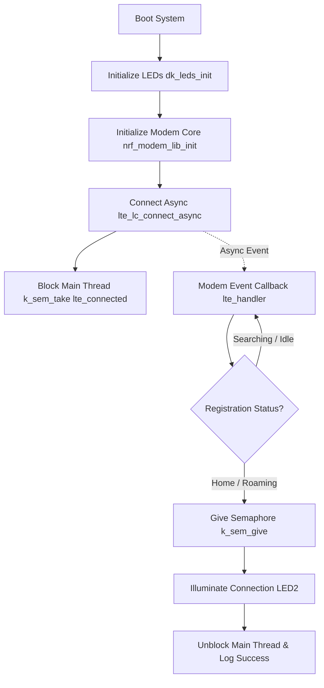
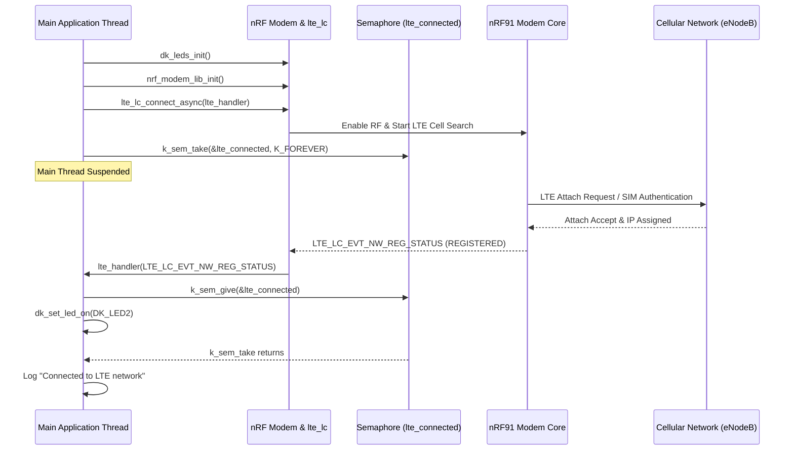
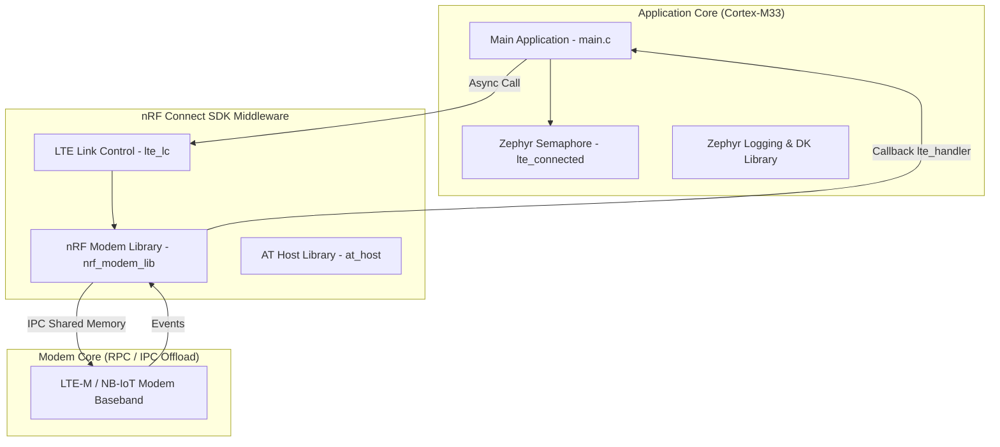

# Lesson 2: Getting a Cellular Connection (LTE-M / NB-IoT)

Comprehensive documentation for **Lesson 2 (`l2_LTE`)** of the Cellular IoT Fundamentals course. This lesson covers modem initialization, asynchronous network registration over LTE-M/NB-IoT using the **LTE Link Controller (`lte_lc`)** library, thread synchronization using Zephyr semaphores, and serial AT command interface debugging.

---

## 🚀 Features & Exercises

* **`l2_e2`**: Base application implementing asynchronous LTE network attachment using `nrf_modem_lib_init()` and `lte_lc_connect_async()`.
* **`l2_e2_sol`**: Reference solution with full event handling, LED status signals, and AT host command interface enabled.

---

## 🏗️ System Operation Principles

### 1. Core Flow Diagram


### 2. Data Flow & Sequence Diagram


### 3. Technical Architecture Diagram


---

## 📋 Prerequisites & Tools

* **Hardware**: Nordic nRF9160 DK, nRF9161 DK, Thingy:91, or Thingy:91X.
* **SIM Card**: Active nano-SIM supporting LTE-M or NB-IoT.
* **Software**:
  * nRF Connect SDK v3.3.0 / v3.4.0
  * VS Code with nRF Connect Extension Pack
  * LTE Link Monitor (nRF Connect for Desktop)

---

## ⚙️ Configuration Documentation (`prj.conf`)

| Kconfig Symbol | Status | Default | Purpose & Description |
| :--- | :--- | :--- | :--- |
| `CONFIG_LOG` | Required | `y` | Enables Zephyr logging infrastructure. |
| `CONFIG_DK_LIBRARY` | Required | `y` | Enables Board Support Package (BSP) for DK buttons and LEDs. |
| `CONFIG_NETWORKING` | Required | `y` | Enables networking stack interface. |
| `CONFIG_NET_NATIVE` | Required | `n` | Disables native Zephyr TCP/IP stack in favor of modem offloading. |
| `CONFIG_NET_SOCKETS` | Required | `y` | Enables BSD Socket API support. |
| `CONFIG_NET_SOCKETS_OFFLOAD` | Required | `y` | Offloads socket calls directly to the nRF91 modem core. |
| `CONFIG_NRF_MODEM_LIB` | Required | `y` | Link nRF Modem driver library (`nrf_modem_lib`). |
| `CONFIG_LTE_LINK_CONTROL` | Required | `y` | Enables high-level LTE link controller library (`lte_lc`). |
| `CONFIG_AT_HOST_LIBRARY` | Optional | `y` | Enables UART AT command host for direct modem serial interaction. |
| `CONFIG_UART_INTERRUPT_DRIVEN`| Optional | `y` | Enables UART interrupt driver required for AT Host interface. |

---

## 🛠️ Step-by-Step Build & Flash Instructions

### Step 1: Open Target Exercise
Open VS Code and navigate to [`l2_LTE/l2_e2`](file:///Users/faiisu/projects.nosync/senier-project/workspace/l2_LTE/l2_e2).

### Step 2: Build Application
Run the build command for your target board via terminal:
```bash
# Build for nRF9160 DK
west build -b nrf9160dk/nrf9160/ns l2_LTE/l2_e2

# Or build for nRF9161 DK
west build -b nrf9161dk/nrf9161/ns l2_LTE/l2_e2
```

### Step 3: Flash Board
Connect your board via USB, power it on, and execute:
```bash
west flash
```

### Step 4: Verify Operation
1. Launch **LTE Link Monitor** (or serial terminal at `115200` baud rate).
2. Expected UART Log Output:
   ```text
   *** Booting nRF Connect SDK *
   [00:00:00.294] <inf> Lesson2_Exercise2: Initializing modem library
   [00:00:00.562] <inf> Lesson2_Exercise2: Connecting to LTE network
   [00:00:01.589] <inf> Lesson2_Exercise2: RRC mode: Connected
   [00:00:03.935] <inf> Lesson2_Exercise2: Network registration status: Connected - roaming
   [00:00:03.935] <inf> Lesson2_Exercise2: Connected to LTE network
   ```
3. Confirm that **LED2** on the board illuminates solid green upon connection.

---

## 🔍 Serial AT Command Verification

With `CONFIG_AT_HOST_LIBRARY=y` enabled, send AT commands via LTE Link Monitor terminal:
* `AT+CFUN?`: Check functional mode (`1` = Full functionality).
* `AT+CESQ`: Query signal strength (RRP, RSRQ, SINR).
* `AT+CEREG?`: Query network registration state.
