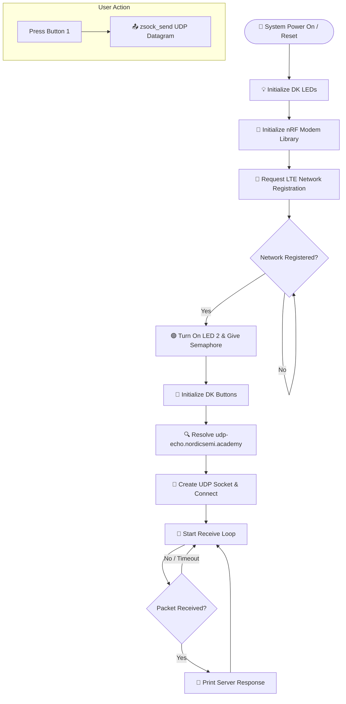
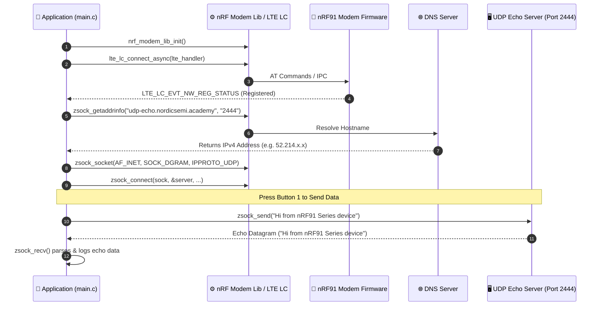
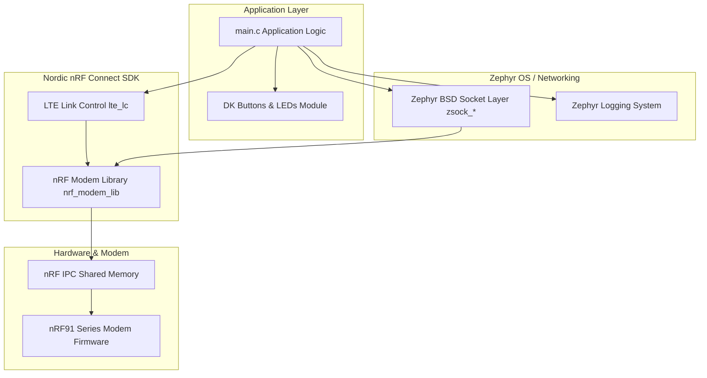

# Lesson 3: nRF Modem Library & BSD Sockets API (`l3_nRF_modem_lib`)

A hands-on cellular IoT application demonstrating how to initialize the **nRF Modem Library**, establish an LTE connection using **LTE Link Control**, resolve DNS addresses, and send/receive UDP datagrams using Zephyr's **BSD Sockets API** on Nordic nRF91 Series devices.

---

## 🌟 Features

- **nRF Modem Library Initialization**: Configures and initializes the cellular modem firmware interface.
- **Asynchronous LTE Connection**: Registers to home or roaming cellular networks using `lte_lc_connect_async()`.
- **DNS Server Resolution**: Resolves hostnames (e.g., `udp-echo.nordicsemi.academy`) to IPv4 addresses using `zsock_getaddrinfo()`.
- **BSD UDP Socket API**: Creates and connects non-blocking/blocking UDP sockets (`zsock_socket`, `zsock_connect`, `zsock_send`, `zsock_recv`).
- **Interactive Button Trigger**: Transmits UDP datagram messages when Button 1 is pressed on the board (`DK_BTN1_MSK`).
- **Real-time Echo Reception**: Listens for incoming server response packets and displays them via Zephyr logging (`LOG_INF`).

---

## 📐 System Operation Principles

### 1. Core Workflow Diagram



### 2. Data Flow Diagram



### 3. Technical Architecture Diagram



---

## 🚀 Quick Start (Step by Step)

### Step 1: Prerequisites

Before building and flashing, ensure you have the following installed:

- **nRF Connect SDK (NCS)** v2.x or v3.x (Installed via nRF Connect Toolchain Manager)
- **Zephyr Toolchain** (`west` meta-tool)
- **Nordic nRF9160 DK**, **Thingy:91**, or equivalent nRF91 Series Development Kit
- SIM Card with active Cellular IoT (LTE-M or NB-IoT) data plan

### Step 2: Open Terminal / Environment

Open the nRF Connect Toolchain terminal or initialize your environment:

```bash
# Example for macOS / Linux
source ~/ncs/zephyr/zephyr-env.sh
```

### Step 3: Navigate to Project Directory

```bash
cd l3_nRF_modem_lib/l3_e1
```

### Step 4: Build the Project

Build the exercise application for your target board (e.g., `nrf9160dk_nrf9160_ns`):

```bash
west build -b nrf9160dk_nrf9160_ns
```

*For Thingy:91:*
```bash
west build -b thingy91_nrf9160_ns
```

### Step 5: Flash to Target Board

Connect your board via USB and run:

```bash
west flash
```

### Step 6: Verify System Operation

Open a serial terminal (e.g., SEGGER RTT Viewer or serial monitor at 115200 baud):

1. **Observe Startup Logs**:
   ```text
   <inf> Lesson3_Exercise1: Initializing modem library
   <inf> Lesson3_Exercise1: Connecting to LTE network
   <inf> Lesson3_Exercise1: Network registration status: Connected - home network
   <inf> Lesson3_Exercise1: Connected to LTE network
   <inf> Lesson3_Exercise1: IPv4 Address found 52.214.246.103
   <inf> Lesson3_Exercise1: Successfully connected to server
   <inf> Lesson3_Exercise1: Press button 1 on your DK or Thingy:91 to send your message
   ```
2. **Press Button 1**:
   ```text
   <inf> Lesson3_Exercise1: Successfully sent message: Hi from nRF91 Series device
   <inf> Lesson3_Exercise1: Data received from the server: (Hi from nRF91 Series device)
   ```

---

## ⚙️ Configuration (`prj.conf`)

The application is configured using Zephyr Kconfig parameters in [`prj.conf`](file:///Users/faiisu/projects.nosync/senier-project/workspace/l3_nRF_modem_lib/l3_e1/prj.conf):

```ini
# ========================================
# Logging & User Interface
# ========================================
CONFIG_LOG=y
CONFIG_DK_LIBRARY=y

# ========================================
# Zephyr Networking & BSD Socket Offload
# ========================================
CONFIG_NETWORKING=y
CONFIG_NET_NATIVE=n
CONFIG_NET_SOCKETS=y
CONFIG_NET_SOCKETS_OFFLOAD=y

# ========================================
# Memory Resources
# ========================================
CONFIG_HEAP_MEM_POOL_SIZE=4096
CONFIG_MAIN_STACK_SIZE=4096

# ========================================
# Nordic Modem & LTE Subsystems
# ========================================
CONFIG_NRF_MODEM_LIB=y
CONFIG_LTE_LINK_CONTROL=y
```

### Options Breakdown

| Parameter | Type | Default / Value | Required? | Description |
|---|---|---|---|---|
| `CONFIG_LOG` | boolean | `y` | ✅ Required | Enables Zephyr logging backend. |
| `CONFIG_DK_LIBRARY` | boolean | `y` | ✅ Required | Provides button and LED abstractions. |
| `CONFIG_NETWORKING` | boolean | `y` | ✅ Required | Enables Zephyr networking stack framework. |
| `CONFIG_NET_NATIVE` | boolean | `n` | ✅ Required | Disables native network stack in favor of modem offload. |
| `CONFIG_NET_SOCKETS` | boolean | `y` | ✅ Required | Enables BSD Sockets API layer (`<zephyr/net/socket.h>`). |
| `CONFIG_NET_SOCKETS_OFFLOAD` | boolean | `y` | ✅ Required | Routes BSD socket API calls directly to nRF Modem Library. |
| `CONFIG_NRF_MODEM_LIB` | boolean | `y` | ✅ Required | Initializes `nrf_modem_lib` for cellular modem IPC. |
| `CONFIG_LTE_LINK_CONTROL` | boolean | `y` | ✅ Required | Provides LTE network registration control API. |

---

## 🛠️ Tech Stack

- **Language**: C (C99 standard)
- **Framework / RTOS**: Zephyr RTOS & Nordic nRF Connect SDK (NCS)
- **Hardware Platform**: Nordic Semiconductor nRF9160 / nRF9161 Cellular SiP
- **Protocols**: Cellular LTE-M / NB-IoT, UDP, DNS
- **Build System**: CMake & `west`

---

## 📁 Project Structure

```text
l3_nRF_modem_lib/
├── README.md               # Complete Project & Exercise Documentation
├── l3_e1/                  # Exercise 1 Starter Project (Completed)
│   ├── CMakeLists.txt      # Build system configuration
│   ├── prj.conf            # Kconfig parameters
│   ├── sample.yaml         # Test runner metadata
│   └── src/
│       └── main.c          # Application source code
└── l3_e1_sol/              # Exercise 1 Reference Solution
    ├── CMakeLists.txt
    ├── prj.conf
    ├── sample.yaml
    └── src/
        └── main.c
```

---

## 💡 Important Notes & Troubleshooting

> [!TIP]
> If network registration takes more than 30 seconds, ensure your antenna is firmly connected and your SIM card is activated.

> [!WARNING]
> Always build with non-secure board targets (ending with `_ns`, e.g., `nrf9160dk_nrf9160_ns`) because the nRF Modem Library requires SPM / TF-M secure domain separation.

> [!NOTE]
> `udp-echo.nordicsemi.academy` operates on UDP port 2444. Ensure firewalls or SIM provider restrictions do not block outbound UDP traffic on port 2444.

---

## 📜 License

Copyright (c) 2022 Nordic Semiconductor ASA.  
SPDX-License-Identifier: LicenseRef-Nordic-5-Clause
