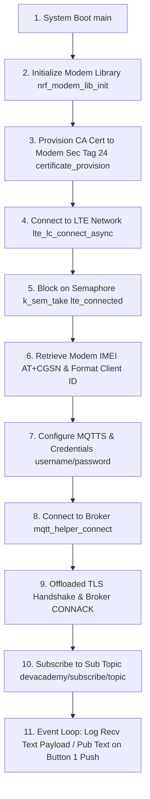
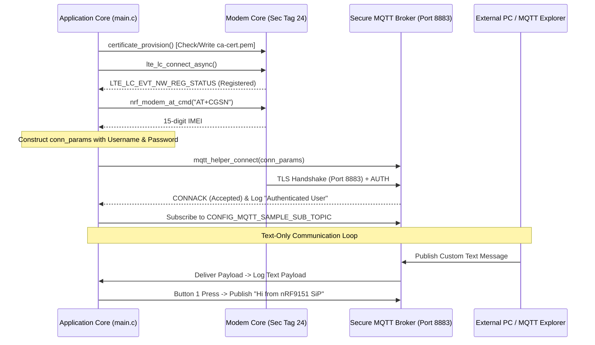
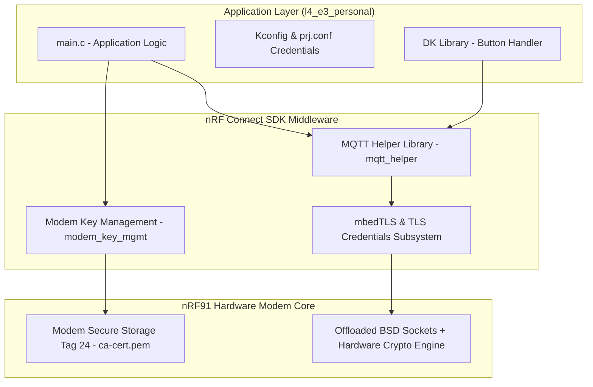

# Lesson 4 Exercise 3 (Personal): Secure MQTTS with Username & Password Authentication

Dedicated documentation for **Lesson 4 Exercise 3 Personal (`l4_e3_personal`)**. This exercise extends Nordic's MQTTS sample by implementing **client username & password authentication**, **TLS encrypted communication (port 8883)** using modem certificate flash provisioning (security tag 24), and **text-only MQTT payload handling** (hardware LED control disabled).

---

## 📋 Features Overview

* **🔒 TLS Encryption (MQTTS)**: Encrypts all network traffic on port `8883` using mbedTLS and socket offloading.
* **🔑 Client Authentication**: Supports MQTT username and password authentication via `CONFIG_MQTT_SAMPLE_USERNAME` and `CONFIG_MQTT_SAMPLE_PASSWORD`.
* **🏷️ Secure Flash Tag 24**: Provisions the server CA root certificate (`ca-cert.pem`) directly to nRF91 modem flash during offline boot.
* **🆔 Dynamic IMEI Client ID**: Retrieves modem IMEI (`AT+CGSN`) to generate a unique Client ID (`nrf-<IMEI>`).
* **💬 Text-Only Messaging**: Disabled hardware LED triggers. Received payloads are logged directly as text, and Button 1 publishes `"Hi from nRF9151 SiP"` over MQTT.

---

## 🏗️ System Operation Principles

### 1. Core Execution Flow Diagram


### 2. MQTTS Data Flow & Sequence Diagram


### 3. Technical Architecture Diagram


---

## ⚙️ Configuration Documentation

### 1. Project Configuration (`prj.conf`)

```ini
# Logging and Button Support
CONFIG_LOG=y
CONFIG_DK_LIBRARY=y

# Networking Stack & Modem Offloading
CONFIG_NETWORKING=y
CONFIG_NET_NATIVE=n
CONFIG_NET_SOCKETS=y
CONFIG_NET_SOCKETS_OFFLOAD=y

# System Memory Allocation
CONFIG_MAIN_STACK_SIZE=4096
CONFIG_HEAP_MEM_POOL_SIZE=2048

# Modem Library & LTE Control
CONFIG_NRF_MODEM_LIB=y
CONFIG_LTE_LINK_CONTROL=y
CONFIG_LTE_NETWORK_MODE_LTE_M_NBIOT=y

# MQTT Helper Library
CONFIG_MQTT_HELPER=y
CONFIG_MQTT_CLEAN_SESSION=y
CONFIG_MQTT_SAMPLE_PUB_TOPIC="devacademy/publish/topic"
CONFIG_MQTT_SAMPLE_SUB_TOPIC="devacademy/subscribe/topic"

# MQTTS TLS Configuration
CONFIG_MQTT_LIB_TLS=y
CONFIG_MBEDTLS=y
CONFIG_TLS_CREDENTIALS=y
CONFIG_MQTT_HELPER_SEC_TAG=24
CONFIG_MODEM_KEY_MGMT=y

# Broker Authentication Credentials
CONFIG_MQTT_SAMPLE_USERNAME="your_username"
CONFIG_MQTT_SAMPLE_PASSWORD="your_password"
```

### 2. Kconfig Options (`Kconfig`)

| Kconfig Symbol | Default Value | Description |
| :--- | :--- | :--- |
| `CONFIG_MQTT_SAMPLE_PUB_TOPIC` | `"devacademy/publish/topic"` | Topic string for device publications. |
| `CONFIG_MQTT_SAMPLE_SUB_TOPIC` | `"devacademy/subscribe/topic"` | Topic string for device subscriptions. |
| `CONFIG_MQTT_SAMPLE_BROKER_HOSTNAME` | `"mqtt.nordicsemi.academy"` | Domain name of the target MQTT broker. |
| `CONFIG_MQTT_SAMPLE_USERNAME` | `""` | Username credential for MQTT broker login. |
| `CONFIG_MQTT_SAMPLE_PASSWORD` | `""` | Password credential for MQTT broker login. |
| `CONFIG_MQTT_HELPER_SEC_TAG` | `24` | Security tag where the TLS CA certificate is stored on modem flash. |

---

## 🛠️ Step-by-Step Instructions

### Step 1: Prerequisites
- **Hardware**: nRF9160 DK, nRF9161 DK, Thingy:91, or Thingy:91X with an active SIM card.
- **Software**: nRF Connect SDK v3.3.0 or v3.4.0, VS Code with nRF Connect Extension, and [MQTT Explorer](https://mqtt-explorer.com/).

### Step 2: Configure Credentials
Open [`prj.conf`](file:///Users/faiisu/projects.nosync/senier-project/workspace/l4/l4_e3_personal/prj.conf) and update your broker authentication parameters:
```ini
CONFIG_MQTT_SAMPLE_USERNAME="your_actual_username"
CONFIG_MQTT_SAMPLE_PASSWORD="your_actual_password"
```

### Step 3: Build Application
Run the build command for your target board:
```bash
# For nRF9160 DK
west build -b nrf9160dk/nrf9160/ns l4/l4_e3_personal

# Or for nRF9161 DK
west build -b nrf9161dk/nrf9161/ns l4/l4_e3_personal
```

### Step 4: Flash Board
Connect the board via USB and flash:
```bash
west flash
```

### Step 5: Verify Serial Output
Open a serial terminal at `115200` baud. Expected output:
```text
*** Booting nRF Connect SDK *
[00:00:00.294] <inf> Lesson4_Exercise3_Personal: Initializing modem library
[00:00:00.562] <inf> Lesson4_Exercise3_Personal: Comparing credentials: Match
[00:00:01.589] <inf> Lesson4_Exercise3_Personal: RRC mode: Connected
[00:00:03.817] <inf> Lesson4_Exercise3_Personal: Network registration status: Connected - roaming
[00:00:03.817] <inf> Lesson4_Exercise3_Personal: Connected to LTE network
[00:00:06.305] <inf> Lesson4_Exercise3_Personal: Connected to MQTT broker
[00:00:06.305] <inf> Lesson4_Exercise3_Personal: Hostname: mqtt.nordicsemi.academy
[00:00:06.305] <inf> Lesson4_Exercise3_Personal: Client ID: nrf-355025930008030
[00:00:06.305] <inf> Lesson4_Exercise3_Personal: Port: 8883
[00:00:06.305] <inf> Lesson4_Exercise3_Personal: TLS: Yes
[00:00:06.305] <inf> Lesson4_Exercise3_Personal: Authenticated User: your_username
[00:00:06.305] <inf> Lesson4_Exercise3_Personal: Subscribing to devacademy/subscribe/topic
```

---

## 🔍 Verification & MQTT Explorer Test Guide

1. Launch **MQTT Explorer**.
2. Configure a new connection:
   - **Host**: `mqtt.nordicsemi.academy`
   - **Port**: `8883`
   - **Encryption (TLS)**: Enabled
   - **CA Certificate**: Add [`credentials/ca-cert.pem`](file:///Users/faiisu/projects.nosync/senier-project/workspace/l4/l4_e3_personal/credentials/ca-cert.pem) under Advanced $\rightarrow$ Certificates.
   - **Username & Password**: Enter matching credentials configured in `prj.conf`.
3. Click **Connect**.
4. **Test Receiving**: Publish a text message (e.g. `"Hello nRF91"`) to `devacademy/subscribe/topic`. Observe the payload logged in serial output.
5. **Test Publishing**: Press **Button 1** on the board. Confirm that `"Hi from nRF9151 SiP"` is received in MQTT Explorer under `devacademy/publish/topic`.

---

## 💡 Troubleshooting & Notes

* ⚠️ **Connection Refused (Return Code 4 or 5)**: Verify username and password in `prj.conf`.
* 💡 **TLS Handshake Failures**: Ensure `ca-cert.pem` matches the broker certificate and is provisioned while modem is in offline mode.
