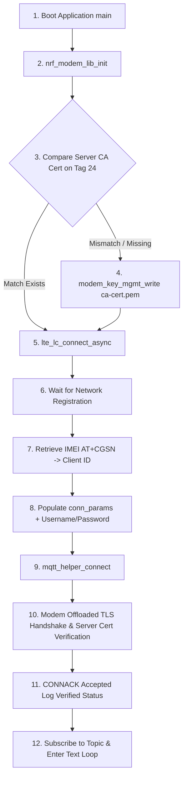

# Lesson 4 Exercise 3 (Personal Server Cert): MQTTS with Server Certificate Verification & User Login

Dedicated documentation for **`l4_e3_personal_server_cert`**. This version enforces **TLS Server Certificate Chain Verification** using the server root CA certificate (`ca-cert.pem`) provisioned to modem flash security tag `24`, combined with **MQTT Username and Password client authentication**.

---

## 📋 Features Overview

* **🛡️ Server Certificate Verification**: Validates server identity (`mqtt.nordicsemi.academy`) via CA Root Chain (`MODEM_KEY_MGMT_CRED_TYPE_CA_CHAIN`) stored on Modem Flash Tag `24`.
* **🔑 Username & Password Authentication**: Client authenticates using credentials configured in `CONFIG_MQTT_SAMPLE_USERNAME` and `CONFIG_MQTT_SAMPLE_PASSWORD`.
* **🔒 Encrypted MQTTS (Port 8883)**: Socket offloaded TLS 1.2/1.3 session encryption.
* **🏷️ Wear-Leveling Cert Check**: Checks `modem_key_mgmt_cmp` before writing to prevent flash wear.
* **💬 Text-Only Messaging**: Log incoming text messages directly and publish text on Button 1 triggers.

---

## 🏗️ System Architecture



---

## ⚙️ Configuration Setup (`prj.conf`)

```ini
# Logging and Buttons
CONFIG_LOG=y
CONFIG_DK_LIBRARY=y

# Networking Stack & Modem Offloading
CONFIG_NETWORKING=y
CONFIG_NET_NATIVE=n
CONFIG_NET_SOCKETS_OFFLOAD=y
CONFIG_NET_SOCKETS=y

# Memory Allocation
CONFIG_MAIN_STACK_SIZE=4096
CONFIG_HEAP_MEM_POOL_SIZE=2048

# Modem & LTE Control
CONFIG_NRF_MODEM_LIB=y
CONFIG_LTE_LINK_CONTROL=y
CONFIG_LTE_NETWORK_MODE_LTE_M_NBIOT=y

# MQTT Helper Configuration
CONFIG_MQTT_HELPER=y
CONFIG_MQTT_CLEAN_SESSION=y
CONFIG_MQTT_SAMPLE_PUB_TOPIC="devacademy/publish/topic"
CONFIG_MQTT_SAMPLE_SUB_TOPIC="devacademy/subscribe/topic"

# MQTTS TLS & Server Certificate Validation
CONFIG_MQTT_LIB_TLS=y
CONFIG_MBEDTLS=y
CONFIG_TLS_CREDENTIALS=y
CONFIG_MQTT_HELPER_SEC_TAG=24
CONFIG_MODEM_KEY_MGMT=y

# Broker Authentication Credentials
CONFIG_MQTT_SAMPLE_USERNAME="your_username"
CONFIG_MQTT_SAMPLE_PASSWORD="your_password"
```

---

## 🛠️ Step-by-Step Instructions

### Step 1: Build & Flash
```bash
# Build for nRF9160 DK
west build -b nrf9160dk/nrf9160/ns l4/l4_e3_personal_server_cert

# Flash binary to board
west flash
```

### Step 2: Verification Logs
Open serial terminal at `115200` baud:
```text
*** Booting nRF Connect SDK *
[00:00:00.294] <inf> Lesson4_Exercise3_Personal_ServerCert: Initializing modem library
[00:00:00.562] <inf> Lesson4_Exercise3_Personal_ServerCert: Comparing server CA credentials: Match
[00:00:01.589] <inf> Lesson4_Exercise3_Personal_ServerCert: RRC mode: Connected
[00:00:03.817] <inf> Lesson4_Exercise3_Personal_ServerCert: Network registration status: Connected - roaming
[00:00:03.817] <inf> Lesson4_Exercise3_Personal_ServerCert: Connected to LTE network
[00:00:06.305] <inf> Lesson4_Exercise3_Personal_ServerCert: Connected to MQTT broker (MQTTS TLS)
[00:00:06.305] <inf> Lesson4_Exercise3_Personal_ServerCert: Hostname: mqtt.nordicsemi.academy
[00:00:06.305] <inf> Lesson4_Exercise3_Personal_ServerCert: Port: 8883
[00:00:06.305] <inf> Lesson4_Exercise3_Personal_ServerCert: TLS: Yes (Sec Tag 24)
[00:00:06.305] <inf> Lesson4_Exercise3_Personal_ServerCert: Server Certificate: Verified (CA Chain)
[00:00:06.305] <inf> Lesson4_Exercise3_Personal_ServerCert: Authenticated User: your_username
```
