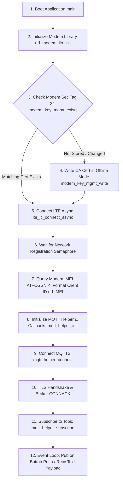
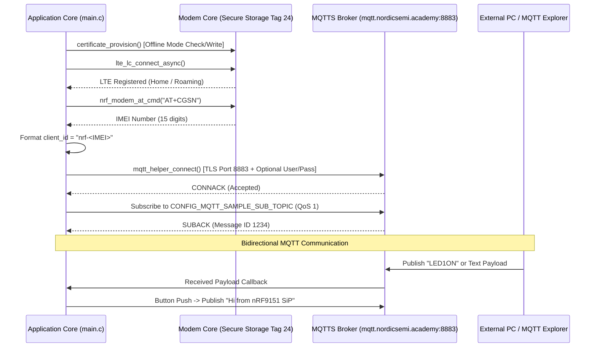
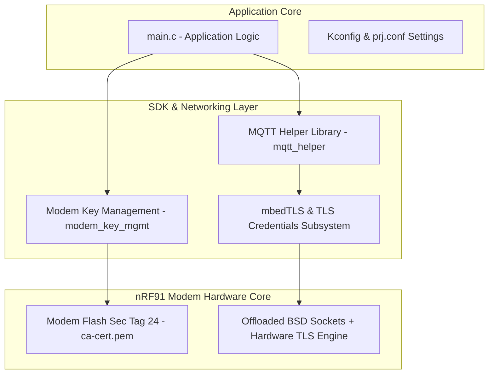

# Lesson 4: Application Layer Protocols — MQTT, MQTTS (TLS), & Authenticated MQTT

Comprehensive documentation for **Lesson 4 (`l4`)** of the Cellular IoT Fundamentals course. This lesson covers MQTT communication using Nordic's **MQTT Helper (`mqtt_helper`)** library, IMEI-based dynamic Client ID generation (`AT+CGSN`), secure Transport Layer Security (TLS) certificate provisioning to nRF91 modem flash, and username/password client authentication.

---

## 🚀 Exercises Overview

| Exercise | Security | Broker Port | Client Authentication | Key Features |
| :--- | :--- | :--- | :--- | :--- |
| **[`l4_e1`](file:///Users/faiisu/projects.nosync/senier-project/workspace/l4/l4_e1)** | Plaintext (No TLS) | `1883` | None | Basic MQTT pub/sub, IMEI client ID, button & LED trigger. |
| **[`l4_e1_sol`](file:///Users/faiisu/projects.nosync/senier-project/workspace/l4/l4_e1_sol)** | Plaintext (No TLS) | `1883` | None | Exercise 1 canonical reference solution. |
| **[`l4_e2`](file:///Users/faiisu/projects.nosync/senier-project/workspace/l4/l4_e2)** | Encrypted MQTTS (TLS) | `8883` | Server Certificate | CA root cert (`ca-cert.pem`) provisioned to modem security tag `24`. |
| **[`l4_e2_sol`](file:///Users/faiisu/projects.nosync/senier-project/workspace/l4/l4_e2_sol)** | Encrypted MQTTS (TLS) | `8883` | Server Certificate | Exercise 2 canonical reference solution. |
| **[`l4_e3_personal`](file:///Users/faiisu/projects.nosync/senier-project/workspace/l4/l4_e3_personal)** | Encrypted MQTTS (TLS) | `8883` | **Username & Password** | Custom broker credentials (`user_name`, `password`), text messaging over MQTT. |

---

## 🏗️ System Operation Principles

### 1. System Execution & MQTTS Connection Flow


### 2. MQTTS Data Flow & Sequence Diagram


### 3. Technical Architecture Diagram


---

## ⚙️ Configuration Documentation (`prj.conf`)

| Kconfig Symbol | `l4_e1` | `l4_e2` | `l4_e3_personal` | Purpose & Description |
| :--- | :---: | :---: | :---: | :--- |
| `CONFIG_MQTT_HELPER` | `y` | `y` | `y` | Enables Nordic MQTT helper library. |
| `CONFIG_MQTT_CLEAN_SESSION` | `y` | `y` | `y` | Disables persistent MQTT sessions. |
| `CONFIG_MQTT_LIB_TLS` | `n` | `y` | `y` | Enables TLS encryption (switches port to `8883`). |
| `CONFIG_MBEDTLS` | `n` | `y` | `y` | Enables mbedTLS library for crypto operations. |
| `CONFIG_TLS_CREDENTIALS` | `n` | `y` | `y` | Enables socket API TLS credential storage. |
| `CONFIG_MODEM_KEY_MGMT` | `n` | `y` | `y` | Enables modem flash security key storage driver. |
| `CONFIG_MQTT_HELPER_SEC_TAG` | — | `24` | `24` | Modem flash security tag for CA certificate. |
| `CONFIG_MQTT_SAMPLE_USERNAME` | — | — | `"username"` | Username credential for broker authentication. |
| `CONFIG_MQTT_SAMPLE_PASSWORD` | — | — | `"password"` | Password credential for broker authentication. |

---

## 🛠️ Step-by-Step Instructions

### 1. Build and Flash `l4_e3_personal`
```bash
# Build for nRF9160 DK
west build -b nrf9160dk/nrf9160/ns l4/l4_e3_personal

# Flash binary to board
west flash
```

### 2. Verify Output Logs
Open serial terminal (115200 baud). Expected boot logs:
```text
*** Booting nRF Connect SDK *
[00:00:00.294] <inf> Lesson4_Exercise3_Personal: Initializing modem library
[00:00:00.562] <inf> Lesson4_Exercise3_Personal: Comparing credentials: Match
[00:00:01.589] <inf> Lesson4_Exercise3_Personal: RRC mode: Connected
[00:00:03.817] <inf> Lesson4_Exercise3_Personal: Network registration status: Connected - roaming
[00:00:03.817] <inf> Lesson4_Exercise3_Personal: Connected to LTE network
[00:00:06.305] <inf> Lesson4_Exercise3_Personal: Connected to MQTT broker
[00:00:06.305] <inf> Lesson4_Exercise3_Personal: Hostname: mqtt.nordicsemi.academy
[00:00:06.305] <inf> Lesson4_Exercise3_Personal: Client ID: nrf-355025930008030
[00:00:06.305] <inf> Lesson4_Exercise3_Personal: Port: 8883
[00:00:06.305] <inf> Lesson4_Exercise3_Personal: TLS: Yes
[00:00:06.305] <inf> Lesson4_Exercise3_Personal: Authenticated User: your_username
[00:00:06.305] <inf> Lesson4_Exercise3_Personal: Subscribing to devacademy/subscribe/topic
```

### 3. Testing with MQTT Explorer
1. Connect **MQTT Explorer** to `mqtt.nordicsemi.academy` on port `8883` with TLS enabled using `ca-cert.pem`.
2. Enter your username and password under Connection Settings.
3. Publish a text payload to `devacademy/subscribe/topic`. Observe the payload printed in the serial terminal.
4. Press Button 1 on your board. Observe message `"Hi from nRF9151 SiP"` received in MQTT Explorer under `devacademy/publish/topic`.
