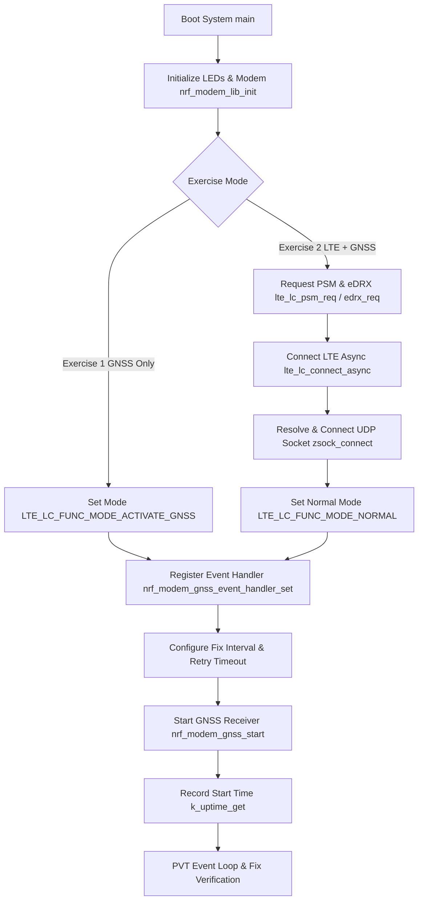
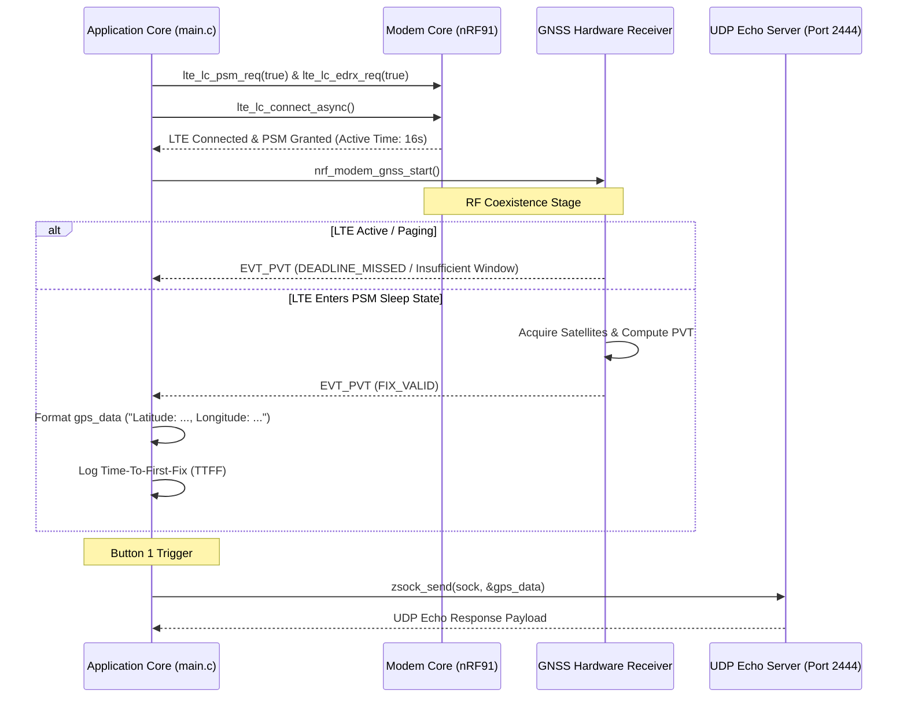
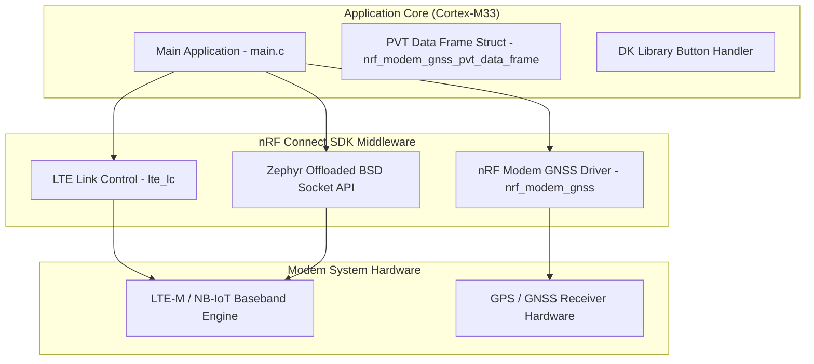

# Lesson 6: Requesting Location Using GNSS & UDP Telemetry

Comprehensive documentation for **Lesson 6 (`l6`)** of the Cellular IoT Fundamentals course. This lesson covers initializing and starting the GNSS receiver on nRF91 Series SiPs, handling Position, Velocity, and Time (PVT) data frames, measuring Time-To-First-Fix (TTFF), managing RF coexistence between LTE and GNSS, and sending GPS coordinates over UDP using Power Saving Mode (PSM) and extended Discontinuous Reception (eDRX).

---

## 🚀 Exercises Overview

| Exercise | Functional Mode | Network Support | Key Features |
| :--- | :--- | :--- | :--- |
| **[`l6_e1`](file:///Users/faiisu/projects.nosync/senier-project/workspace/l6/l6_e1)** | GNSS Only (`LTE_LC_FUNC_MODE_ACTIVATE_GNSS`) | Offline / GPS | Periodic GNSS fix search, PVT reading, TTFF measurement, satellite counting. |
| **[`l6_e1_sol`](file:///Users/faiisu/projects.nosync/senier-project/workspace/l6/l6_e1_sol)** | GNSS Only | Offline / GPS | Exercise 1 reference solution. |
| **[`l6_e2`](file:///Users/faiisu/projects.nosync/senier-project/workspace/l6/l6_e2)** | Normal Mode (`LTE_LC_FUNC_MODE_NORMAL`) | LTE-M/NB-IoT + GPS | Dual LTE & GNSS activity, PSM/eDRX coexistence, UDP socket coordinate transmission on Button 1. |
| **[`l6_e2_sol`](file:///Users/faiisu/projects.nosync/senier-project/workspace/l6/l6_e2_sol)** | Normal Mode | LTE-M/NB-IoT + GPS | Exercise 2 reference solution. |

---

## 🏗️ System Operation Principles

### 1. Core Execution Flow Diagram


### 2. LTE & GNSS Coexistence Sequence Diagram


### 3. Technical Architecture Diagram


---

## ⚙️ Configuration Documentation (`prj.conf` & `Kconfig`)

### 1. `prj.conf` Parameters

| Kconfig Symbol | Status | Default | Purpose & Description |
| :--- | :--- | :--- | :--- |
| `CONFIG_LOG` | Required | `y` | Enables Zephyr logging subsystem. |
| `CONFIG_DK_LIBRARY` | Required | `y` | Enables Button & LED BSP. |
| `CONFIG_NEWLIB_LIBC_FLOAT_PRINTF` | Required | `y` | Enables floating-point formatting (`%.06f`) in `LOG_INF` / `printf`. |
| `CONFIG_FPU` | Required | `y` | Enables Hardware Floating Point Unit. |
| `CONFIG_NRF_MODEM_LIB` | Required | `y` | Links nRF Modem library (includes GNSS driver). |
| `CONFIG_LTE_NETWORK_MODE_LTE_M_NBIOT_GPS`| Required | `y` | Configures modem system mode to support LTE-M, NB-IoT, and GPS. |
| `CONFIG_LTE_LC_EDRX_MODULE` | Required (Ex 2)| `y` | Enables eDRX driver module in Link Controller. |
| `CONFIG_LTE_LC_PSM_MODULE` | Required (Ex 2)| `y` | Enables PSM driver module in Link Controller. |
| `CONFIG_LTE_EDRX_REQ` | Required (Ex 2)| `y` | Requests eDRX operation from cellular network. |
| `CONFIG_LTE_PSM_REQ_RPTAU` | Required (Ex 2)| `"00101000"`| Requested Periodic TAU string (8 Hours). |
| `CONFIG_LTE_PSM_REQ_RAT` | Required (Ex 2)| `"00001000"`| Requested Active Time string (16 Seconds). |

### 2. Custom `Kconfig` Options

| Symbol | Range | Default | Purpose |
| :--- | :---: | :---: | :--- |
| `CONFIG_GNSS_PERIODIC_INTERVAL` | `10` - `65535` | `120` | Interval between periodic GPS fix attempts (in seconds). |
| `CONFIG_GNSS_PERIODIC_TIMEOUT` | `0` - `65535` | `480` | Maximum time allowed for GNSS receiver to obtain fix (in seconds). |

---

## 🛠️ Step-by-Step Instructions

### 1. Build and Flash Exercise 1 (`l6_e1`)
```bash
# Build for nRF9160 DK
west build -b nrf9160dk/nrf9160/ns l6/l6_e1

# Flash binary to board
west flash
```

### 2. Verify Exercise 1 Log Output
Place board outdoors under open sky. Terminal logs (115200 baud):
```text
*** Booting nRF Connect SDK ***
[00:00:00.234] <inf> Lesson6_Exercise1: Initializing modem library
[00:00:05.076] <inf> Lesson6_Exercise1: Activating GNSS
[00:00:05.078] <inf> Lesson6_Exercise1: Starting GNSS
[00:00:06.080] <inf> Lesson6_Exercise1: Searching...
[00:00:06.080] <inf> Lesson6_Exercise1: Number of current satellites: 7
[00:00:45.120] <inf> Lesson6_Exercise1: Latitude:       59.913868
[00:00:45.120] <inf> Lesson6_Exercise1: Longitude:      10.752245
[00:00:45.120] <inf> Lesson6_Exercise1: Altitude:       142.5 m
[00:00:45.120] <inf> Lesson6_Exercise1: Time (UTC):     13:45:12.000
[00:00:45.120] <inf> Lesson6_Exercise1: Time to first fix: 40 s
```

### 3. Build and Flash Exercise 2 (`l6_e2`)
```bash
# Build Exercise 2 with UDP Telemetry & PSM
west build -b nrf9160dk/nrf9160/ns l6/l6_e2

# Flash to board
west flash
```

### 4. Verify Exercise 2 Operation
1. Terminal shows LTE connection, UDP socket resolution (`udp-echo.nordicsemi.academy:2444`), and PSM parameter update (`TAU: 28800s, Active time: 16s`).
2. Once a valid fix is acquired, press **Button 1**.
3. Terminal logs:
   ```text
   [00:01:05.120] <inf> Lesson6_Exercise2: Data received from the server: (Latitude: 59.913868, Longitude: 10.752245)
   ```
