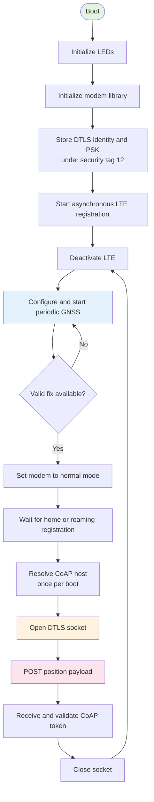

# Lesson 8 Solution: GNSS-to-CoAP Asset Tracker

`l8_sol` is the capstone application from the Cellular IoT Fundamentals course. It acquires periodic GNSS fixes, temporarily enables LTE-M or NB-IoT, and uploads the latest position to a CoAP server over DTLS. The application targets nRF91 Series devices with nRF Connect SDK (NCS) v3.3.0.

This is a teaching sample, not production-ready tracker firmware. Review [Known limitations](#known-limitations) before adapting it for deployment.

## Features

- GPS-first radio sequencing: LTE is deactivated while GNSS searches for a fix.
- Periodic GNSS fixes with configurable interval and retry timeout.
- Secure UDP transport using DTLS 1.2 and modem-stored PSK credentials.
- Confirmable CoAP `POST` messages containing coordinates, accuracy, and UTC time.
- Asynchronous LTE and GNSS callbacks coordinated with Zephyr semaphores.
- Status indication using DK LEDs and Button 1.
- Optional release configuration that disables logging and console features.

## Operation



The GNSS callback reads the PVT frame after `NRF_MODEM_GNSS_EVT_SLEEP_AFTER_FIX` and releases `gnss_fix_sem`. The main thread then enables LTE and waits for `lte_connected`, which is released only after home or roaming registration. After the server response, the socket is closed and LTE is deactivated before the next GNSS cycle.

The CoAP request is confirmable and has this shape:

```text
POST /<CONFIG_COAP_POST_RESOURCE>?keep
Content-Format: text/plain

<latitude>,<longitude>
<accuracy> m
<YYYY-MM-DD HH:MM:SS>
```

With the checked-in defaults, the resource path is `/echo?keep`. `CONFIG_COAP_DEVICE_NAME` is used as the DTLS PSK identity; it is not appended to the URI.

## Hardware and software requirements

- An nRF91 Series board listed in `sample.yaml`:
  - `nrf9151dk/nrf9151/ns`
  - `nrf9161dk/nrf9161/ns`
  - `nrf9160dk/nrf9160/ns`
  - `thingy91x/nrf9151/ns`
  - `thingy91/nrf9160/ns`
- An activated SIM with LTE-M or NB-IoT service and suitable cellular coverage.
- A GNSS antenna and an outdoor location with a clear view of the sky.
- nRF Connect SDK v3.3.0 and its toolchain, initialized as a west workspace.
- A serial terminal for development-build logs.
- A reachable CoAP-over-DTLS server with a matching PSK identity and key.

## Configure the application

Application-owned settings are defined in `Kconfig`. Select project values in `prj.conf`; do not hard-code deployment credentials in `src/main.c` or commit real PSKs.

| Setting | Checked-in value | Purpose |
| --- | --- | --- |
| `CONFIG_COAP_DEVICE_NAME` | `"<insert_name_here>"` in `prj.conf` | DTLS PSK identity; replace before use. |
| `CONFIG_COAP_POST_RESOURCE` | `"echo"` | CoAP URI path segment. |
| `CONFIG_COAP_SERVER_HOSTNAME` | `"californium.eclipseprojects.io"` | Remote CoAP server hostname. |
| `CONFIG_COAP_SERVER_PORT` | `5684` | Remote DTLS/CoAP port. |
| `CONFIG_COAP_SERVER_PSK` | Course sample value | DTLS pre-shared key written to modem security tag 12. |
| `CONFIG_TRACKER_PERIODIC_INTERVAL` | `120` | Seconds between periodic fixes; range `10` to `65535`. |
| `CONFIG_TRACKER_PERIODIC_TIMEOUT` | `600` | Seconds allowed for each fix; `0` means no timeout. |
| `CONFIG_GNSS_LOW_ACCURACY` | `n` | Allows faster fixes using looser accuracy criteria. |
| `CONFIG_GNSS_HIGH_ACCURACY_TIMING_SOURCE` | `n` | Uses TCXO timing instead of RTC at a power cost. |
| `CONFIG_TRACKER_VERSION_*` | `0.2.1` | Version printed at startup. |

At minimum, set a server-approved identity and PSK:

```ini
CONFIG_COAP_DEVICE_NAME="your-device-id"
CONFIG_COAP_SERVER_PSK="replace-with-server-provided-psk"
```

> [!WARNING]
> The checked-in identity and PSK are course/demo values. Never commit production credentials, passwords, certificates, or private keys. The server must be configured with exactly the same identity and PSK used by the device.

`prj.conf` enables the LTE Link Control PSM and eDRX modules so their events can be handled. The current source does not call `lte_lc_psm_req(true)` or `lte_lc_edrx_req(true)`, so it does not explicitly request either power-saving mode.

## Build and flash

Run these commands from the repository workspace root. The example uses the slash-qualified nRF9160 DK non-secure board target declared in `sample.yaml`.

```bash
west build -p always -b nrf9160dk/nrf9160/ns \
  l8_asset_tracking/l8_sol --sysbuild
west flash
```

A successful build confirms source and Kconfig integration. It does not verify the SIM, network registration, GNSS reception, DTLS handshake, or remote CoAP endpoint.

To build without logs, console output, assertions, or thread names, add the release fragment:

```bash
west build -p always -b nrf9160dk/nrf9160/ns \
  l8_asset_tracking/l8_sol --sysbuild -- \
  -DEXTRA_CONF_FILE=release.conf
```

The release build intentionally provides no serial logs, which makes initial hardware bring-up harder.

## Verify on hardware

1. Flash a development build and open the board's serial terminal at `115200` baud.
2. Place the GNSS antenna outdoors with a clear view of the sky.
3. Confirm modem initialization, GNSS startup, and repeated satellite-search messages.
4. Wait for latitude, longitude, altitude, and UTC time to be printed after a fix.
5. Confirm home or roaming LTE registration after the fix.
6. Confirm DNS resolution, a successful CoAP send, and a response with the same token.
7. Verify the received resource or payload independently on the configured server.
8. Confirm the application closes the socket, deactivates LTE, and returns to GNSS acquisition.

The exact timestamps, coordinates, response code, and response payload depend on the environment and server. The configured public course endpoint is an external dependency and may be unavailable or behave differently over time.

## LEDs and Button 1

The application tracks three states:

| LED | State represented |
| --- | --- |
| LED 1 | Initial, no-LTE/error state |
| LED 2 | Searching for a GNSS fix |
| LED 3 | GNSS fix acquired |

Status LEDs are not continuously updated. Press Button 1 to toggle the current status LED on; press it again to turn LEDs 1–3 off.

## Project structure

```text
l8_sol/
├── CMakeLists.txt    # Zephyr application definition
├── Kconfig           # Tracker-owned configuration symbols
├── prj.conf          # Development configuration defaults
├── release.conf      # Overlay that removes debug and console features
├── sample.yaml       # Supported boards and build-only test metadata
└── src/main.c        # Modem, GNSS, DTLS, CoAP, button, and LED logic
```

## Troubleshooting

### GNSS never produces a fix

- Move outdoors and check the GNSS antenna connection.
- Keep LTE deactivated during acquisition; the application already follows this GPS-first sequence.
- Increase `CONFIG_TRACKER_PERIODIC_TIMEOUT`, or set it to `0` while diagnosing.
- Enable `CONFIG_GNSS_LOW_ACCURACY=y` if reduced accuracy is acceptable.

### LTE registration never completes

- Confirm that the SIM is activated and supports LTE-M or NB-IoT in the current region.
- Check antenna selection, signal coverage, and roaming permissions.
- The application waits indefinitely for a home or roaming registration event.

### DNS, DTLS, or CoAP fails

- Verify the hostname and port from another network before testing the device.
- Confirm that the PSK identity and key match the server and that security tag 12 is used consistently.
- Use a development build because `release.conf` removes diagnostic output.
- Remember that DNS is resolved only once per boot; reboot after changing server addressing.

## Known limitations

- The sample blocks indefinitely while waiting for GNSS, LTE registration, and the CoAP response.
- DNS is cached for the lifetime of the process and is not refreshed after network changes.
- Some socket setup and error paths return without closing the socket.
- Payload formatting does not robustly reject `snprintf` truncation before appending data.
- CoAP response payload handling assumes printable string data rather than treating it strictly as a length-delimited byte span.
- PSM and eDRX are not explicitly requested by the application.
- Credentials are written on every boot and use a fixed security tag.
- Hardware, carrier, GNSS, DTLS, and server behavior cannot be verified by a build-only test.

For repository-wide architecture, safety rules, and verification boundaries, see [`../../docs/AI_CODING_GUIDE.md`](../../docs/AI_CODING_GUIDE.md). For the lesson narrative, see [`../../docs/l8.md`](../../docs/l8.md).
