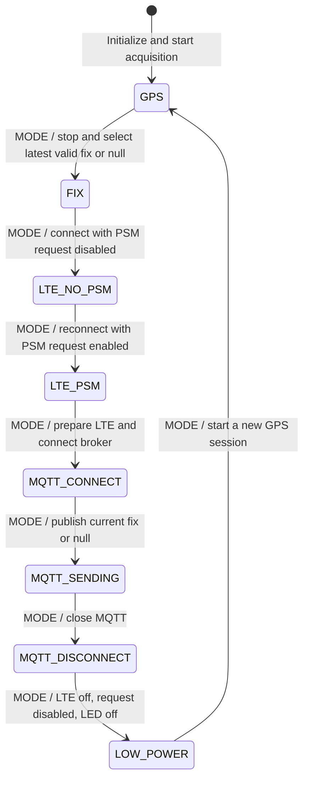

# GPS/LTE/MQTT State Control

An eight-state NCS v3.3.0 power-test harness for the SparkFun Thing Plus nRF9160.
The application directory is `gps_mqtt_stateControl`. MODE separates GPS,
LTE/PSM, MQTT connection, one location publish, disconnect and LOW_POWER holds.

## MODE sequence



| State | Entry behavior | What MODE does |
| --- | --- | --- |
| GPS | Automatically starts continuous acquisition at boot and on return from LOW_POWER | Stops acquisition and shows FIX |
| FIX | Holds the latest valid position as JSON in RTT, or null fields if no fix | Starts LTE connection without PSM |
| LTE_NO_PSM | Registers LTE with PSM request disabled; registration wait up to 60 s | Starts fresh registration with PSM requested |
| LTE_PSM | Re-registers LTE; waits up to 60 s for confirmed PSM entry after registration | Starts MQTT connection, even if PSM was not granted |
| MQTT_CONNECT | Prepare LTE if needed, connect MQTT/TLS and wait up to 15 s for CONNACK | Publishes the current session report |
| MQTT_SENDING | Publish one current fix or null report; QoS 1 waits up to 15 s for PUBACK | Disconnects MQTT |
| MQTT_DISCONNECT | Close MQTT and wait up to 10 s for callback | Enters LOW_POWER |
| LOW_POWER | Deactivates LTE, disables PSM request, stops any GNSS acquisition and cancels LED work | Starts GPS immediately; no extra start press |

Press and release MODE (`sw0`, P0.12). Holding it does not repeat. The RESET button
reboots. Presses during setup/registration/PSM-entry waits are discarded; press
when `HOLD:` appears. GPS accepts a press while collecting PVT frames. A valid fix
alone does not end the session. Errors stay at the current state and MODE retries
entry; they do not add extra states or advance silently.

The GPS acquisition limit is **180 seconds**. If it expires, acquisition stops
and the application logs `GPS session ended; press MODE to show FIX`. It remains
in GPS until MODE; the timeout does not advance to FIX automatically. The latest
valid fix collected in that session is retained, including on timeout. With no
valid fix, FIX shows:

```json
{"lat":null,"lon":null,"alt":null,"acc":null,"time":null}
```

FIX displays the JSON locally. MQTT_SENDING transmits that session's report later.
No-fix sessions publish null fields; no previous-session coordinate is reused.
Only one report is held for this manual cycle, not a backlog of earlier cycles.

## Logs and indicators

```text
ENTER: GPS
Waiting for GNSS fix... Press MODE to finish the session
ENTER: FIX
FIX: {"lat":null,"lon":null,"alt":null,"acc":null,"time":null}
HOLD: FIX; MODE -> LTE_NO_PSM
ENTER: LTE_NO_PSM
LTE connecting... [PSM request disabled]
LTE connected
HOLD: LTE_NO_PSM; MODE -> LTE_PSM
```

This example shows message text, not a measured run. RTT adds timestamps/module
names. Existing GPS PVT/NMEA presentation remains. `ENTER:` identifies the current
operation and `HOLD:` identifies the completed state waiting for its next press.

`LTE connected - [PSM enabled]` reports the network grant. `PSM sleeping` confirms
a sleep-entry event; `PSM awake` reports a later wake event. PSM is controlled by
the network. Refusal/timeout logs `PSM entry unconfirmed`; LTE is retained in the
LTE_PSM state until MODE starts MQTT_CONNECT. Do not label refusal as successful
PSM or silently equate it with LTE-off fallback.

The blue `led0` heartbeat is one pulse while holding, two during GPS acquisition,
three during LTE registration, and four during MQTT connect/send. LOW_POWER forces it off and cancels delayed LED
work; waking restores normal indications. Pulse/group settings are in
`config/hardware.conf`. LOW_POWER is a System ON radio-off wait with the modem
library initialized, not System OFF or modem shutdown. Remaining board circuitry,
debug connections and logging can affect current.

Before each MQTT connect attempt the helper cleans up a previous rejected/timed-out
connection. A failed MQTT_SENDING stays at that state; the next MODE reconnects
before retrying the same report. Lost PUBACK can therefore cause a duplicate QoS 1
delivery. Long holds can allow MQTT keepalive traffic or disconnects and LTE/PSM
wake/sleep events; include that behavior in the power trace.

## Local broker setup

TLS defaults to port 8883. Use ignored `config/mqtt-credentials.conf` based on
`config/mqtt-credentials.conf.example`, with the broker endpoint and credentials,
and place the root CA at ignored `credentials/ca-cert.pem`. MQTT initializes after
the modem and before GPS starts; missing CA or invalid credentials setup can stop
initialization. Existing local deployment assets are reused by this build.

## Power-testing documentation

- [State machine and code ownership](docs/state-machine.md)
- [Measurement windows, procedure and analysis](docs/power-testing.md)
- [Experiment 0004 and evidence status](../../docs-obsidian/experiments/0004-state-control-power/README.md)

No controlled per-state power result has been established by software tests.

## Build and checks

Use `sparkfun_thing_plus/nrf9160/ns` for the SparkFun board. The CircuitDojo Feather
variant is also allowed. From an initialized NCS v3.3.0 west workspace:

```sh
west build -p always -b sparkfun_thing_plus/nrf9160/ns \
  /path/to/workspace/myprojects/gps_mqtt_stateControl --sysbuild \
  -d /path/to/workspace/myprojects/gps_mqtt_stateControl/build-sparkfun
```

Flash the generated `build-sparkfun/merged.hex` to the intended board. Effective
configuration is in `build-sparkfun/gps_mqtt_stateControl/zephyr/.config`.
Application `Kconfig` reuses tracker symbol definitions. CMake loads the app's
system/logging/hardware/networking/modem/MQTT/tracker fragments, followed by the
ignored local broker overlay when present. It generates the local CA include.

The original modem implementation and board GNSS setup remain shared with
`../gps_mqtt_tracker/src`; keep both app directories. MQTT source and report types are active. The earlier backlog implementation
remains as historical code but is not compiled; current reports are retained in
main.c while their state awaits a retry. Tests cover the state cycle and the actual
MQTT formatter/acknowledgement path for valid/null JSON.

```sh
python3 myprojects/gps_mqtt_stateControl/tests/test_state_control.py
python3 myprojects/gps_mqtt_stateControl/tests/test_gnss_session.py
python3 myprojects/gps_mqtt_stateControl/tests/test_tracker_ui.py
```

On hardware verify the eight transitions per cycle, GPS stop/timeout gating, both
LTE registrations, PSM grant/refusal/wake, CONNACK/PUBACK and broker JSON receipt,
disconnect, and LED-off LOW_POWER with MODE wake.
Host stubs and compilation do not validate radio behavior, current, or calibration.
