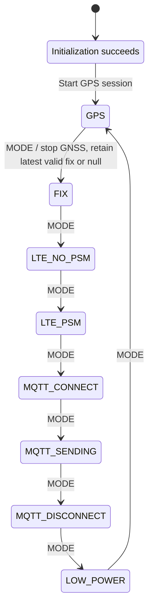

[Back to application README](../README.md)

# Eight-state machine for power testing

## Purpose and control

The harness isolates GPS acquisition, the held fix result, LTE without PSM, LTE
with requested PSM, three MQTT operations, and a radio-off LOW_POWER wait.
It has exactly eight application states. MODE moves around the cycle; GPS begins automatically at boot and after
waking from LOW_POWER. MQTT follows LTE_PSM; there are no separate PSM-disable or
cleanup states. MQTT sends one current-session report, without a backlog loop.

## Main-state overview



GPS accepts the transition press while receiving PVT. Valid fixes update the
candidate and do not automatically advance. A 180 s deadline stops acquisition,
but the application remains in GPS and waits for MODE before displaying FIX.
All other transition presses are accepted only after state entry finishes and
`HOLD:` appears. Presses during registration/setup/PSM waits are discarded.
A failed entry stays in that same state; MODE retries it. Initialization failure
stops the application. No extra error state is introduced.

## Main states and internal phases

The eight enclosing states below are the actual application states. Internal
phase names are descriptive labels, not extra enum values. MODE-labeled edges
require a press; other edges execute automatically. Error phases remain inside
their main state and MODE retries entry. GPS setup/collection/stop failures and
LOW_POWER cleanup failures do not advance to the next main state.

```mermaid
stateDiagram-v2
    state "Initialization succeeds" as INIT_READY
    [*] --> INIT_READY
    INIT_READY --> GPS: Start GPS session

    state GPS {
        [*] --> GPS_Prepare
        GPS_Prepare: Clear previous fix / LTE off / PSM disabled
        GPS_Prepare --> GPS_Configure: Preparation succeeds
        GPS_Configure: Configure and start continuous GNSS
        GPS_Configure --> GPS_Search: GNSS started
        GPS_Search: Receive PVT / search for satellites
        GPS_Search --> GPS_SaveFix: FIX_VALID
        GPS_SaveFix: Save latest valid fix
        GPS_SaveFix --> GPS_Search: Continue acquisition
        GPS_Search --> GPS_Search: Invalid PVT / retain valid candidate
        GPS_Search --> GPS_StopButton: MODE
        GPS_StopButton: Stop GNSS
        GPS_StopButton --> [*]: Stop succeeds
        GPS_Search --> GPS_StopTimeout: 180-second timeout
        GPS_StopTimeout: Stop GNSS / retain candidate or null
        GPS_StopTimeout --> GPS_WaitButton: Stop succeeds
        GPS_WaitButton: Remain in GPS with acquisition stopped
        GPS_WaitButton --> [*]: MODE
        GPS_Prepare --> GPS_Error: Preparation error
        GPS_Configure --> GPS_Error: Setup error / attempt GNSS stop
        GPS_Search --> GPS_Error: Queue error / attempt GNSS stop
        GPS_StopButton --> GPS_Error: Stop error
        GPS_StopTimeout --> GPS_Error: Stop error
        GPS_Error: Report failure / remain in GPS
        GPS_Error --> GPS_Prepare: MODE / retry entry
    }
    GPS --> FIX: Session ended by MODE and GNSS stopped

    state FIX {
        [*] --> FIX_Check
        state FIX_Check <<choice>>
        FIX_Check --> FIX_Valid: Valid candidate exists
        FIX_Check --> FIX_Null: No valid candidate
        FIX_Valid: Prepare position and timestamp
        FIX_Null: Prepare JSON null fields
        FIX_Valid --> FIX_Display
        FIX_Null --> FIX_Display
        FIX_Display: Display JSON on RTT / retain report
        FIX_Display --> FIX_Hold
        FIX_Hold: Wait for MODE
    }
    FIX --> LTE_NO_PSM: MODE

    state LTE_NO_PSM {
        [*] --> LTE_N_Reset
        LTE_N_Reset: Deactivate LTE / disable PSM request
        LTE_N_Reset --> LTE_N_Register: Preparation succeeds
        LTE_N_Register: Activate LTE / wait for home or roaming registration
        LTE_N_Register --> LTE_N_Hold: Registered within 60 seconds
        LTE_N_Reset --> LTE_N_Error: Preparation error
        LTE_N_Register --> LTE_N_Error: Error or timeout
        LTE_N_Error: Report failure / remain in this state
        LTE_N_Error --> LTE_N_Reset: MODE / retry
        LTE_N_Hold: Registered LTE without PSM request / wait for MODE
    }
    LTE_NO_PSM --> LTE_PSM: MODE

    state LTE_PSM {
        [*] --> LTE_P_Reset
        LTE_P_Reset: Deactivate LTE / enable PSM request
        LTE_P_Reset --> LTE_P_Register: Preparation succeeds
        LTE_P_Register: Fresh LTE registration
        LTE_P_Register --> LTE_P_Wait: Registered within 60 seconds
        LTE_P_Reset --> LTE_P_Error: Preparation error
        LTE_P_Register --> LTE_P_Error: Error or timeout
        LTE_P_Error: Report failure / remain in this state
        LTE_P_Error --> LTE_P_Reset: MODE / retry
        LTE_P_Wait: Wait up to 60 seconds for PSM sleep event
        LTE_P_Wait --> LTE_P_Sleep: Sleep confirmed
        LTE_P_Wait --> LTE_P_Unconfirmed: Sleep not confirmed
        LTE_P_Sleep: PSM sleeping / wait for MODE
        LTE_P_Sleep --> LTE_P_Awake: Modem wake event
        LTE_P_Awake: PSM awake / wait for MODE
        LTE_P_Awake --> LTE_P_Sleep: Modem sleep event
        LTE_P_Unconfirmed: LTE retained / warning / wait for MODE
        LTE_P_Unconfirmed --> LTE_P_Sleep: Later sleep event
    }
    LTE_PSM --> MQTT_CONNECT: MODE

    state MQTT_CONNECT {
        [*] --> MQTT_C_Cleanup
        MQTT_C_Cleanup: Close previous attempt if needed / wait up to 10 seconds
        MQTT_C_Cleanup --> MQTT_C_LTE: Cleanup succeeds
        MQTT_C_LTE: Retain LTE registration or register within 60 seconds
        MQTT_C_LTE --> MQTT_C_Transport: LTE ready
        MQTT_C_Transport: DNS / TCP / TLS setup
        MQTT_C_Transport --> MQTT_C_Connack: Transport established
        MQTT_C_Connack: Send CONNECT / wait up to 15 seconds for CONNACK
        MQTT_C_Connack --> MQTT_C_Hold: Accepted
        MQTT_C_Cleanup --> MQTT_C_Error: Cleanup error
        MQTT_C_LTE --> MQTT_C_Error: Registration error or timeout
        MQTT_C_Transport --> MQTT_C_Error: Connection error
        MQTT_C_Connack --> MQTT_C_Error: Rejected or timeout
        MQTT_C_Error: Report failure / remain in this state
        MQTT_C_Error --> MQTT_C_Cleanup: MODE / retry
        MQTT_C_Hold: MQTT connected / wait for MODE
    }
    MQTT_CONNECT --> MQTT_SENDING: MODE

    state MQTT_SENDING {
        [*] --> MQTT_S_Format
        MQTT_S_Format: Format valid or null JSON / check buffer length
        MQTT_S_Format --> MQTT_S_Publish: Formatting succeeds
        MQTT_S_Publish: Send PUBLISH / log MQTT sending
        MQTT_S_Publish --> MQTT_S_Puback: Submitted / QoS 1
        MQTT_S_Format --> MQTT_S_Error: Formatting error
        MQTT_S_Publish --> MQTT_S_Error: Send error
        MQTT_S_Puback: Wait up to 15 seconds for matching PUBACK
        MQTT_S_Puback --> MQTT_S_Sent: Successful PUBACK
        MQTT_S_Puback --> MQTT_S_Error: Error or timeout
        MQTT_S_Sent: Log MQTT sent and transmitted JSON
        MQTT_S_Sent --> MQTT_S_Hold
        MQTT_S_Hold: MQTT remains connected / wait for MODE
        MQTT_S_Error: Retain same report / report failure
        MQTT_S_Error --> MQTT_S_Reconnect: MODE / retry
        MQTT_S_Reconnect: Cleanup / prepare LTE / reconnect MQTT
        MQTT_S_Reconnect --> MQTT_S_Format: Reconnected
        MQTT_S_Reconnect --> MQTT_S_Error: Reconnection failed
    }
    MQTT_SENDING --> MQTT_DISCONNECT: MODE

    state MQTT_DISCONNECT {
        [*] --> MQTT_D_Check
        state MQTT_D_Check <<choice>>
        MQTT_D_Check --> MQTT_D_Request: Connection attempt exists
        MQTT_D_Check --> MQTT_D_Hold: Already disconnected
        MQTT_D_Request: Request MQTT disconnect
        MQTT_D_Request --> MQTT_D_Wait: Request succeeds
        MQTT_D_Request --> MQTT_D_Error: Request error
        MQTT_D_Wait: Wait up to 10 seconds for callback
        MQTT_D_Wait --> MQTT_D_Hold: Completed
        MQTT_D_Wait --> MQTT_D_Error: Error or timeout
        MQTT_D_Error: Report failure / remain in this state
        MQTT_D_Error --> MQTT_D_Check: MODE / retry
        MQTT_D_Hold: MQTT closed / LTE retained / wait for MODE
    }
    MQTT_DISCONNECT --> LOW_POWER: MODE

    state LOW_POWER {
        [*] --> LOW_StopGPS
        LOW_StopGPS: Stop remaining GNSS if needed
        LOW_StopGPS --> LOW_RadioOff: Stop succeeds or already stopped
        LOW_RadioOff: Deactivate LTE / disable PSM request
        LOW_RadioOff --> LOW_LEDOff: Modem calls succeed
        LOW_LEDOff: Turn LED off / cancel delayed LED work
        LOW_LEDOff --> LOW_Hold
        LOW_StopGPS --> LOW_Error: Stop error
        LOW_RadioOff --> LOW_Error: Modem error
        LOW_Error: Report failure / remain in LOW_POWER state
        LOW_Error --> LOW_StopGPS: MODE / retry entry
        LOW_Hold: Main thread blocked on MODE
    }
    LOW_POWER --> GPS: MODE / start new session
```



The publish diagram uses the current QoS 1 configuration. With QoS 0, successful
submission goes directly to sent/hold without PUBACK. LOW_POWER LED API failures
are logged by the UI module; its void API does not propagate them to main.c, so
verify the dark LED physically rather than inferring it from the state name.

For power tests, distinguish an entry failure from a successful hold. LTE_PSM's
internal sleep/awake phases represent asynchronous modem events; these events do
not change the application state by themselves. MQTT socket traffic can wake the
modem. LOW_POWER is a System ON radio-off wait, not System OFF.

## Operations and physical behavior

| State | Entry operation | Behavior while holding |
| --- | --- | --- |
| GPS | Deactivate LTE, disable PSM request, start continuous GNSS; stop on MODE or 180 s | Acquires PVT until stopped; after timeout holds a candidate with GNSS stopped until MODE |
| FIX | Print latest valid position/time as JSON or all null fields | LTE off, GNSS stopped, heartbeat active; no radio transmission |
| LTE_NO_PSM | Deactivate LTE, explicitly request no PSM, activate LTE and wait up to 60 s for registration | Registered LTE, PSM request disabled; RRC/network activity can continue |
| LTE_PSM | Deactivate LTE, enable PSM request, re-register (up to 60 s) and wait up to 60 s for PSM sleep event | Confirmed PSM or an unconfirmed/denied request; LTE is not automatically deactivated on PSM timeout |
| MQTT_CONNECT | Close any old attempt, prepare LTE registration if needed, connect broker and wait for CONNACK (15 s) | MQTT and PSM request remain active; sockets can wake the modem |
| MQTT_SENDING | Send current valid/null JSON; wait for QoS 1 PUBACK (15 s); reconnect on a retry | Report stays available; MQTT remains connected |
| MQTT_DISCONNECT | Disconnect and wait for callback (10 s) | MQTT closed; LTE remains registered until LOW_POWER |
| LOW_POWER | Stop pending GNSS, deactivate LTE, disable PSM request, turn LED off and synchronously cancel LED work | Main thread blocks on MODE; no LED timer; modem library remains initialized |

LTE_PSM is an application state naming the requested policy. It does not guarantee
that the network granted it or that the modem remains asleep. Grant events display
`LTE connected - [PSM enabled/disabled]`; actual sleep events display `PSM sleeping`
and `PSM awake`. An unconfirmed entry is explicitly logged. Press MODE to enter
MQTT_CONNECT even when the network refused PSM. The PSM request stays enabled
during MQTT; uplink/socket activity can wake the modem from confirmed sleep.

LOW_POWER is System ON idle, not System OFF. The LED is off only in this state.
Other holds blink once, GPS acquisition twice, LTE registration three times and
MQTT connection/send four times.
On LOW_POWER -> GPS, acquisition starts with that same press.

## FIX and session data

Only `NRF_MODEM_GNSS_PVT_FLAG_FIX_VALID` frames replace the session's candidate.
Invalid frames cannot overwrite a previous valid result. Candidate validity is
reset on each new GPS entry, so a previous session's fix is not reused. Normal
acquisition errors remain errors; missing fix/timeout produces a null result.

```json
{"lat":null,"lon":null,"alt":null,"acc":null,"time":null}
```

FIX displays the result in RTT and retains it for MQTT_SENDING. That later state
publishes one report; a send/PUBACK failure keeps the report and MODE retries with
reconnection. QoS 1 retry can produce duplicate delivery after a lost PUBACK. The configured low-accuracy GNSS policy remains enabled unless
overridden. The application deadline bounds continuous mode; the periodic interval
is unused. The stop button is polled at roughly 100 ms when there are no PVT events.

## Code ownership and markers

- [main.c](../src/main.c): eight states, MODE gates, FIX display, PSM observation.
- [tracker_gnss.c](../src/tracker_gnss.c): continuous PVT collection, timeout and
  button-end distinction, unchanged GPS diagnostics.
- [tracker_ui.c](../src/tracker_ui.c): pulse groups and LOW_POWER cancellation.
- [shared modem module](../../gps_mqtt_tracker/src/tracker_modem.c): initialization,
  registration semaphore and functional-mode operations.
- [tracker_mqtt.c](../src/tracker_mqtt.c): TLS setup, bounded JSON formatting,
  CONNACK/PUBACK waits and concise payload logging.
- [CMakeLists.txt](../CMakeLists.txt): active source/config selection, local broker
  overlay and CA generation; the old backlog source is excluded.

`ENTER: X` precedes X's work. `HOLD: X; MODE -> Y` follows successful entry and
marks a current-state wait. The special `LOW_POWER:` message follows radio-off and
LED cancellation. GPS finishes at `ENTER: FIX`, after its ending press; a timeout
also produces a stopped-GPS hold before that press. Mark these as separate windows
rather than combining them with active acquisition.

## See also

- [Power measurement procedure](power-testing.md)
- [Experiment 0004](../../../docs-obsidian/experiments/0004-state-control-power/README.md)
- [Application configuration](../config/tracker.conf)
