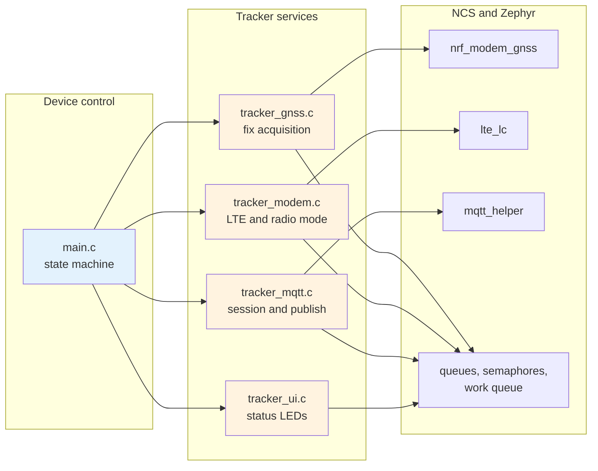
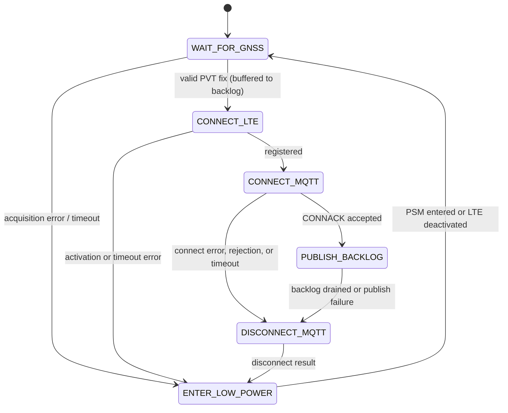

# GPS MQTT tracker code architecture

This guide explains the source layout, device state machine, and rules to keep
when extending `gps_mqtt_tracker`. Use `README.md` for configuration, building,
and hardware testing.

## Design goal

`main.c` controls **what the device does next**. Each subsystem module controls
**how its hardware or protocol works**:

- `main.c` owns device states and transitions.
- `tracker_gnss.c` owns GNSS configuration, callbacks, queues, and status output.
- `tracker_modem.c` owns modem initialization, LTE events, and radio modes.
- `tracker_mqtt.c` owns the MQTT session, callbacks, client ID, and JSON publish.
- `tracker_ui.c` owns the board blink groups and optional state LEDs.

This separation keeps the GPS-first sequence visible in one short file without
exposing subsystem semaphores, message queues, or callback details to the state
machine.

## Runtime architecture



There are two execution contexts:

- The main thread executes state transitions and may wait for subsystem events.
- Modem and MQTT callbacks do short event processing, then signal a queue or
  semaphore owned by their module.

Callbacks never perform long waits, DNS operations, or the complete upload
sequence.

## Source layout

| File | Responsibility | Public operations |
| --- | --- | --- |
| `src/main.c` | Device state and transition policy | `main()` |
| `src/tracker_backlog.h/.c` | In-memory fix backlog and adaptive stride retention | `tracker_backlog_add()`, `tracker_backlog_peek_oldest()`, `tracker_backlog_remove_oldest()`, `tracker_backlog_count()` |
| `src/tracker_gnss.h/.c` | GNSS setup, PVT/NMEA callbacks, fix validation, status logging | `tracker_gnss_start()`, `tracker_gnss_wait_for_fix()` |
| `src/tracker_modem.h/.c` | Modem startup, PSM request, LTE registration, and fallback radio handover | `tracker_modem_init()`, `tracker_modem_prepare_upload()`, `tracker_modem_enter_low_power()` |
| `src/tracker_mqtt.h/.c` | Client ID, uplink-only MQTT callbacks, JSON formatting, QoS 1 delivery | `tracker_mqtt_init()`, `tracker_mqtt_connect()`, `tracker_mqtt_publish_location()`, `tracker_mqtt_disconnect()` |
| `src/tracker_status.h/.c` | Application phase status string tracking for debug/UI | `tracker_status_set()`, `tracker_status_get()` |
| `src/tracker_ui.h/.c` | Heartbeat work item and optional state LEDs | `tracker_ui_init()`, `tracker_ui_set_state()` |
| `src/circuitdojo_gnss.c` | Early board-specific GNSS power-mode GPIO setup | Zephyr `SYS_INIT` hook |
| `boards/*.conf` | Board-specific modem antenna routing | Kconfig overlays |
| `config/*.conf` | Default settings grouped by subsystem | Kconfig fragments loaded by CMake |
| `Kconfig` | Definitions of application-owned settings | `CONFIG_*` declarations |
| `prj.conf` | Standard Zephyr configuration entry point and fragment index | Kconfig entry point |
| `CMakeLists.txt` | Application source and configuration-fragment lists | Zephyr build definition |

Headers intentionally expose operations, not internal semaphores or callback
functions. This lets subsystem implementations change without rewriting the
state machine.

## Device state machine

The state enum and transition decisions live only in `main.c`.



All successful upload cycles follow:

```text
GNSS fix -> buffer in backlog -> ensure LTE registration -> MQTT CONNACK -> drain backlog via QoS 1 publish -> PUBACK
-> MQTT disconnect -> PSM (or LTE-deactivation fallback) -> next GNSS fix
```

The cleanup state is deliberate. MQTT is disconnected before the modem enters
PSM. LTE is deactivated only if PSM is rejected, unavailable, or times out.

## Initialization order

`tracker_init()` preserves the required modem order:

1. Initialize the optional user interface.
2. Initialize the nRF modem library.
3. Register the asynchronous LTE handler and configure/request PSM.
4. Do not start LTE registration yet, preserving the first GPS-first cycle.
5. Deactivate LTE and explicitly activate GNSS.
6. Initialize MQTT Helper and generate the client ID using the configured value
   or modem IMEI.
7. Configure and start GNSS.

Do not move AT, LTE, GNSS, MQTT, or socket operations before modem library
initialization.

## Subsystem synchronization

| Object | Owner | Producer | Consumer | Meaning |
| --- | --- | --- | --- | --- |
| `gnss_pvt_queue` | GNSS | GNSS PVT callback | `tracker_gnss_wait_for_fix()` | PVT/search frames |
| `gnss_nmea_queue` | GNSS diagnostics | GNSS NMEA callback | GNSS status printer | Optional NMEA sentences |
| `lte_connected` | Modem | LTE registration callback | `tracker_modem_prepare_upload()` | Home/roaming registration completed |
| `psm_entered` | Modem | PSM sleep callback | `tracker_modem_enter_low_power()` | Modem entered network PSM |
| `mqtt_conn_sem` | MQTT | CONNACK callback | `tracker_mqtt_connect()` | Broker accepted or rejected connection |
| `mqtt_puback_sem` | MQTT | PUBACK callback | `tracker_mqtt_publish_location()` | Matching QoS 1 payload acknowledged |
| `mqtt_disconnected_sem` | MQTT | Disconnect callback | `tracker_mqtt_disconnect()` | MQTT transport disconnected |

Each semaphore is reset immediately before starting the asynchronous operation
that will signal it. Finite waits return an error to `main.c`, which selects the
cleanup state.

## Subsystem behavior

### GNSS

`tracker_gnss_start()` configures the timing source, use case, callback,
periodic interval, retry timeout, receiver, and priority mode. NMEA queues and
status output exist only with `CONFIG_TRACKER_GNSS_DIAGNOSTICS`. The PVT
callback only reads a modem frame and queues it. `tracker_gnss_wait_for_fix()`
consumes and displays frames until `NRF_MODEM_GNSS_PVT_FLAG_FIX_VALID` is set,
bounded overall by `CONFIG_TRACKER_PERIODIC_TIMEOUT` (returns `-ETIMEDOUT`
otherwise, routing the state machine to `ENTER_LOW_POWER`).

If a PVT or NMEA queue is full, the callback drops status data instead of
blocking modem event processing.

### Modem and LTE

`tracker_modem_init()` initializes the modem before all dependent services and
sets the initial GPS-first radio mode. `tracker_modem_prepare_upload()` reuses
retained registration when available; otherwise it selects normal functional
mode and waits for home or roaming registration.

`tracker_modem_enter_low_power()` waits for confirmed PSM entry. When the
network does not grant PSM or the wait expires, it calls
`tracker_modem_return_to_gnss()` to deactivate LTE as a safe fallback.

### MQTT

`tracker_mqtt_init()` initializes MQTT Helper once, validates the optional
username/password pairing, and creates a stable client ID buffer.
`tracker_mqtt_connect()` passes length-aware hostname, client-ID, username, and
password spans, waits for CONNACK, and distinguishes a broker rejection from a
timeout. Credential contents are never logged.

The MQTT session is uplink-only. An accepted CONNACK proceeds directly to the
location publish; no command topic is subscribed.

`tracker_mqtt_publish_location()` formats the fixed-size JSON buffer with
`snprintf`, checks for truncation, publishes with QoS 1, and keeps the payload
buffer alive while waiting for the matching PUBACK. The payload is sent to
`CONFIG_MQTT_PUB_TOPIC`:

```json
{"lat":13.756331,"lon":100.501765,"alt":12.5,"acc":3.2,"time":"2026-08-08T09:30:00Z"}
```

### User interface

`tracker_ui.c` contains both visual mechanisms:

- `CONFIG_STARTUP_LED` schedules `led0` groups: 2 blinks for GNSS finding,
  3 for LTE finding, and 4 for LTE registered during MQTT upload. Initialization
  and low-power preparation leave the board LED off.
- `CONFIG_ENABLE_LEDS` uses the optional DK library to show GNSS finding, LTE finding, or LTE registered during MQTT
  state.

The rest of the application does not need board LED details.

## Where new code belongs

| Change | Put it here |
| --- | --- |
| Add a device state or change transition policy | `main.c` |
| Change GNSS use case, output, or fix validation | `tracker_gnss.c` |
| Change LTE registration or functional modes | `tracker_modem.c` |
| Change topics, JSON payload, MQTT QoS, or callbacks | `tracker_mqtt.c` |
| Change board blink groups or status LED behavior | `tracker_ui.c` |
| Add a user-adjustable value | Define in `Kconfig`, select it in the owning `config/*.conf` fragment or a board overlay, then consume it in its owning module |
| Add board-only antenna or GPIO setup | `boards/` and a focused board source file |

Create a new module when a new feature has its own lifecycle or asynchronous
events—for example, motion sensing or battery measurement. Do not put unrelated
helpers into a generic `utils.c`; name the module after the responsibility it
owns.

## Rules for future changes

1. Preserve GPS-first radio sequencing.
2. Keep modem initialization before every modem-dependent API.
3. Keep callbacks short and non-blocking.
4. Reset synchronization objects before starting their asynchronous operation.
5. Check every finite wait and external API return value.
6. Validate `FIX_VALID` before publishing PVT data.
7. Wait for the matching PUBACK after a QoS 1 publish.
8. Disconnect MQTT before waiting for PSM or deactivating LTE as fallback.
9. Keep MQTT buffers length-aware and check formatting for truncation.
10. Define tunables in application `Kconfig`; do not add only a configuration-fragment value.
11. Never commit real certificates, passwords, PSKs, or private keys.

## Verification boundary

A build validates source, API, and Kconfig integration. Hardware testing must
still confirm GNSS reception, antenna routing, LTE registration, carrier-granted
PSM values, actual PSM entry, MQTT broker reachability, PUBACK delivery, current
consumption, and repeated PSM/fallback cycles.
