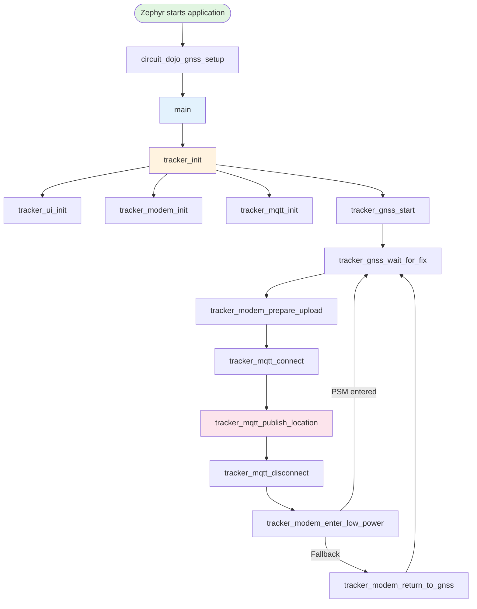

# GPS MQTT tracker function guide

This document explains what every function in `src/` does, when it runs, what
it receives, and how it communicates with the rest of the tracker.

For module boundaries and design rules, see
[`CODE_ARCHITECTURE.md`](CODE_ARCHITECTURE.md). For configuration and build
instructions, see [`README.md`](README.md).

## Function visibility

The source uses two kinds of functions:

- **Public functions** are declared in a module's `.h` file. `main.c` calls
  these functions to request an operation from a subsystem.
- **Private functions** are declared `static` inside a `.c` file. They are
  implementation details, helper functions, or asynchronous callbacks.

`main.c` does not access subsystem queues, semaphores, callbacks, or internal
buffers directly.

## Complete runtime call flow



The callback functions run asynchronously when the modem or MQTT library
delivers an event. They signal the blocking public function through a queue or
semaphore.

## `src/main.c`: device state control

### `tracker_state_name()`

```c
static const char *tracker_state_name(enum tracker_state state);
```

Converts a `tracker_state` enum value into readable text for logging. For
example, `TRACKER_STATE_CONNECT_LTE` becomes `"CONNECT_LTE"`. An invalid value
returns `"UNKNOWN"`.

This function does not change device state.

### `tracker_init()`

```c
static int tracker_init(void);
```

Initializes the tracker in the required order:

1. Calls `tracker_ui_init()`. UI failure is logged but does not stop tracking.
2. Calls `tracker_modem_init()`. This must happen before MQTT, AT, LTE, or GNSS
   operations.
3. Calls `tracker_mqtt_init()` to register callbacks and create the client ID.
4. Calls `tracker_gnss_start()` to configure and start the receiver.

Returns `0` when required initialization succeeds. A modem, MQTT, or GNSS error
is returned immediately to `main()`.

### `main()`

```c
int main(void);
```

Owns the device state machine. It stores the most recent valid location in a
local `nrf_modem_gnss_pvt_data_frame` and repeatedly executes one state:

| State | Function called | Successful next state | Error next state |
| --- | --- | --- | --- |
| `WAIT_FOR_GNSS` | `tracker_gnss_wait_for_fix()` | `CONNECT_LTE` | `ENTER_LOW_POWER` |
| `CONNECT_LTE` | `tracker_modem_prepare_upload()` | `CONNECT_MQTT` | `ENTER_LOW_POWER` |
| `CONNECT_MQTT` | `tracker_mqtt_connect()` | `PUBLISH_LOCATION` | `DISCONNECT_MQTT` |
| `PUBLISH_LOCATION` | `tracker_mqtt_publish_location()` | `DISCONNECT_MQTT` | `DISCONNECT_MQTT` |
| `DISCONNECT_MQTT` | `tracker_mqtt_disconnect()` | `ENTER_LOW_POWER` | `ENTER_LOW_POWER` |
| `ENTER_LOW_POWER` | `tracker_modem_enter_low_power()` | `WAIT_FOR_GNSS` | `WAIT_FOR_GNSS` |

Publication and disconnect errors are logged, but cleanup continues. This
ensures MQTT disconnect is attempted before waiting for PSM or using the LTE
deactivation fallback.

## `src/tracker_gnss.c`: GNSS receiver

### GNSS message queues

The GNSS callback always uses a PVT queue. A second NMEA queue is compiled only
when `CONFIG_TRACKER_GNSS_DIAGNOSTICS` is enabled:

| Queue | Capacity | Data |
| --- | ---: | --- |
| `gnss_pvt_queue` | 2 frames | Position, Velocity, and Time data |
| `gnss_nmea_queue` | 20 frames | NMEA text sentences |

The callback uses `K_NO_WAIT`. If a queue is full, it drops status data instead
of blocking the modem callback.

### `print_satellite_stats()`

```c
static void print_satellite_stats(
    const struct nrf_modem_gnss_pvt_data_frame *pvt);
```

Walks through the satellite array in a PVT frame and counts:

- satellites currently tracked;
- satellites used in the position fix;
- satellites marked unhealthy.

It prints only diagnostic information and does not modify the frame.

### `print_gnss_flags()`

```c
static void print_gnss_flags(
    const struct nrf_modem_gnss_pvt_data_frame *pvt);
```

Checks PVT status flags and explains conditions such as LTE blocking GNSS,
insufficient radio windows, sleeping between fixes, or scheduled navigation
data downloads.

### `print_fix_data()`

```c
static void print_fix_data(
    const struct nrf_modem_gnss_pvt_data_frame *pvt);
```

Prints the complete valid fix: latitude, longitude, accuracy, altitude, speed,
heading, UTC date/time, and dilution-of-precision values. It is called only
when the PVT frame contains `NRF_MODEM_GNSS_PVT_FLAG_FIX_VALID`.

### `print_gnss_status()`

```c
static void print_gnss_status(
    const struct nrf_modem_gnss_pvt_data_frame *pvt);
```

Builds the complete GNSS status display. It clears the terminal view, prints
satellite statistics and flags, then either prints the valid fix or shows the
search duration and activity indicator. Finally, it drains all currently queued
NMEA frames without waiting.

### `gnss_event_handler()`

```c
static void gnss_event_handler(int event);
```

Asynchronous callback registered with the modem GNSS library.

Important events:

| Event | Action |
| --- | --- |
| `NRF_MODEM_GNSS_EVT_PVT` | Reads one PVT frame and places it in `gnss_pvt_queue` |
| `NRF_MODEM_GNSS_EVT_NMEA` | When diagnostics are enabled, reads one NMEA frame into `gnss_nmea_queue` |
| `NRF_MODEM_GNSS_EVT_FIX` | Logs that the modem detected a fix |
| `NRF_MODEM_GNSS_EVT_BLOCKED` | Logs that LTE currently blocks GNSS radio time |
| `NRF_MODEM_GNSS_EVT_UNBLOCKED` | Logs that GNSS radio time is available again |
| Periodic/sleep/reference events | Logs receiver lifecycle information |

The callback never starts LTE or publishes MQTT data.

### `tracker_gnss_start()`

```c
int tracker_gnss_start(void);
```

Configures and starts GNSS in this order:

1. Optionally selects the TCXO timing source.
2. Enables multiple hot starts and optional low-accuracy mode.
3. Registers `gnss_event_handler()`.
4. Enables RMC, GGA, GLL, GSA, and GSV NMEA output only when
   `CONFIG_TRACKER_GNSS_DIAGNOSTICS` is enabled.
5. Sets the periodic interval and retry timeout from Kconfig.
6. Starts GNSS.
7. Enables GNSS priority mode.

Returns `0` on success or the first modem error code. Later setup steps are not
attempted after a required step fails.

### `tracker_gnss_wait_for_fix()`

```c
int tracker_gnss_wait_for_fix(
    struct nrf_modem_gnss_pvt_data_frame *pvt);
```

Waits indefinitely for PVT frames from `gnss_pvt_queue`. Diagnostic builds
print each frame; all builds return only after the `FIX_VALID` flag is present.

- `pvt` is an output pointer filled with the validated location.
- Returns `-EINVAL` if `pvt` is `NULL`.
- Returns `0` after a valid fix.
- Returns a queue error if waiting unexpectedly fails.

## `src/tracker_modem.c`: modem and LTE

### `lte_connected`

A binary semaphore used for LTE registration. The LTE callback gives it only
after home or roaming registration. `tracker_modem_prepare_upload()` resets it
before enabling LTE, then waits with a timeout.

### `lte_event_handler()`

```c
static void lte_event_handler(const struct lte_lc_evt *const evt);
```

Asynchronous LTE Link Control callback. Registration events maintain the
retained-registration flag and release `lte_connected` only for
`REGISTERED_HOME` or `REGISTERED_ROAMING`. PSM update events record whether the
network granted PSM. PSM sleep events maintain the sleep flag and release
`psm_entered`. RRC events log whether the modem connection is active or idle.

The callback does not perform MQTT operations.

### `tracker_modem_init()`

```c
int tracker_modem_init(void);
```

Performs the modem startup sequence:

1. Initializes the nRF modem library.
2. Registers `lte_event_handler()` without starting LTE registration.
3. Configures the requested TAU and active-time values in seconds and requests
   PSM. A failed request is logged and later uses the deactivation fallback.
4. Deactivates LTE through `tracker_modem_return_to_gnss()`.
5. Explicitly activates GNSS functional mode.

Returns an error if modem initialization, PSM parameter setup, or radio mode
setup fails.

### `tracker_modem_prepare_upload()`

```c
int tracker_modem_prepare_upload(k_timeout_t timeout);
```

Returns immediately when LTE registration was retained through PSM. Otherwise,
it resets the registration semaphore, changes the modem to normal functional
mode, and waits for a registered-home or registered-roaming event.

Selecting normal mode only starts LTE access; it does not prove registration.
The function returns `-ETIMEDOUT` when the supplied timeout expires.

### `tracker_modem_enter_low_power()`

```c
int tracker_modem_enter_low_power(k_timeout_t timeout);
```

Waits for a confirmed `LTE_LC_MODEM_SLEEP_PSM` event after MQTT disconnect. If
registration was lost, PSM was not granted, or the wait expires, it calls
`tracker_modem_return_to_gnss()` so the next GNSS cycle remains usable.

### `tracker_modem_return_to_gnss()`

```c
int tracker_modem_return_to_gnss(void);
```

Sets `LTE_LC_FUNC_MODE_DEACTIVATE_LTE`, releasing the shared radio from LTE so
the already-active GNSS receiver can acquire the next fix. Returns the LTE Link
Control error code when the mode change fails.

## `src/tracker_mqtt.c`: MQTT session and location publishing

### MQTT synchronization and state

| Object | Purpose |
| --- | --- |
| `mqtt_conn_sem` | Wakes `tracker_mqtt_connect()` after CONNACK |
| `mqtt_puback_sem` | Wakes the publisher after the matching QoS 1 PUBACK |
| `mqtt_disconnected_sem` | Wakes the disconnect function after transport shutdown |
| `client_id_buf` | Stable client-ID storage used for every connection |
| `pending_publish_id` | Identifies the location publish currently awaiting PUBACK |
| `connect_attempted` | Atomic flag indicating that MQTT cleanup may be required |

### `client_id_get()`

```c
static int client_id_get(char *buffer, size_t buffer_len);
```

Copies `CONFIG_MQTT_CLIENT_ID` when it is non-empty. Otherwise, it reads the
15-digit modem IMEI using `AT+CGSN` and formats `nrf-<IMEI>`.

Both formatting paths check the `snprintf` result. An oversized ID returns
`-EMSGSIZE`; an AT command failure returns the modem error.

### MQTT callbacks

| Function | Event | Behavior |
| --- | --- | --- |
| `on_mqtt_connack()` | Broker replies to CONNECT | Stores the result and gives `mqtt_conn_sem` |
| `on_mqtt_puback()` | Broker acknowledges QoS 1 PUBLISH | Verifies `pending_publish_id`, stores the result, and gives `mqtt_puback_sem` |
| `on_mqtt_disconnect()` | MQTT transport disconnects | Clears `connect_attempted` and gives `mqtt_disconnected_sem` |

These callbacks must remain short and only update state or signal semaphores.

### `tracker_mqtt_init()`

```c
int tracker_mqtt_init(void);
```

Creates the MQTT Helper callback configuration and calls `mqtt_helper_init()`
once. Before initialization, it rejects a non-empty
`CONFIG_MQTT_BROKER_PASSWORD` when `CONFIG_MQTT_BROKER_USERNAME` is empty. It
then fills the stable client-ID buffer using `client_id_get()`.

The modem must already be initialized because client ID generation may issue an
AT command.

### `tracker_mqtt_connect()`

```c
int tracker_mqtt_connect(k_timeout_t timeout);
```

Builds length-aware hostname, client-ID, username, and password parameters,
resets `mqtt_conn_sem`, and starts the connection. Empty credential strings
disable authentication. Credential contents are never logged. The function
then waits for the CONNACK callback.

Returns:

- `0` when the broker accepts the connection;
- the MQTT Helper error when starting the connection fails;
- `-ETIMEDOUT` when no CONNACK arrives;
- `-ECONNREFUSED` when the broker rejects the connection.

### `tracker_mqtt_publish_location()`

```c
int tracker_mqtt_publish_location(
    const struct nrf_modem_gnss_pvt_data_frame *pvt,
    k_timeout_t timeout);
```

Formats latitude, longitude, altitude, accuracy, and UTC time into a compact
JSON payload. It checks for formatting failure or truncation before publishing.

The function selects QoS from `CONFIG_MQTT_PUB_QOS`. QoS 0 returns after the
send is accepted and does not wait for a broker acknowledgement. QoS 1 requests
a unique MQTT message ID and waits for a matching PUBACK. Because the function
waits before returning for QoS 1, its stack-based payload remains alive during
the publish operation.

Returns `-EINVAL` for a null PVT pointer, `-EMSGSIZE` for a formatting problem,
`-ETIMEDOUT` when the QoS 1 PUBACK does not arrive, an MQTT Helper publish
error, or the PUBACK result supplied by the callback.

### `tracker_mqtt_disconnect()`

```c
int tracker_mqtt_disconnect(k_timeout_t timeout);
```

Returns immediately when no MQTT connection was attempted. Otherwise, it resets
the disconnect semaphore, asks MQTT Helper to disconnect, and waits for the
disconnect callback. A missing callback returns `-ETIMEDOUT`.

## `src/tracker_ui.c`: heartbeat and state LEDs

### `working_led_blink_handler()`

```c
static void working_led_blink_handler(struct k_work *work);
```

Zephyr delayed-work handler enabled by `CONFIG_STARTUP_LED`. It toggles `led0`
and reschedules itself after `CONFIG_WORKING_LED_BLINK_INTERVAL_MS`. A GPIO error
stops the rescheduling loop and is logged.

### `working_led_start()`

```c
static int working_led_start(void);
```

Checks that the `led0` GPIO device is ready, configures it active, initializes
the delayed-work object, and schedules the first toggle. Returns `-ENODEV` when
the GPIO is unavailable or the GPIO/work error otherwise.

### `tracker_ui_init()`

```c
int tracker_ui_init(void);
```

Starts the heartbeat when `CONFIG_STARTUP_LED` is enabled. When
`CONFIG_ENABLE_LEDS` is enabled, it also initializes the Nordic DK LED library.
Returns `0` when all enabled UI features initialize successfully.

### `tracker_ui_set_state()`

```c
void tracker_ui_set_state(enum tracker_ui_state state);
```

When optional status LEDs are enabled, it first clears the status LEDs and then
shows the selected subsystem:

| UI state | LED |
| --- | --- |
| `TRACKER_UI_GNSS` | `DK_LED2` |
| `TRACKER_UI_LTE` | `DK_LED1` |
| `TRACKER_UI_MQTT` | `DK_LED4` |

When status LEDs are disabled, the function intentionally does nothing.

## `src/circuitdojo_gnss.c`: early board setup

### `circuit_dojo_gnss_setup()`

```c
static int circuit_dojo_gnss_setup(void);
```

Gets the `gpio0` devicetree device, checks that it is ready, and drives
`CONFIG_TRACKER_GNSS_POWER_MODE_PIN` low. On the supported Circuit Dojo and
SparkFun hardware this is normally GPIO0 pin 13.

`SYS_INIT` runs this function during Zephyr application initialization, before
`main()`. The source file is compiled only when
`CONFIG_TRACKER_CIRCUIT_DOJO_GNSS_SETUP` is enabled.

## Error-handling pattern

Subsystem public functions use the common Zephyr convention:

```text
0             operation succeeded
negative code operation failed
```

`main.c` converts those results into state transitions. Initialization errors
stop the application. Runtime LTE/MQTT errors follow cleanup states and then
return to GNSS for another cycle.

## Adding a new function

1. Put the implementation in the module that owns the behavior.
2. Declare it in the module header only if another `.c` file must call it.
3. Keep implementation-only helpers and callbacks `static`.
4. Return `0` or a meaningful negative error code for fallible operations.
5. Keep asynchronous callbacks short; signal normal thread code with a queue,
   semaphore, work item, or another suitable Zephyr primitive.
6. If the function changes device sequencing, call it from a clear state in
   `main.c`.
7. Define any new user-adjustable value in application `Kconfig`, then select a
   default in the owning `config/*.conf` fragment or a deployment overlay.
