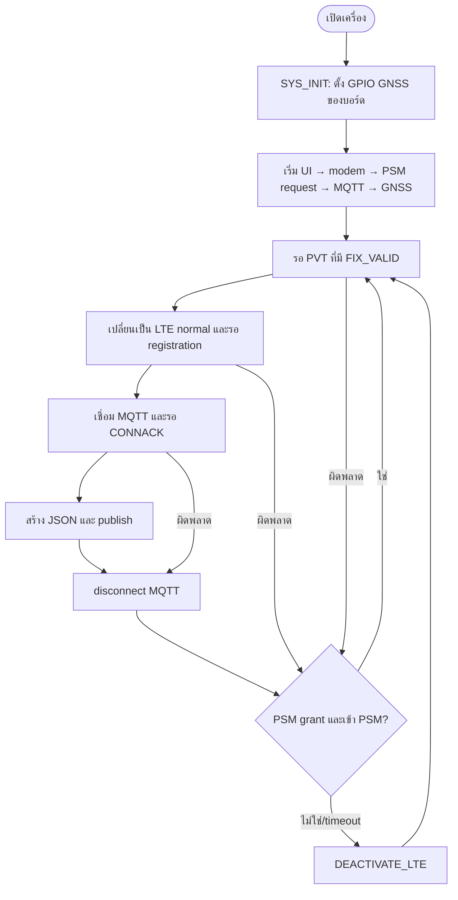

# คู่มือระบบ GPS MQTT Tracker

เอกสารนี้อธิบายการทำงานของ `gps_mqtt_tracker` ตามซอร์สและไฟล์ตั้งค่าที่อยู่ใน
repository ณ ปัจจุบัน ครอบคลุมฟีเจอร์ ฟังก์ชันทุกตัวใน `src/` การไหลของข้อมูล
และผลของการตั้งค่าต่อพลังงาน เครือข่าย และพฤติกรรมของอุปกรณ์

ใช้กับ NCS v3.3.0 และบอร์ด `circuitdojo_feather/nrf9160/ns` หรือ
`sparkfun_thing_plus/nrf9160/ns` เท่านั้น

> [!IMPORTANT]
> อุปกรณ์นี้ใช้วิทยุ LTE และ GNSS ร่วมกัน จึงต้องรักษาลำดับ **GNSS ก่อน, LTE
> เฉพาะเมื่อมีตำแหน่งพร้อมส่ง** ไว้เสมอ ห้ามย้ายการเชื่อม LTE ไปก่อนการหา
> GNSS fix เพราะ LTE อาจแย่งช่วงเวลาวิทยุจนหา fix ช้าหรือหาไม่ได้

## หน้าที่ของระบบและฟีเจอร์

Tracker ทำงานเป็น uplink-only asset tracker: รับพิกัด GNSS, สร้าง JSON, เปิด
LTE/MQTT เพื่อส่งข้อมูล แล้วปิด MQTT ก่อนรอ PSM หรือปิด LTE เพื่อกลับไปหา
ตำแหน่งรอบถัดไป ไม่มีการ subscribe, ไม่มีคำสั่ง downlink และไม่มี motion
sensor หรือไลบรารี JSON ภายนอก

| ฟีเจอร์ | ทำอะไร | ผลต่อระบบ |
| --- | --- | --- |
| GNSS แบบ periodic | ขอ fix ตามช่วงเวลา และหยุดค้นหาตาม timeout | ช่วงเวลาสั้นให้ข้อมูลถี่แต่เพิ่มแบตเตอรี่; timeout นานช่วยได้ fix แต่กินพลังงานมากขึ้น |
| GPS-first radio sequencing | ปิด LTE ระหว่างหา fix และเปิดเมื่อพร้อม upload | ลดการชนกันของ shared radio และปกป้องคุณภาพ/เวลา GNSS |
| MQTT over TLS | เข้ารหัสและตรวจ CA ของ broker | ป้องกันการดักฟัง/ปลอม broker แต่ต้องมี CA ที่ถูกต้องใน modem และใช้หน่วยความจำ/เวลาเพิ่ม |
| QoS 0 หรือ QoS 1 | เลือกระดับรับประกันการส่ง | QoS 0 เร็วและประหยัดกว่าแต่ไม่มี PUBACK; QoS 1 รอ PUBACK จึงน่าเชื่อถือขึ้นแต่ใช้เวลา/พลังงานเพิ่ม และอาจซ้ำได้ |
| PSM | ขอให้เครือข่ายเก็บ registration ระหว่างรอบ | ลดไฟและอาจไม่ต้อง attach ใหม่ แต่ผู้ให้บริการเป็นผู้ตัดสินว่าจะ grant หรือไม่ |
| LTE-deactivation fallback | ปิด LTE หาก PSM ไม่ได้หรือรอนานเกิน | ทำให้ GNSS รอบถัดไปใช้วิทยุได้แน่นอน แต่รอบ upload ถัดไปอาจต้อง register ใหม่ |
| GNSS diagnostics | แสดง PVT, ดาวเทียม, flags และ NMEA | ช่วย debug แต่เพิ่ม log, การปลุก application core และ memory; ไม่ควรเปิดบนอุปกรณ์ใช้แบตเตอรี่จริง |
| Heartbeat LED | กระพริบ `led0` ขณะ firmware ทำงาน | สะดวกตรวจว่าโปรแกรมยังทำงาน แต่เพิ่มการใช้ GPIO/ไฟเล็กน้อย |
| DK status LEDs | แสดงสถานะ GNSS/LTE/MQTT ด้วย DK LED | ใช้ได้เมื่อ board รองรับ DK library; ค่าเริ่มต้นปิดบนบอร์ดเป้าหมาย |
| Circuit Dojo/SparkFun GNSS setup | ดึง GPIO0.13 ลง low และตั้ง antenna coexistence | จำเป็นกับ routing/power mode ของบอร์ดที่รองรับ; ไม่ควรเปิดบน board อื่นโดยไม่ตรวจ schematic |

## ลำดับการทำงาน



ค่ารอคงที่ใน state machine คือ LTE registration 60 วินาที, MQTT CONNACK 15
วินาที, PUBACK (เมื่อ QoS 1) 15 วินาที และ MQTT disconnect 10 วินาที ส่วนเวลา
รอ PSM อ่านจาก `CONFIG_TRACKER_PSM_ENTRY_TIMEOUT_SECONDS`.

## โครงสร้างและความรับผิดชอบ

| ส่วน | เจ้าของ | หน้าที่ |
| --- | --- | --- |
| `src/main.c` | state machine | ตัดสินใจว่าจะหา GNSS, เปิด LTE, ส่ง MQTT หรือเข้าสู่ low power ต่อไป |
| `src/tracker_gnss.c` | GNSS | ตั้งค่า modem GNSS, รับ callback, เก็บ PVT/NMEA ใน queue และคืนเฉพาะ fix ที่ valid |
| `src/tracker_modem.c` | modem/LTE/PSM | เริ่ม modem, สังเกต LTE event, สลับ functional mode และใช้ PSM/fallback |
| `src/tracker_mqtt.c` | MQTT/TLS | provision CA, สร้าง client ID, เชื่อมต่อ, สร้าง JSON, publish และ disconnect |
| `src/tracker_ui.c` | UI | heartbeat และ status LEDs ที่เป็น optional |
| `src/circuitdojo_gnss.c` | บอร์ด | ตั้ง GPIO ก่อน `main()` เมื่อเปิด feature บอร์ด |
| `config/*.conf` | ค่า default ที่เลือกใช้ | แยกค่าตาม subsystem และ CMake รวมเข้ากับ build |
| `boards/*.conf` | board overlay | ตั้ง antenna routing ของแต่ละบอร์ดโดย Zephyr เลือกให้อัตโนมัติ |

Callback ไม่ทำงานหนัก: GNSS callback ใส่ข้อมูลลง message queue ส่วน LTE/MQTT
callback ตั้ง flag หรือ `give` semaphore แล้วให้ main thread ทำงานต่อ วิธีนี้
ป้องกัน callback ไป block DNS, socket หรือ wait นาน ๆ

## State machine ใน `main.c`

| State | เรียกฟังก์ชัน | เมื่อสำเร็จ | เมื่อผิดพลาด | ผล |
| --- | --- | --- | --- | --- |
| `WAIT_FOR_GNSS` | `tracker_gnss_wait_for_fix()` | `CONNECT_LTE` | `ENTER_LOW_POWER` | ใช้เฉพาะ PVT ที่มี `FIX_VALID` |
| `CONNECT_LTE` | `tracker_modem_prepare_upload()` | `CONNECT_MQTT` | `ENTER_LOW_POWER` | เปิด LTE เฉพาะหลังมีตำแหน่ง |
| `CONNECT_MQTT` | `tracker_mqtt_connect()` | `PUBLISH_LOCATION` | `DISCONNECT_MQTT` | broker ต้องตอบรับ CONNACK |
| `PUBLISH_LOCATION` | `tracker_mqtt_publish_location()` | `DISCONNECT_MQTT` | `DISCONNECT_MQTT` | แม้ส่งไม่สำเร็จก็ยัง cleanup |
| `DISCONNECT_MQTT` | `tracker_mqtt_disconnect()` | `ENTER_LOW_POWER` | `ENTER_LOW_POWER` | ไม่เก็บ MQTT socket ขณะ sleep |
| `ENTER_LOW_POWER` | `tracker_modem_enter_low_power()` | `WAIT_FOR_GNSS` | `WAIT_FOR_GNSS` | ใช้ PSM หากทำได้ มิฉะนั้นปิด LTE |

## ฟังก์ชันทั้งหมด

### `src/main.c`

| ฟังก์ชัน | เรียกเมื่อ | หน้าที่และผลลัพธ์ |
| --- | --- | --- |
| `tracker_state_name(state)` (private) | ก่อน log แต่ละ state | แปลง enum เป็นข้อความเพื่อ log; ไม่มีผลต่อ state; ค่าไม่รู้จักคืน `UNKNOWN` |
| `tracker_init()` (private) | ต้น `main()` | เริ่ม UI (ผิดพลาดแล้วเตือนแต่ไปต่อ), เริ่ม modem, MQTT และ GNSS ตามลำดับที่ปลอดภัย; คืน error ตัวแรกของ modem/MQTT/GNSS |
| `main()` | Zephyr เริ่ม application | เก็บ PVT ล่าสุดที่ valid และวน state machine ตลอดอายุโปรแกรม; initialization ล้มเหลวจะ log แล้วจบ main |

### `src/tracker_gnss.c`

`gnss_pvt_queue` เก็บ PVT ได้ 2 frame เสมอ; เมื่อเปิด diagnostics จะมี
`gnss_nmea_queue` เก็บ NMEA ได้ 20 frame. การใส่ queue ใช้ `K_NO_WAIT`:
ถ้าเต็มจะทิ้งข้อมูล status แทนการ block modem callback. PVT ที่ถูกทิ้งอาจทำให้
log ขาดช่วง แต่ไม่ทำให้ publish ข้อมูลที่ไม่ valid.

| ฟังก์ชัน | เรียกเมื่อ | หน้าที่และผลลัพธ์ |
| --- | --- | --- |
| `print_satellite_stats(pvt)` (private, diagnostics) | `print_gnss_status()` | นับดาวเทียมที่ติดตาม, ใช้ใน fix และ unhealthy แล้วพิมพ์; ไม่แก้ PVT |
| `print_gnss_flags(pvt)` (private, diagnostics) | `print_gnss_status()` | แปล flags: LTE block, radio window ไม่พอ, sleep ระหว่าง PVT และ navigation download |
| `print_fix_data(pvt)` (private, diagnostics) | PVT มี `FIX_VALID` | แสดง lat/lon, accuracy, altitude, speed, heading, UTC และ DOP; ใช้ float printf |
| `print_gnss_status(pvt)` (private, diagnostics) | ทุก PVT ที่ main ดึงได้ | ล้างหน้าจอ terminal, แสดงสถานะ/เวลา search หรือ fix, แล้ว drain NMEA queue แบบไม่รอ |
| `gnss_event_handler(event)` (private callback) | modem แจ้ง GNSS event | อ่าน PVT แล้ว enqueue; เมื่อ diagnostics เปิดจึงอ่าน/enqueue NMEA; event อื่น log วงจรชีวิต GNSS เท่านั้น ไม่เปิด LTE หรือส่ง MQTT |
| `tracker_gnss_start()` | หลัง modem/MQTT init | ตั้ง timing source, use case, callback, NMEA mask, interval, retry timeout, start และ priority mode; คืน error แรกหากขั้นใดล้มเหลว |
| `tracker_gnss_wait_for_fix(pvt)` | state `WAIT_FOR_GNSS` | block รอ PVT queue จน `FIX_VALID`; `pvt == NULL` คืน `-EINVAL`; เมื่อสำเร็จเติม PVT ให้ caller |

GNSS event ที่สำคัญ: `PVT` คือข้อมูล Position/Velocity/Time, `FIX` คือ modem
พบ fix, `NMEA` คือข้อความ NMEA, `BLOCKED`/`UNBLOCKED` บอก LTE แย่ง/ปล่อยวิทยุ,
`SLEEP_AFTER_FIX` และ `SLEEP_AFTER_TIMEOUT` บอกการจบรอบ GNSS.

### `src/tracker_modem.c`

| ฟังก์ชัน | เรียกเมื่อ | หน้าที่และผลลัพธ์ |
| --- | --- | --- |
| `lte_event_handler(evt)` (private callback) | LTE Link Control ส่ง event | home/roaming registration ตั้ง `lte_registered` และปล่อย `lte_connected`; PSM update ตั้ง `psm_granted`; PSM sleep enter/exit ตั้ง `modem_in_psm` และปล่อย `psm_entered`; RRC event ใช้ log เท่านั้น |
| `tracker_modem_init()` | หลัง UI init | `nrf_modem_lib_init()` ก่อนทุก modem API, register LTE handler, ตั้ง/ขอ PSM, ปิด LTE แล้ว activate GNSS; ไม่เริ่ม LTE registration ในจุดนี้เพื่อรักษา GPS-first |
| `tracker_modem_prepare_upload(timeout)` | state `CONNECT_LTE` | ถ้า retained registration ยังอยู่คืน 0; ถ้าไม่อยู่ reset semaphore, เปลี่ยนเป็น `LTE_LC_FUNC_MODE_NORMAL` และรอ home/roaming registration; timeout คืน `-ETIMEDOUT` |
| `tracker_modem_enter_low_power(timeout)` | หลัง MQTT disconnect | ถ้า registration/PSM grant ไม่มี จะเรียก fallback ปิด LTE; มิฉะนั้นรอ `LTE_LC_MODEM_SLEEP_PSM`; หาก timeout ก็ fallback ปิด LTE |
| `tracker_modem_return_to_gnss()` | init หรือ PSM fallback | clear LTE/PSM flags และตั้ง `LTE_LC_FUNC_MODE_DEACTIVATE_LTE`; คืน error ของ LTE Link Control หากปิดไม่ได้ |

Semaphores `lte_connected` และ `psm_entered` ถูก reset ก่อนเริ่ม asynchronous
operation ทุกครั้ง จึงไม่ใช้ event เก่าจากรอบก่อนเป็นผลสำเร็จของรอบใหม่.

### `src/tracker_mqtt.c`

| ฟังก์ชัน | เรียกเมื่อ | หน้าที่และผลลัพธ์ |
| --- | --- | --- |
| `broker_ca_provision()` (private) | `tracker_mqtt_init()` เมื่อ TLS เปิด | ตรวจ `credentials/ca-cert.pem` ที่ CMake แปลงเป็น include, ตรวจ/เปรียบเทียบ CA ใน modem security tag, ลบของเดิมเมื่อไม่ตรง และเขียน CA ใหม่; ไม่มี PEM คืน `-ENOENT` |
| `client_id_get(buffer, len)` (private) | หลัง MQTT Helper init | ใช้ `CONFIG_MQTT_CLIENT_ID` ถ้าไม่ว่าง; ถ้าว่างใช้ `AT+CGSN` อ่าน IMEI แล้วสร้าง `nrf-<IMEI>`; ตรวจ truncation และคืน `-EMSGSIZE` เมื่อ buffer ไม่พอ |
| `on_mqtt_connack(code, present)` (private callback) | broker ตอบ CONNECT | เก็บผล accept/reject แล้วปล่อย `mqtt_conn_sem`; ไม่มี publish ใน callback |
| `on_mqtt_disconnect(result)` (private callback) | transport ถูกตัด | clear `connect_attempted`, log ผล และปล่อย `mqtt_disconnected_sem` |
| `on_mqtt_puback(id, result)` (private callback) | broker ACK QoS 1 | รับเฉพาะ id ที่เท่ากับ `pending_publish_id`; เก็บผลและปล่อย `mqtt_puback_sem`; ACK อื่นถูก ignore |
| `tracker_mqtt_init()` | หลัง modem init | reject password ที่ไม่มี username, provision CA เมื่อ TLS เปิด, register MQTT callbacks และสร้าง client ID ที่อยู่ใน buffer ถาวร |
| `tracker_mqtt_connect(timeout)` | state `CONNECT_MQTT` | เติม hostname/client ID/username/password แบบ pointer+length, เริ่ม helper และรอ CONNACK; return 0, helper error, `-ETIMEDOUT`, หรือ `-ECONNREFUSED` |
| `tracker_mqtt_publish_location(pvt, timeout)` | state `PUBLISH_LOCATION` | ตรวจ `pvt`, สร้าง JSON ด้วย `snprintf`, ตรวจ truncation, ส่งไป topic ที่ config; QoS 0 คืนหลัง helper รับส่ง, QoS 1 รอ PUBACK ที่ id ตรงกัน |
| `tracker_mqtt_disconnect(timeout)` | state `DISCONNECT_MQTT` | ถ้าไม่เคย connect คืน 0; มิฉะนั้น disconnect และรอ callback; callback ไม่มาภายในเวลาที่ให้คืน `-ETIMEDOUT` |

payload มีรูปแบบดังนี้ (เวลาคือ UTC จาก PVT):

```json
{"lat":13.756331,"lon":100.501765,"alt":12.5,"acc":3.2,"time":"2026-08-08T09:30:00Z"}
```

`payload` เป็น buffer บน stack ขนาด 256 byte. ที่ QoS 1 ฟังก์ชันรอ ACK ก่อน return
จึงยังมีอายุพอสำหรับการส่ง; ที่ QoS 0 helper รับข้อความก่อน function return.

### `src/tracker_ui.c`

| ฟังก์ชัน | เรียกเมื่อ | หน้าที่และผลลัพธ์ |
| --- | --- | --- |
| `working_led_blink_handler(work)` (private) | delayed work ครบเวลา | สลับค่า `led0` แล้ว schedule ตัวเองใหม่ตาม interval; GPIO error หยุดการ schedule ต่อและ log error |
| `working_led_start()` (private) | UI init เมื่อ heartbeat เปิด | ตรวจ device, configure `led0` active, initialize delayed work และ schedule ครั้งแรก; device ไม่พร้อมคืน `-ENODEV` |
| `tracker_ui_init()` | ต้น `tracker_init()` | เริ่ม heartbeat เมื่อ `STARTUP_LED=y`; เริ่ม DK library เมื่อ `ENABLE_LEDS=y`; คืน error ของ UI แต่ `tracker_init()` เลือก log แล้ว tracking ต่อ |
| `tracker_ui_set_state(state)` | ก่อน GNSS/LTE/MQTT state | เมื่อ DK LEDs เปิดจะ clear แล้วใช้ LED2=GNSS, LED1=LTE, LED4=MQTT; เมื่อปิดจะ no-op |

`CONFIG_STARTUP_LED` ต้องมี devicetree alias `led0` ที่พร้อมใช้ มิฉะนั้น compile-time
error. `ENABLE_LEDS` เป็นคนละ feature กับ heartbeat และต้องเปิด `DK_LIBRARY` ด้วย.

### `src/circuitdojo_gnss.c`

| ฟังก์ชัน | เรียกเมื่อ | หน้าที่และผลลัพธ์ |
| --- | --- | --- |
| `circuit_dojo_gnss_setup()` (private) | Zephyr `SYS_INIT(..., APPLICATION, CONFIG_APPLICATION_INIT_PRIORITY)` ก่อน `main()` | ตรวจ `gpio0` แล้ว configure pin `CONFIG_TRACKER_GNSS_POWER_MODE_PIN` เป็น output low; GPIO device ไม่พร้อมคืน `-ENODEV` |

ไฟล์นี้ถูก compile เฉพาะเมื่อ `CONFIG_TRACKER_CIRCUIT_DOJO_GNSS_SETUP=y`.

## การตั้งค่า: ที่มาและลำดับ override

`CMakeLists.txt` รวมไฟล์ตามลำดับ `system`, `logging`, `hardware`, `networking`,
`modem`, `mqtt`, `tracker` และสุดท้ายเพิ่ม `config/mqtt-credentials.conf`
เฉพาะเมื่อไฟล์ local นั้นมีอยู่. `Kconfig` เป็นที่ประกาศ type/range/help ของค่า
application; `config/*.conf` เลือกค่า default สำหรับ application นี้. ค่า command
line overlay ที่ให้ Zephyr ภายหลังยัง override ได้ตามกติกา Zephyr.

> [!CAUTION]
> ห้าม commit `config/mqtt-credentials.conf` หรือ `credentials/ca-cert.pem`.
> ทั้งคู่ถูก ignore แล้ว. ใช้ `mqtt-credentials.conf.example` เป็น template และ
> ใส่ **public CA chain เท่านั้น** ใน `ca-cert.pem` ไม่ใช่ private key.

### Application Kconfig ทุกตัว

| Symbol | ค่า Kconfig default / range | ค่าเลือกใน config ปัจจุบัน | หน้าที่และผล |
| --- | --- | --- | --- |
| `TRACKER_VERSION_MAJOR/MINOR/PATCH` | `1/0/0` | ไม่ override | แสดงเวอร์ชันใน startup log; ไม่เปลี่ยน protocol |
| `MQTT_BROKER_HOSTNAME` | `test.mosquitto.org` | ตั้งใน `mqtt.conf` | DNS hostname/IP ของ broker; ผิดจะ connect ไม่ได้ |
| `MQTT_BROKER_PORT` | `1883` | `8883` | port ที่ log แสดง; ต้องสอดคล้องกับ `MQTT_HELPER_PORT` |
| `MQTT_PUB_TOPIC` | `nrf91/tracker/gps` | ตั้งใน `mqtt.conf` | MQTT destination ของ JSON; เปลี่ยนแล้ว consumer ต้อง subscribe topic ใหม่ |
| `MQTT_PUB_QOS` | `1`, range 0–1 | `0` | 0 ไม่รอ PUBACK; 1 รอ ACK และใช้พลังงาน/เวลาเพิ่ม |
| `MQTT_CLIENT_ID` | ว่าง | ตั้งใน `mqtt.conf` | ID ที่ broker เห็น; ว่างใช้ IMEI; ต้องไม่ชน client อื่น |
| `MQTT_BROKER_USERNAME` | ว่าง | local credentials overlay (optional) | username สำหรับ broker; password ต้องมี username คู่กัน |
| `MQTT_BROKER_PASSWORD` | ว่าง | local credentials overlay (optional) | secret สำหรับ broker; ไม่ log และห้าม version control |
| `TRACKER_PERIODIC_INTERVAL` | 120 s, 10–65535 | 60 s | รอบการหา fix; ลดค่ายิ่งรายงานถี่และกินไฟมาก |
| `TRACKER_PERIODIC_TIMEOUT` | 300 s, 0–65535 | 300 s | เวลาค้นหา fix ต่อรอบ; 0 คือไม่จำกัดและอาจค้างรอ GNSS ตลอด |
| `TRACKER_PSM_PERIODIC_TAU_SECONDS` | 28800 s, 0–1152000 | 60 s | TAU ที่ขอ; network อาจ grant ค่าอื่น |
| `TRACKER_PSM_ACTIVE_TIME_SECONDS` | 0 s, 0–11160 | 0 s | paging window หลัง LTE; 0 เหมาะ uplink-only แต่รับ downlink ไม่ได้ระหว่าง PSM |
| `TRACKER_PSM_ENTRY_TIMEOUT_SECONDS` | 60 s, 1–600 | 60 s | รอ event PSM นานสุด; หมดเวลาจะปิด LTE fallback |
| `TRACKER_GNSS_DIAGNOSTICS` | `n` | `y` | เปิด PVT/NMEA/log ละเอียด; เหมาะ debug ไม่เหมาะประหยัดพลังงาน |
| `GNSS_LOW_ACCURACY` | `y` | Kconfig default | อนุญาต fix เร็วขึ้นโดยแลก accuracy; เหมาะ indoor/urban canyon |
| `GNSS_HIGH_ACCURACY_TIMING_SOURCE` | `n` | Kconfig default | ใช้ TCXO แทน RTC; อาจแม่นขึ้นแต่ใช้พลังงานเพิ่ม |
| `TRACKER_CIRCUIT_DOJO_GNSS_SETUP` | `y` บน board ที่รองรับ, ต้อง GPIO | `y` ใน board overlay | เปิด source ตั้ง GPIO GNSS ก่อน main |
| `TRACKER_GNSS_POWER_MODE_PIN` | 13, 0–31 | Kconfig default | GPIO0 pin สำหรับ power mode; เปลี่ยนผิดอาจทำให้ GNSS routing/board behavior ผิด |
| `STARTUP_LED` | `y` บน board รองรับ, ต้อง GPIO | `y` | heartbeat `led0`; ใช้ disable เพื่อ deployment ประหยัดไฟ |
| `WORKING_LED_BLINK_INTERVAL_MS` | 1000 ms, 100–60000 | 1000 | เวลาระหว่าง toggle; รอบกระพริบเต็มคือสองเท่าของค่านี้ |
| `ENABLE_LEDS` | `n` | ไม่ override (`n`) | status LEDs ผ่าน DK library; ต้องเปิด `CONFIG_DK_LIBRARY=y` เพิ่ม |

### System, logging และ hardware configuration

| File / symbol | ค่า | ผล |
| --- | --- | --- |
| `system.conf`: `NEWLIB_LIBC`, `FPU`, `NEWLIB_LIBC_FLOAT_PRINTF` | `y` ทั้งหมด | รองรับ `%f` ใน GNSS log และ JSON; เพิ่ม image/memory cost เมื่อเทียบ libc/format แบบเล็ก |
| `system.conf`: `MAIN_STACK_SIZE` | 8192 | stack ของ main thread; ลดมากเกินอาจ stack overflow |
| `system.conf`: `HEAP_MEM_POOL_SIZE` | 8192 | heap pool ของ Zephyr; ลดมากเกินอาจ allocation ของ library ล้มเหลว |
| `logging.conf`: `LOG`, `LOG_PRINTK`, `USE_SEGGER_RTT`, `LOG_BACKEND_RTT` | `y` | log ผ่าน RTT สำหรับ development โดยไม่ใช้ serial console |
| `logging.conf`: `LOG_BACKEND_RTT_MODE_DROP` | `y` | เมื่อ RTT host อ่านไม่ทันให้ทิ้ง log แทน block firmware; debug output อาจขาดช่วง |
| `logging.conf`: `LOG_BACKEND_UART`, `SERIAL`, `CONSOLE`, `UART_CONSOLE`, `UART_INTERRUPT_DRIVEN`, `SHELL_BACKEND_SERIAL`, `AT_HOST_LIBRARY` | `n` | ปิด UART console, shell และ AT host ลด resource/การรบกวน แต่พิมพ์ AT ผ่าน UART ไม่ได้ |
| `logging.conf`: `TFM_LOG_LEVEL_SILENCE`, `TFM_SECURE_UART` | `y`, `n` | ลด secure firmware log/UART exposure |
| `hardware.conf`: `GPIO` | `y` | เปิด GPIO สำหรับ LED และ board GNSS setup |
| `hardware.conf`: `STARTUP_LED`, `WORKING_LED_BLINK_INTERVAL_MS` | `y`, 1000 | เปิด heartbeat ตามตาราง Kconfig |
| `hardware.conf`: `DK_LIBRARY` | `n` | ปิด DK LEDs; ถ้าเปิด `ENABLE_LEDS` ต้องแก้เป็น `y` |

### Networking, modem, MQTT และ board configuration

| File / symbol | ค่า | ผล |
| --- | --- | --- |
| `networking.conf`: `NETWORKING`, `NET_SOCKETS` | `y` | เปิด Zephyr network/socket API ที่ MQTT Helper ใช้ |
| `networking.conf`: `NET_NATIVE` | `n` | ไม่ใช้ native network stack ของ application core |
| `networking.conf`: `NET_SOCKETS_OFFLOAD` | `y` | socket/TLS วิ่งผ่าน nRF modem; ต้องจับคู่กับ `NET_NATIVE=n` |
| `modem.conf`: `NRF_MODEM_LIB`, `LTE_LINK_CONTROL` | `y` | เปิด modem API และ LTE event/control ที่ tracker เรียก |
| `modem.conf`: `LTE_NETWORK_MODE_LTE_M_NBIOT_GPS` | `y` | เปิด mode ที่รองรับ LTE-M, NB-IoT และ GNSS shared radio |
| `modem.conf`: `LTE_LC_PSM_MODULE`, `LTE_LC_MODEM_SLEEP_MODULE` | `y` | ขอ PSM และรับ event enter/exit PSM เพื่อ retention/fallback |
| `modem.conf`: `LTE_LC_EDRX_MODULE` | `n` | ไม่ขอ eDRX; เหมาะกับ tracker uplink-only ปัจจุบัน |
| `mqtt.conf`: `MQTT_HELPER`, `MQTT_CLEAN_SESSION` | `y` | ใช้ Nordic MQTT Helper และเริ่ม clean session ทุก connect; ไม่มี subscription ค้าง |
| `mqtt.conf`: `MQTT_LIB_TLS`, `MBEDTLS`, `TLS_CREDENTIALS`, `MODEM_KEY_MGMT` | `y` | เปิด TLS และจัดการ CA ใน modem; หากไม่มี CA local init จะ fail โดยตั้งใจ |
| `mqtt.conf`: `MQTT_HELPER_SEC_TAG` | 24 | หมายเลขที่เก็บ CA ใน modem; ต้องตรงกับ tag ที่ helper ใช้ และอย่าใช้ชนกับ credential อื่น |
| `mqtt.conf`: `MQTT_HELPER_PORT` | 8883 | port ที่ MQTT Helper ใช้จริง; ต้องเท่ากับ `MQTT_BROKER_PORT` และ TLS endpoint |
| `mqtt.conf`: broker/client/topic/QoS | กำหนดในไฟล์นี้ | เป็น deployment values; แก้ผ่าน overlay ได้, หลีกเลี่ยงใส่ secret ในไฟล์ tracked |
| `boards/*.conf`: `MODEM_ANTENNA` | `y` | เปิด NCS modem antenna library สำหรับ board นั้น |
| `boards/*.conf`: `MODEM_ANTENNA_AT_COEX0` | `AT%XCOEX0=1,1,1565,1586` | สั่ง modem ตั้ง coexistence/routing สำหรับ GNSS band; ใช้เฉพาะ hardware ที่ file ระบุ |

## การตั้งค่า deployment อย่างปลอดภัย

1. สร้าง local credentials file จาก template:

   ```sh
   cd myprojects/gps_mqtt_tracker
   cp config/mqtt-credentials.conf.example config/mqtt-credentials.conf
   ```

2. เติม username/password ในไฟล์ local เท่านั้น หาก broker ต้อง authentication.
   Password ที่ตั้งโดยไม่มี username ทำให้ `tracker_mqtt_init()` คืน `-EINVAL`.

3. สำหรับ TLS ให้บันทึก public CA chain ที่ broker ใช้ไว้ที่
   `credentials/ca-cert.pem`. CMake จะสร้าง include เฉพาะ build ที่ไฟล์มีอยู่;
   runtime จะ write/replace CA ที่ security tag 24 ก่อน connect.

4. ให้ `MQTT_BROKER_PORT` และ `MQTT_HELPER_PORT` เท่ากัน. TLS โดยปกติใช้ 8883;
   การเปลี่ยน port เพียงอย่างเดียวไม่เปิด TLS และการเปิด TLS โดยไม่มี CA จะไม่ผ่าน
   initialization.

5. หาก client ID ว่าง จะใช้ IMEI. หากมีอุปกรณ์มากกว่าหนึ่งเครื่อง ห้ามตั้ง client
   ID เดียวกัน เพราะ broker มักตัด connection ของ client เก่าที่ ID ซ้ำ.

ตัวอย่าง build จาก repository root:

```sh
west build -p always -b sparkfun_thing_plus/nrf9160/ns \
  myprojects/gps_mqtt_tracker --sysbuild
west flash
```

หลัง build ตรวจค่าที่ resolve แล้วด้วย `west build -t menuconfig` หรือ
`build/zephyr/.config`; ห้ามแก้ไฟล์ใต้ `build/` โดยตรง.

## การตรวจสอบและขอบเขตที่ build พิสูจน์ไม่ได้

Build ที่ผ่านยืนยัน C/Kconfig/API integration แต่ไม่ยืนยัน RF หรือ service จริง.
หลัง flash ควรตรวจตามลำดับนี้:

1. GNSS กลางแจ้งพร้อม antenna: ต้องได้ PVT ที่มี `FIX_VALID`.
2. log ต้องแสดงว่า LTE เริ่มหลัง valid GNSS fix ไม่ใช่ก่อนหน้า.
3. SIM/network ต้อง register home หรือ roaming และ broker ต้องตอบ CONNACK.
4. subscriber ภายนอกต้องเห็น JSON บน topic ที่ตั้งไว้.
5. ถ้า QoS 1 ให้ยืนยัน PUBACK; ค่า config ปัจจุบัน QoS 0 จึงไม่ควรคาดหวัง PUBACK.
6. ตรวจ PSM update และ PSM enter; carrier สามารถ grant ค่า TAU/active time
   ต่างจากที่ขอได้. หากไม่ grant ต้องเห็น LTE-deactivation fallback.
7. วัดกระแสจริงด้วย Power Profiler Kit โดยรักษา GNSS interval และ RF condition
   ให้เท่ากันก่อนเปรียบเทียบ firmware.

GNSS reception, antenna routing, LTE attach, certificate validation, broker
reachability, PSM grant/entry, current consumption และความคงทนของหลายรอบ upload
ต้องทดสอบด้วย hardware, SIM และเครือข่ายจริง.
