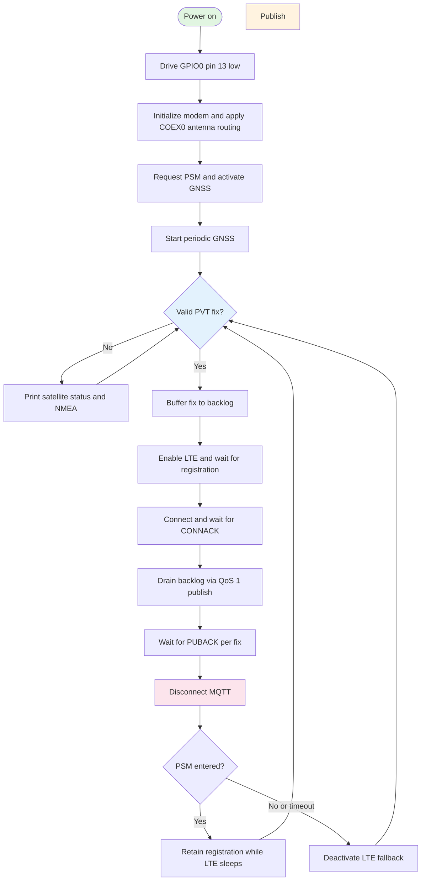

# GPS MQTT tracker for Circuit Dojo nRF9160 hardware

This application acquires a GNSS fix first, enables LTE only when an upload is
ready, publishes the fix to an MQTT broker, and disconnects MQTT after the QoS 1
acknowledgement. Between uploads it keeps network registration through Power
Saving Mode (PSM). If the network does not grant PSM, it safely falls back to
deactivating LTE for the next GNSS cycle. It targets nRF Connect SDK (NCS)
v3.3.0.

The board-specific GNSS setup from `samples/gps` is integrated for both names
used by NCS for this hardware family:

- `circuitdojo_feather/nrf9160/ns` for the Circuit Dojo nRF9160 Feather
- `sparkfun_thing_plus/nrf9160/ns` for the SparkFun Thing Plus nRF9160

For module boundaries and state diagrams, see
[`CODE_ARCHITECTURE.md`](CODE_ARCHITECTURE.md). For a detailed explanation of
every public function, helper, and callback, see
[`CODE_FUNCTIONS.md`](CODE_FUNCTIONS.md). For diagnosis of external-power
startup, the MODE/power-latch behavior, and the optional JMP2 Always-on setting,
see [`POWER_SOURCE_STARTUP_TROUBLESHOOTING_TH.md`](POWER_SOURCE_STARTUP_TROUBLESHOOTING_TH.md).

## Before integration: project differences

The two projects had different purposes. The sample is a GNSS demonstration;
the tracker is an application that transports validated GNSS data over MQTT.

| Area | `samples/gps` before integration | `myprojects/gps_mqtt_tracker` before integration |
| --- | --- | --- |
| Main purpose | Display PVT, satellite, and NMEA data | Periodically publish a GPS fix as JSON over MQTT |
| GNSS implementation | Builds the NCS v3.3.0 GNSS sample source from `${NRF_DIR}` | Own `nrf_modem_gnss` callback and tracker state loop |
| Circuit Dojo hardware setup | Drives GPIO0 pin 13 low in `src/startup.c`; board fragment enables `MODEM_ANTENNA` and `%XCOEX0` | No GPIO power-mode startup and no antenna-routing board fragment |
| Radio flow | GNSS-only by default; LTE is optional for assistance | GPS first, then LTE/MQTT, then LTE deactivation |
| GNSS output | Full PVT status, satellite counts, flags, and NMEA | Location fix used for MQTT; your in-progress changes had already added sample-style PVT/NMEA queues and console output |
| Cloud protocol | Optional nRF Cloud/SUPL assistance | TLS MQTT through Nordic `mqtt_helper` |
| Configuration | Continuous, periodic, TTFF, and optional assistance modes | Periodic interval/timeout, broker/topics, low accuracy, and optional LEDs |
| Supported board metadata | Legacy nRF9160 DK identifier only | No `sample.yaml` before this integration |

The integration deliberately does not copy the sample's complete GNSS
application or assistance clients. Doing so would replace the tracker state
machine and could violate the required GPS-first sequencing. The old sample's
MCUboot setting is also not a GNSS requirement, so bootloader selection remains
outside this integration.

## What was integrated

| Sample behavior | Tracker implementation |
| --- | --- |
| Configure GPIO0 pin 13 as output-low during application initialization | `src/circuitdojo_gnss.c`, enabled by `CONFIG_TRACKER_CIRCUIT_DOJO_GNSS_SETUP` |
| Route the onboard GNSS antenna with `AT%XCOEX0=1,1,1565,1586` | Board-specific `.conf` files enable the NCS modem antenna library |
| Read every PVT event and show search/fix status | PVT message queue and length-safe callback-to-main-thread processing |
| Enable RMC, GGA, GLL, GSA, and GSV NMEA messages | NMEA mask and NMEA message queue |
| Use multiple hot starts and optional low-accuracy fixes | Tracker GNSS use-case configuration |
| Explicitly activate GNSS | GPS-first modem setup before starting the receiver |

The MQTT cycle waits for the QoS 1 PUBACK and closes the MQTT connection before
waiting for PSM. The tracker is intentionally uplink-only, so it does not keep
an MQTT subscription or an open socket while the modem sleeps.

## Runtime flow after integration



The GNSS callback only reads modem frames and places them in message queues.
`main.c` selects the next device state; the GNSS, modem, MQTT, and UI modules
own their implementation details and asynchronous synchronization. LTE
registration, MQTT connection, publication acknowledgement, and disconnection
are passed back through module-owned semaphores.

## Build

Prerequisites:

- NCS v3.3.0, as pinned by the repository's `cell-fund.yml`
- An nRF9160 Feather or SparkFun Thing Plus nRF9160
- A compatible programmer/debugger, SIM, LTE coverage, and GNSS antenna

From the repository root, build the SparkFun-branded board variant:

```bash
west build -p always -b sparkfun_thing_plus/nrf9160/ns \
  myprojects/gps_mqtt_tracker --sysbuild
west flash
```

For a board sold as the Circuit Dojo nRF9160 Feather, use:

```bash
west build -p always -b circuitdojo_feather/nrf9160/ns \
  myprojects/gps_mqtt_tracker --sysbuild
west flash
```

## Configuration

Application-owned settings are declared in `Kconfig`. `prj.conf` remains the
standard Zephyr entry point, and `CMakeLists.txt` merges these subsystem
fragments into the default build:

| File | Settings owned by the fragment |
| --- | --- |
| `config/system.conf` | C library, floating-point formatting, stack, and heap |
| `config/logging.conf` | RTT logging and serial/console policy |
| `config/hardware.conf` | GPIO, heartbeat LED, and DK LED support |
| `config/networking.conf` | Zephyr networking and modem socket offload |
| `config/modem.conf` | Modem library, LTE/GNSS radio mode, PSM, and eDRX |
| `config/mqtt.conf` | MQTT Helper, TLS/security tag, topic, client ID, and QoS defaults |
| `config/tracker.conf` | GNSS interval/timeout, PSM timers, and diagnostics |

Board-specific antenna settings remain in `boards/*.conf` and are discovered
automatically by Zephyr. Deployment-specific changes can still be provided with
a normal Zephyr overlay instead of editing the defaults.

The broker hostname/port and any username/password are deployment-specific
and never tracked in Git. Create the ignored local overlay from the
checked-in template before building for a real broker:

```bash
cd myprojects/gps_mqtt_tracker
cp config/mqtt-credentials.conf.example config/mqtt-credentials.conf
```

Fill in `config/mqtt-credentials.conf` with your broker's hostname, port, and
(optionally) username/password. CMake loads that file automatically when it
exists. A password without a username is rejected during tracker
initialization, and credential contents are never printed.

For a TLS endpoint such as HiveMQ Cloud, also save the public root CA PEM as
`credentials/ca-cert.pem`. The tracker provisions that CA to
`CONFIG_MQTT_HELPER_SEC_TAG` after modem initialization and before MQTT
connect. The PEM is ignored by Git; it is a CA only, not a client certificate
or private key.

Default values are defined in [`Kconfig`](Kconfig) and the configuration fragments under [`config/`](config/). Use `west build -t menuconfig` to inspect all options interactively.

| Config Option | Edit in | Description |
| --- | --- | --- |
| `CONFIG_TRACKER_PERIODIC_INTERVAL` | `config/tracker.conf` | Time between GNSS fix cycles |
| `CONFIG_TRACKER_PERIODIC_TIMEOUT` | `config/tracker.conf` | Search timeout; `0` means no timeout |
| `CONFIG_TRACKER_PSM_PERIODIC_TAU_SECONDS` | `config/tracker.conf` | Requested periodic TAU; the network may grant a different value |
| `CONFIG_TRACKER_PSM_ACTIVE_TIME_SECONDS` | `config/tracker.conf` | Requested paging time before PSM; zero selects uplink-only operation |
| `CONFIG_TRACKER_PSM_ENTRY_TIMEOUT_SECONDS` | `config/tracker.conf` | Wait for PSM before falling back to LTE deactivation |
| `CONFIG_TRACKER_GNSS_DIAGNOSTICS` | `config/tracker.conf` | Development satellite, search, and NMEA diagnostics |
| `CONFIG_GNSS_LOW_ACCURACY` | `Kconfig` | Permit faster, lower-accuracy fixes |
| `CONFIG_GNSS_HIGH_ACCURACY_TIMING_SOURCE` | `Kconfig` | Select the TCXO timing source |
| `CONFIG_TRACKER_CIRCUIT_DOJO_GNSS_SETUP` | `boards/*.conf` | Apply the GPIO power-mode setup |
| `CONFIG_TRACKER_GNSS_POWER_MODE_PIN` | `Kconfig` | GPIO0 pin copied from the Circuit Dojo sample |
| `CONFIG_STARTUP_LED` | `config/hardware.conf` | State blink groups on `led0`; set to `n` to disable |
| `CONFIG_MQTT_BROKER_HOSTNAME` | Local credential fragment | MQTT broker hostname; never committed |
| `CONFIG_MQTT_BROKER_PORT` | `config/mqtt.conf` | TLS MQTT broker port; override in the local fragment for a non-standard port |
| `CONFIG_MQTT_HELPER_PORT` | `config/mqtt.conf` | Actual MQTT Helper port; keep it equal to the broker port |
| `CONFIG_MQTT_PUB_TOPIC` | `config/mqtt.conf` | GPS JSON destination topic |
| `CONFIG_MQTT_PUB_QOS` | `config/mqtt.conf` | `0` sends without PUBACK; `1` waits for PUBACK |
| `CONFIG_MQTT_CLIENT_ID` | `config/mqtt.conf` | Leave empty to derive `nrf-<IMEI>` automatically |
| `CONFIG_MQTT_BROKER_USERNAME` | Local credential fragment | Optional broker authentication username |
| `CONFIG_MQTT_BROKER_PASSWORD` | Local credential fragment | Optional broker authentication password; requires a username |

The board status LED (`led0`) repeats these patterns:

| Pattern | Application state |
| --- | --- |
| 2 blinks, then 1 second off | Waiting for a GNSS fix |
| 3 blinks, then 1 second off | Preparing LTE and waiting for network registration |
| 4 blinks, then 1 second off | LTE registration confirmed; connecting, publishing, or disconnecting MQTT |
| Off | Initialization or low-power preparation |

Each blink is 200 ms on, with 200 ms off between blinks. A state change
starts with a 1-second dark gap so consecutive groups remain distinguishable.
Tune the pulse and group pause in `config/hardware.conf` using
`CONFIG_WORKING_LED_BLINK_INTERVAL_MS` and `CONFIG_WORKING_LED_GROUP_PAUSE_MS`.
The four-blink pattern indicates the upload phase after LTE registration;
it does not confirm MQTT delivery or continuously monitor registration loss.
The GNSS waiting phase can include sleep between periodic fix attempts.

The current configuration enables MQTT over TLS; the specific broker is set
locally per deployment (see Configuration above). Do not commit broker
hostnames, credentials, or CA/device certificate files.

Published payload example:

```json
{"lat":13.756331,"lon":100.501765,"alt":12.5,"acc":3.2,"time":"2026-08-08T09:30:00Z"}
```

## Hardware verification

A successful build checks API and configuration integration only. On the board:

1. Test outdoors with a suitable GNSS antenna and confirm a valid fix. Enable
   `CONFIG_TRACKER_GNSS_DIAGNOSTICS` temporarily when satellite/NMEA detail is
   needed.
2. Confirm the log shows LTE activation only after the valid fix.
3. Confirm home or roaming registration, MQTT CONNACK, PUBACK, and disconnect.
4. Subscribe to the configured topic from another client and validate the JSON.
5. Confirm a PSM update and PSM-entry event occur after MQTT disconnect.
6. Confirm later uploads retain registration instead of performing a fresh LTE
   attach; if PSM is rejected, confirm the LTE-deactivation fallback.
7. Compare average current with the previous firmware using a Power Profiler
   Kit while keeping the GNSS interval and RF conditions unchanged.

GNSS reception, GPIO/antenna routing, carrier registration, carrier-granted PSM
timers, actual PSM entry, broker reachability, current consumption, and repeated
PSM/fallback cycles require physical hardware and network testing; they cannot
be proven by a compile-only test.

## Files

```text
myprojects/gps_mqtt_tracker/
|-- .gitignore
|-- boards/
|   |-- circuitdojo_feather_nrf9160_ns.conf
|   `-- sparkfun_thing_plus_nrf9160_ns.conf
|-- config/
|   |-- hardware.conf
|   |-- logging.conf
|   |-- modem.conf
|   |-- mqtt.conf
|   |-- mqtt-credentials.conf.example
|   |-- networking.conf
|   |-- system.conf
|   `-- tracker.conf
|-- credentials/
|   `-- README.md
|-- src/
|   |-- circuitdojo_gnss.c
|   |-- main.c
|   |-- tracker_backlog.c/.h
|   |-- tracker_gnss.c/.h
|   |-- tracker_modem.c/.h
|   |-- tracker_mqtt.c/.h
|   |-- tracker_status.c/.h
|   `-- tracker_ui.c/.h

|-- CMakeLists.txt
|-- CODE_ARCHITECTURE.md
|-- CODE_FUNCTIONS.md
|-- Kconfig
|-- prj.conf
|-- sample.yaml
`-- README.md
```
