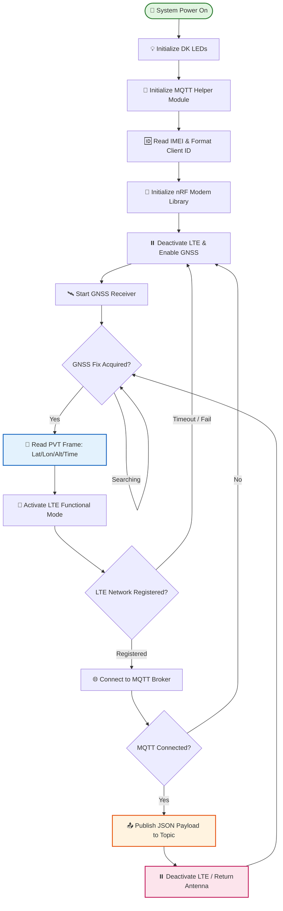
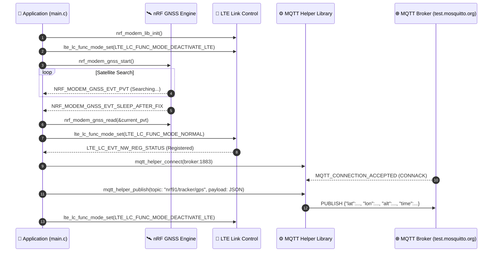
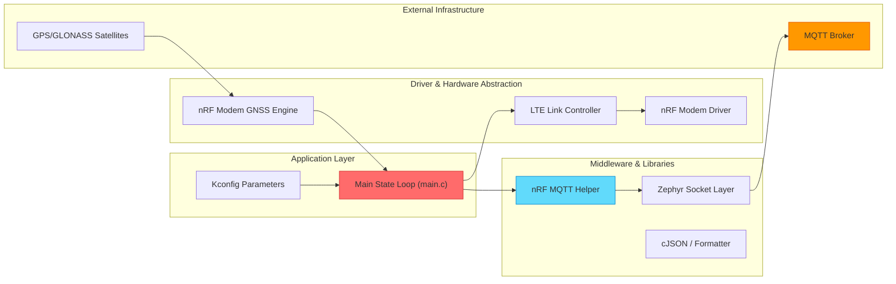

# GPS MQTT Asset Tracker (`gps_mqtt_tracker`)

> A production-grade cellular IoT asset tracking application for Nordic Semiconductor **nRF91 Series** SiP devices (nRF9160 DK, Thingy:91, nRF9161 DK). 

---

## 🌟 Key Features

- **🛰️ GNSS Satellite Location Tracking**: Interfaces directly with `nrf_modem_gnss` to capture periodic satellite fixes (PVT frames).
- **📡 Cellular MQTT Telemetry**: Encapsulates GPS coordinates into JSON and publishes telemetry over LTE-M or NB-IoT using Nordic's `mqtt_helper` module.
- **⚡ GPS-First Dynamic Antenna Control**: Switches modem modes between GNSS acquisition (`LTE_LC_FUNC_MODE_DEACTIVATE_LTE`) and LTE connection (`LTE_LC_FUNC_MODE_NORMAL`) for maximum satellite fix reliability on shared antenna designs.
- **🆔 Automatic IMEI Client ID**: Reads modem hardware IMEI via `AT+CGSN` to generate unique MQTT Client IDs (`nrf-<IMEI>`).
- **🔋 Power Optimization**: Supports 3GPP PSM and eDRX modes for extended battery life.
- **💡 Configurable LED Status**: Optional LED status indicators (`CONFIG_ENABLE_LEDS=n` by default to conserve energy).

---

## 📐 System Operation Principles

### 1. Core Workflow Diagram



---

### 2. System Interaction Sequence



---

### 3. Technical Architecture Diagram



---

## 🚀 Quick Start (Step-by-Step)

### Step 1: Prerequisites

- **Nordic nRF Connect SDK (NCS)** v2.x / v3.x installed
- **Zephyr `west` Toolchain**
- **Target Hardware**: nRF9160 DK, Thingy:91, or nRF9161 DK with LTE SIM card and GNSS antenna

### Step 2: Navigate to Directory

```bash
cd myprojects/gps_mqtt_tracker
```

### Step 3: Build Application

Build for your target board using the non-secure target (`_ns`):

```bash
# For nRF9160 DK
west build -b nrf9160dk_nrf9160_ns

# For Thingy:91
west build -b thingy91_nrf9160_ns

# For nRF9161 DK
west build -b nrf9161dk_nrf9161_ns
```

### Step 4: Flash Firmware

```bash
west flash
```

### Step 5: Verify Operation

Open serial monitor at **115200 baud**:

```text
*** Booting Zephyr OS build v3.x.x ***
[00:00:00.100,000] <inf> GPS_MQTT_Tracker: 🚀 GPS MQTT Asset Tracker Application Started
[00:00:00.200,000] <inf> GPS_MQTT_Tracker: Generated MQTT Client ID: nrf-354315xxxxxxxx
[00:00:00.300,000] <inf> GPS_MQTT_Tracker: GNSS initialized and started successfully
[00:00:05.000,000] <inf> GPS_MQTT_Tracker: Searching for GNSS Satellites...
[00:00:45.000,000] <inf> GPS_MQTT_Tracker: GNSS fix achieved! Reading PVT frame...
[00:00:45.010,000] <inf> GPS_MQTT_Tracker: 📍 GNSS Location Fix Acquired:
   Latitude:  13.756331°
   Longitude: 100.501765°
   Altitude:  12.5 m
[00:00:45.100,000] <inf> GPS_MQTT_Tracker: Activating LTE to send GPS payload over MQTT...
[00:00:48.200,000] <inf> GPS_MQTT_Tracker: 📶 LTE Registered (Home Network)
[00:00:48.300,000] <inf> GPS_MQTT_Tracker: ✅ Connected to MQTT Broker: test.mosquitto.org:1883
[00:00:48.400,000] <inf> GPS_MQTT_Tracker: 📤 Publishing GPS payload to topic 'nrf91/tracker/gps':
   {"lat":13.756331,"lon":100.501765,"alt":12.5,"acc":3.2,"time":"2026-08-01T13:54:00Z"}
[00:00:50.400,000] <inf> GPS_MQTT_Tracker: Deactivating LTE to return antenna control to GNSS...
```

---

## ⚙️ Kconfig Configuration Reference

Configure settings in `prj.conf` or menuconfig (`west build -t menuconfig`):

| Kconfig Parameter | Default Value | Status | Description |
|:---|:---|:---|:---|
| `CONFIG_MQTT_BROKER_HOSTNAME` | `"test.mosquitto.org"` | Required | Target MQTT Broker hostname/IP |
| `CONFIG_MQTT_BROKER_PORT` | `1883` | Required | Target MQTT Broker port (`1883` / `8883`) |
| `CONFIG_MQTT_PUB_TOPIC` | `"nrf91/tracker/gps"` | Required | Telemetry publish topic |
| `CONFIG_MQTT_SUB_TOPIC` | `"nrf91/tracker/cmd"` | Optional | Command receive topic |
| `CONFIG_MQTT_CLIENT_ID` | `""` | Optional | Custom Client ID (`nrf-<IMEI>` if blank) |
| `CONFIG_TRACKER_PERIODIC_INTERVAL` | `120` | Required | Seconds between GNSS scans |
| `CONFIG_TRACKER_PERIODIC_TIMEOUT` | `300` | Required | Max GNSS search timeout (seconds) |
| `CONFIG_GNSS_LOW_ACCURACY` | `y` | Recommended | Fast low-accuracy lock mode |
| `CONFIG_ENABLE_LEDS` | `n` | Optional | Visual status LED indicators |

---

## 📁 File Structure

```text
myprojects/gps_mqtt_tracker/
├── CMakeLists.txt      # Build script configuration
├── Kconfig             # Application Kconfig parameters
├── prj.conf            # Zephyr configuration defaults
├── README.md           # Application documentation
└── src/
    └── main.c          # Tracker application entry point & state machine
```

---

## 📜 License

Copyright (c) 2024 Nordic Semiconductor ASA.  
SPDX-License-Identifier: LicenseRef-Nordic-5-Clause
