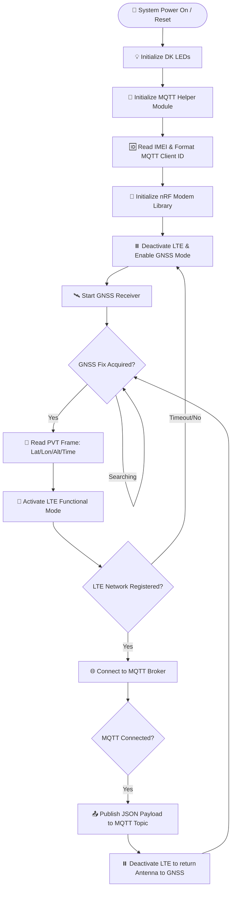
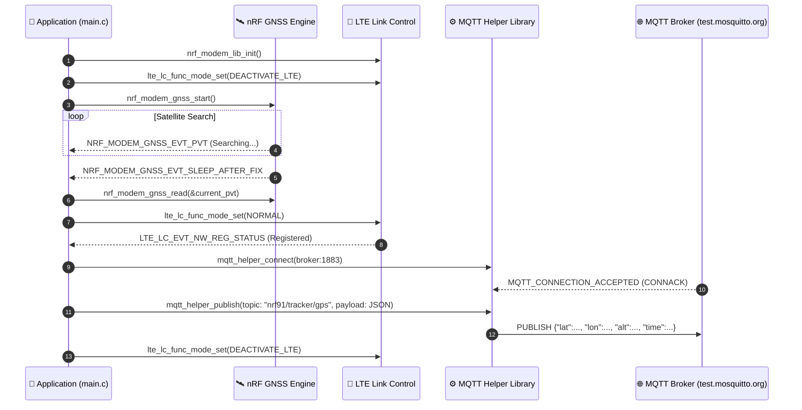

# GPS MQTT Asset Tracker (`gps_mqtt_tracker`)

A production-grade cellular IoT asset tracking application for Nordic Semiconductor **nRF91 Series** devices (nRF9160 DK, Thingy:91, nRF9161 DK). The application acquires periodic GPS/GNSS position fixes (Latitude, Longitude, Altitude, Accuracy, UTC Timestamp) and publishes JSON-formatted telemetry data to an **MQTT Broker** over LTE-M or NB-IoT.

---

## 🌟 Features

- **GNSS Satellite Location Tracking**: Uses the `nrf_modem_gnss` interface to capture periodic satellite fixes (PVT data frames).
- **MQTT Telemetry Transmission**: Formats coordinates into JSON and publishes over MQTT using Nordic's `mqtt_helper` library.
- **Dynamic Antenna Management**: Switches modem modes between GNSS acquisition (`LTE_LC_FUNC_MODE_DEACTIVATE_LTE`) and LTE connection (`LTE_LC_FUNC_MODE_NORMAL`) for maximum satellite fix reliability on shared antenna designs.
- **Automatic Client ID Generation**: Reads the modem's hardware IMEI via `AT+CGSN` to generate unique MQTT Client IDs (`nrf-<IMEI>`).
- **Status Indicators (Configurable)**: Optional LED status indicators (`CONFIG_ENABLE_LEDS=n` by default to conserve power).


---

## 📐 System Operation Principles

### 1. Core Workflow Diagram



### 2. Data Flow Diagram



---

## 🚀 Quick Start (Step by Step)

### Step 1: Prerequisites

- **Nordic nRF Connect SDK (NCS)** v2.x or v3.x installed
- **Zephyr `west` Toolchain**
- **Hardware**: nRF9160 DK, Thingy:91, or nRF9161 DK with GPS antenna and cellular SIM card

### Step 2: Navigate to Project Directory

```bash
cd myprojects/gps_mqtt_tracker
```

### Step 3: Build the Application

Build for your target nRF91 board (non-secure target `_ns`):

```bash
west build -b nrf9160dk_nrf9160_ns
```

*For Thingy:91:*
```bash
west build -b thingy91_nrf9160_ns
```

### Step 4: Flash to Board

```bash
west flash
```

### Step 5: Verify Operation

Open a serial monitor at 115200 baud to view system output:

```text
*** Booting Zephyr OS build v3.x.x ***
[00:00:00.100,000] <inf> GPS_MQTT_Tracker: 🚀 GPS MQTT Asset Tracker Application Started
[00:00:00.200,000] <inf> GPS_MQTT_Tracker: Generated MQTT Client ID: nrf-354315xxxxxxxx
[00:00:00.300,000] <inf> GPS_MQTT_Tracker: GNSS initialized and started successfully
[00:00:05.000,000] <inf> GPS_MQTT_Tracker: Searching for GNSS Satellites...
[00:00:45.000,000] <inf> GPS_MQTT_Tracker: GNSS fix achieved! Reading PVT frame...
[00:00:45.010,000] <inf> GPS_MQTT_Tracker: 📍 GNSS Location Fix Acquired:
   Latitude:  13.756331°
   Longitude: 100.501765°
   Altitude:  12.5 m
[00:00:45.100,000] <inf> GPS_MQTT_Tracker: Activating LTE to send GPS payload over MQTT...
[00:00:48.200,000] <inf> GPS_MQTT_Tracker: 📶 LTE Registered (Home Network)
[00:00:48.300,000] <inf> GPS_MQTT_Tracker: ✅ Connected to MQTT Broker: test.mosquitto.org:1883
[00:00:48.400,000] <inf> GPS_MQTT_Tracker: 📤 Publishing GPS payload to topic 'nrf91/tracker/gps':
   {"lat":13.756331,"lon":100.501765,"alt":12.5,"acc":3.2,"time":"2026-08-01T13:54:00Z"}
[00:00:50.400,000] <inf> GPS_MQTT_Tracker: Deactivating LTE to return antenna control to GNSS...
```

---

## ⚙️ Kconfig Configuration (`prj.conf` & `Kconfig`)

You can customize MQTT broker settings, topics, and fix intervals via `prj.conf` or `menuconfig`:

| Kconfig Parameter | Default Value | Description |
|---|---|---|
| `CONFIG_MQTT_BROKER_HOSTNAME` | `"test.mosquitto.org"` | MQTT Broker address |
| `CONFIG_MQTT_BROKER_PORT` | `1883` | MQTT Broker port (1883 for TCP) |
| `CONFIG_MQTT_PUB_TOPIC` | `"nrf91/tracker/gps"` | Topic for publishing GPS JSON data |
| `CONFIG_MQTT_SUB_TOPIC` | `"nrf91/tracker/cmd"` | Topic for receiving remote commands |
| `CONFIG_TRACKER_PERIODIC_INTERVAL` | `120` | Interval between GPS fixes (seconds) |
| `CONFIG_TRACKER_PERIODIC_TIMEOUT` | `300` | Max GPS fix search timeout (seconds) |
| `CONFIG_GNSS_LOW_ACCURACY` | `y` | Enables fast low-accuracy fixes |

---

## 📁 Project Structure

```text
myprojects/gps_mqtt_tracker/
├── CMakeLists.txt      # Build configuration file
├── Kconfig             # Custom Kconfig options
├── prj.conf            # Project configuration defaults
├── README.md           # Documentation
└── src/
    └── main.c          # Application entry point & tracker logic
```

---

## 📜 License

Copyright (c) 2024 Nordic Semiconductor ASA.  
SPDX-License-Identifier: LicenseRef-Nordic-5-Clause
