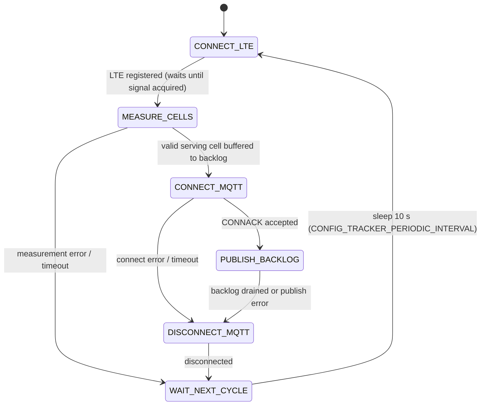

# LTE Cell MQTT Tracker

An nRF Connect SDK v3.3.0 cellular asset tracker that uses **LTE serving and
neighbor cell measurements** (`lte_lc_neighbor_cell_measurement()`) instead of
GNSS as its primary positioning input, publishing JSON cell reports over MQTT
with TLS and QoS 1.

## Runtime Flow



- **Backlog**: Unsent `struct tracker_cell_report` entries are buffered in RAM
  (`CONFIG_TRACKER_BACKLOG_CAPACITY`, default `40`) with adaptive stride
  sampling and removed only after QoS 1 `PUBACK`.
- **Published JSON payload** (`CONFIG_MQTT_PUB_TOPIC`, default `test/nrf91/cell`):

```json
{"mcc":520,"mnc":3,"tac":12345,"cid":67890123,"earfcn":3600,"pci":123,"rsrp":-95,"rsrq":12,"uptime_ms":12345,"meas_time_ms":12000,"ncells":[{"earfcn":3600,"pci":124,"rsrp":-102,"rsrq":10}]}
```

- **Status LED (`led0`, `CONFIG_STARTUP_LED=y`)**: 2 blinks = LTE registration,
  3 blinks = LTE cell scan, 4 blinks = MQTT upload, off = low-power sleep.

## Local Broker Setup

Create the ignored local overlay and place the broker root CA before flashing:

```bash
cd myprojects/lte_mqtt_tracker
cp config/mqtt-credentials.conf.example config/mqtt-credentials.conf
```

Edit `config/mqtt-credentials.conf` with your broker hostname and credentials,
and save the public root CA PEM as `credentials/ca-cert.pem`.

## Build

From an initialized NCS v3.3.0 west workspace:

```bash
west build -p always -b sparkfun_thing_plus/nrf9160/ns \
  myprojects/lte_mqtt_tracker --sysbuild
```

Also allowed: `circuitdojo_feather/nrf9160/ns`.

## Hardware Verification Boundary

A compile-only build verifies API, Kconfig, and memory integration. Physical
hardware, SIM, carrier network, and broker testing is still required to verify
LTE-M/NB-IoT registration, neighbor cell measurement results, TLS handshake,
QoS 1 `PUBACK`, PSM entry/fallback, and power consumption.
