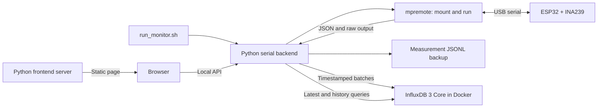

# ESP32 Power Monitor

MicroPython firmware for an ESP32 reading two INA239 current/power channels
over SPI. The ESP32 writes one JSON measurement frame per line; a local Python
backend serves the browser monitor.

## Project layout

- `main.py`, `boot.py`, and the sensor modules are MicroPython files
  mounted into the ESP32 from this directory. Keep these files at the project
  root so device imports continue to resolve.
- `host/serial_monitor.py` runs on the computer, owns the serial connection,
  timestamps readings, and serves the backend API.
- `host/frontend_server.py` serves the browser interface as a separate process.
- `host/influxdb_store.py` batches timestamped measurements into InfluxDB 3 Core.
- `compose.yaml` runs InfluxDB 3 Core with persistent local file storage.
- `web/index.html` contains the browser interface and graph.
- `tests/` contains host-side regression checks; `logs/` and Python caches are
  local generated files and ignored by Git.

## Setup

1. Copy `config.example.py` to `config.py`.
2. Fill in `config.py` with your local Wi-Fi and MQTT broker credentials.
   `config.py` is gitignored and must never be committed.
3. Flash `boot.py`, `config.py`, `main.py`, and the INA239 driver
   (`ina239.py`) to the device.

## Note on `config.py`

`main.py` currently does not import `config.py` — it only reads the two
INA239 channels and writes to the serial console; there is no
Wi-Fi/MQTT connection code in this firmware yet. `config.py` exists as the
credential file for that future integration. Keep credentials there instead
of hardcoding them in `main.py` once Wi-Fi/MQTT support is added.

## Measurement diagnostics

The driver reads the INA239 POWER register as a 24-bit unsigned value.
Each measurement checks DIAG_ALRT before and after reading the values; a math
overflow or trim-memory checksum error rejects the reading. The affected
channel reports a read error over serial while the other channel continues. In
JSON mode, the failed channel is `null`
and `error0` or `error1` contains the reason.

Run the driver regression tests on a computer with Python 3:

```bash
python3 -m unittest discover -s myprojects/monitor-application/ESP32-power-monitor/tests -v
```

These tests use simulated SPI responses; electrical accuracy and operation on
the ESP32 still require a hardware test.

## Run temporarily from the computer

With MicroPython already installed on the ESP32, run:

```bash
./myprojects/monitor-application/ESP32-power-monitor/run_monitor.sh
```

Then open [http://127.0.0.1:3100](http://127.0.0.1:3100) in a browser.

The default serial port is `/dev/cu.usbserial-0001`. Pass another port as the
first argument if needed. The script uses `mpremote` from PATH or the dedicated
`~/.local/share/esp32-power-monitor-tools` environment; `MPREMOTE_BIN` can
override the executable. It mounts this local application directory and runs
it on the ESP32 without copying files to the device. The original running
program is interrupted. Keep the USB connection and terminal open. Press
Ctrl+C to stop, then press the board Reset button to run its original program.
Close other serial monitors before launching.

## Browser serial monitor

Install and start Docker Desktop, then run `run_monitor.sh`. It starts the local
InfluxDB 3 Core container, a separate frontend server, and the serial backend.
The database uses a Docker named volume, so measurements persist across monitor
restarts. Docker is only used for InfluxDB; `mpremote` and the serial backend
stay on the host computer so they can access the USB device.

The browser opens at [http://127.0.0.1:3100](http://127.0.0.1:3100). It reads
latest values and graph history from the backend API, which reads the stored
measurements from InfluxDB. The browser does not connect to InfluxDB directly.
The backend assigns the computer's UTC timestamp when each serial frame arrives
and batches writes asynchronously, leaving the ESP32's 250 ms (4 Hz) loop
independent of database latency. A JSONL backup is also kept under `logs/`.

Use **Clear all InfluxDB data** below the monitor pages and confirm the dialog
to delete all stored data in the configured `INFLUXDB_DATABASE` (default:
`esp32_power_monitor`). This requires InfluxDB 3 Core 3.12 or newer and uses
[the database deletion API](https://docs.influxdata.com/influxdb3/core/api/database/)
with immediate hard deletion, then recreates the database and monitor table.
All tables and database resources in the configured database are removed. Other databases and local JSONL backups are kept.
Old queued samples are discarded after a successful clear; new ESP32 readings
continue to be recorded. The button is disabled during deletion and reports
success or failure. Database deletion cannot be undone.

The InfluxDB container listens on host loopback port 8181 with authentication
disabled for this local development setup. Its port is bound to `127.0.0.1`.
To stop the monitor and frontend, press Ctrl+C in the launcher Terminal. The
database container remains running; stop it with `docker compose down` from this
directory. Do not use `docker compose down -v` unless you intend to erase the
stored measurements.



The page displays voltage, current, power, and errors for both channels, plus
a selectable time-series graph (voltage, current, or power) for the last minute,
five minutes, 15 minutes, or hour. Channel visibility can be toggled. The graph unit selector supports V/mV for
voltage, A/mA/µA for current, and W/mW/µW for power. Axis values and graph
labels follow the selected unit; stored measurements keep their original units.
Each metric remembers its selected unit until the page is reloaded. The graph
reads up to one hour of measurements from InfluxDB. The latest JSON frame and
last 200 raw serial lines remain available in the backend. Pause and clear
affect only the visible serial console, not acquisition or logging. The page
polls every 500 ms; this does not change the firmware's 250 ms measurement
interval (4 Hz).
Data older than four seconds is marked stale. If the serial process exits, the
page stays available with its stopped/error status and raw diagnostic output.
Stop the launcher and run it again to reconnect.

Each firmware frame uses volts, milliamps, and watts:

```json
{"uptime_ms":1000,"channel0":{"battery_v":4.081,"load_v":4.081,"current_ma":0.0,"power_w":0.0},"channel1":null,"error1":"INA239 math overflow: current and power invalid"}
```

Valid frames are also printed to Terminal and appended to `logs/measurements-*.jsonl`
with the same UTC `received_at` timestamp written to InfluxDB. Mount messages, tracebacks,
and other raw lines remain visible but are not recorded as measurement JSON.
The logs and Python caches are ignored by Git.

The frontend and backend listen only on `127.0.0.1`. To change the frontend
port:

```bash
MONITOR_WEB_PORT=3102 ./myprojects/monitor-application/ESP32-power-monitor/run_monitor.sh
```

Use `MONITOR_API_PORT` to change the backend port. Use `INFLUXDB_URL` and
`INFLUXDB_DATABASE` to change the local database endpoint or database name.

Press Ctrl+C in Terminal to stop the server and temporary device loop. If the
connection has failed, press board Reset to ensure the original program runs.
Closing the browser does not stop recording. Tests cover firmware JSON output,
SPI reads, frame validation, logging, bounded raw history, and HTTP responses.
Browser and launcher checks with simulated serial verify the display and stop
flow; hardware accuracy is not established by these checks.
