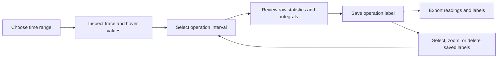

# Power trace analysis dashboard

The dashboard helps engineers correlate electrical measurements from the two
INA239 channels with operations such as GPS finding, LTE initialization, and MQTT
upload. Open `#graphs` for analysis or `#overview` for the device monitor.

## Workflow and implemented functions



| Task | Controls and behavior |
| --- | --- |
| Navigate time | 1 min to 24 hour presets, local From/To, Previous/Next, Live |
| Zoom | Zoom +/−, Zoom to selection, Reset zoom to the preceding range |
| Control refresh | Auto refresh, manual Refresh, loading/updated/error status; recording continues when the view is paused |
| Configure trace | Voltage/current/power, units, raw or 1 s/5 s/1 min/1 hour averages, CH0/CH1 visibility, Include zero |
| Inspect values | Shared hover crosshair, CH0/CH1 values, millisecond timestamp, active labels, average sample count/span |
| Inspect with keyboard | Focus the graph; Home/End and left/right arrows inspect samples, Escape dismisses the tooltip |
| Select an interval | Drag across the graph, Use visible range, Select a saved label, Clear selection |
| Quantify | Raw sample count, minimum, maximum, arithmetic mean, latest, charge mAh, energy mWh, integration spans |
| Label operations | Name the interval, Save label, aligned event ribbon, persisted list, Select/Zoom/Delete |
| Export | Separate raw readings CSV and label CSV for the selected interval, or the visible range if no interval is selected |
| Diagnose device | Latest voltage/current/power, raw serial, latest JSON, acquisition errors and staleness |
| Manage database | Clear all measurements and labels, with explicit confirmation; JSONL backup files remain |

## Layout and visual direction

The electrical trace is the main workspace. An aligned operation ribbon maps
saved events onto the same time axis. The interval notebook keeps statistics,
integrals, and the label editor together. Saved intervals sit below the trace;
database management is collapsed below the work area. On narrow screens the
notebook follows the trace and interval list.

The interface uses pearl `#f3f3f8`, white `#ffffff`, graphite `#29243e`, cobalt
`#5260c9` for CH0, teal `#237f81` for CH1, and brass `#ae792d` for operation
intervals. Local Optima/Trebuchet MS display fonts, Segoe UI/Helvetica Neue body
fonts, and Menlo/Consolas data fonts avoid an external font request.

## Reading the analysis correctly

Hover snaps to the nearest raw frame within 750 ms. Missing channel readings and
larger empty spans show **No reading**. In average mode the tooltip shows the
actual plotted average containing that frame, with its raw sample span/count;
it does not invent values across missing data. Labels are shown for the cursor's
actual time. Millisecond precision reflects the host timestamp, not a calibrated
sensor or radio clock.

The notebook follows the selected interval when present, otherwise the visible
range. Statistics use raw finite samples for the selected metric, converted to
the chosen display unit. Mean is a sample arithmetic mean; Latest is the latest
valid sample in that interval. Channel visibility applies to both the trace and
notebook. Changing graph averaging does not change notebook statistics.

Charge and energy are signed trapezoidal estimates from consecutive raw samples:

```text
charge_mAh = sum((I_previous_mA + I_current_mA) / 2 * dt_seconds) / 3600
energy_mWh = sum((P_previous_W + P_current_W) / 2 * dt_seconds) * 1000 / 3600
```

Only pairs with `0 < dt <= 3 seconds` and valid readings at both endpoints are
included. Missing readings reset the pair. Samples outside the interval are not
used; no endpoints are extrapolated. Current span and Power span report included
duration independently. A single sample cannot establish an integral and shows
an em dash. Valid zero readings can establish a zero integral. These values are
estimates over measured spans, not complete consumption claims or hardware
calibration results.

Dense trace rendering retains the first/last and minimum/maximum points within
horizontal display buckets, preserving missing-sample and time-gap boundaries.
Hover, averages, notebook statistics, and exports still use the loaded samples.
Large 24 hour queries can take longer to load; no controlled latency benchmark
has been performed.

## Labels and deletion

Labels persist in the configured InfluxDB database. Deleting a label requires
confirmation and affects that label ID only. The backend writes a persistent
marker into `annotation_deletions`; history queries exclude marked IDs from
bands, the event ribbon, saved intervals, hover labels, and CSV exports. The
original annotation row remains in InfluxDB. There is no restore/edit UI.
Measurement rows and JSONL logs are unaffected. Clear all InfluxDB data removes
both annotation tables and measurements.

`DELETE /api/annotations/<32-character lowercase hexadecimal ID>` requires
`X-Confirm-Label: delete`, and a local frontend origin when Origin is present.
Responses are 204 on success (including repeated deletion), 400 for invalid
confirmation/ID, 404 for a missing label, and 503 for a database failure. Failed
writes preserve the label in the UI; stale pending history responses cannot
restore a successfully deleted label.

## CSV boundaries

Reading CSV contains UTC timestamps, uptime, both channels in stored units
(V, mA, W), and channel errors. Graph display units and averages do not change
exported readings. Label CSV contains ID, text, original UTC endpoints, and
original duration. An overlapping label is exported with its complete interval,
even if part falls outside the analysis scope. Text is quoted/escaped, and
spreadsheet formula prefixes in text cells are neutralized.

## Verification scope

Run `python3 -m unittest discover -s myprojects/monitor-application/ESP32-power-monitor/tests -q`
from the workspace root. The Node assertions run through the Python frontend
suite and cover conversions, averages, gaps, hover, statistics, integration,
selection, navigation, request races, pause, CSV safety, and label deletion.

Browser checks use **illustrative** generated traces in an isolated InfluxDB
database, including GPS/LTE/MQTT labels. Desktop and 390 px mobile views, keyboard
inspection, selection, label saving, and CSV downloads were checked. A separate
isolated database check verifies deletion persists across a new store instance
while other labels and readings remain. No actual ESP32/LTE/GPS run, sensor
calibration, controlled usability comparison, or 24 hour performance measurement
is claimed.
