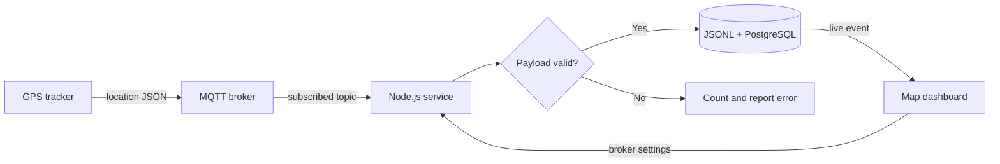

# GOS Monitoring

GOS Monitoring is a local web application for watching an asset's MQTT location reports on a live map. It configures the MQTT subscription from the browser, validates tracker payloads, streams accepted fixes to the dashboard, and keeps location history across restarts.

## Features

- Connect to HiveMQ or another MQTT/MQTTS/WebSocket broker from the web GUI
- Validate location payloads before plotting or storing them
- Plot the current fix, full route, altitude, accuracy, device time, and MQTT topic
- Stream new fixes to every open dashboard using server-sent events
- Store append-only location history in `data/locations.jsonl` and, optionally, PostgreSQL
- Clear all stored GPS logs from the dashboard, JSONL history, and PostgreSQL table
- Preserve broker configuration while never returning the saved password to the browser
- Responsive keyboard-accessible dashboard for desktop and mobile

## How it works



The browser does not connect directly to MQTT. The Node.js service owns the broker connection, stores accepted reports, and exposes only password-free configuration through its API.

## Quick start

### Prerequisites

- Node.js 22 or newer
- An MQTT broker reachable from this computer
- A publisher sending the documented JSON payload
- Internet access for OpenStreetMap tiles (the application code and Leaflet are served locally)

### 1. Install dependencies

```bash
cd myprojects/monitor-application/gps_monitoring
npm install
```

Expected result: npm installs `mqtt` and `leaflet` without security or resolution errors.

### 2. Start the application

```bash
npm start
```

Expected output:

```text
GOS Monitoring is running at http://localhost:3000
```

Open [http://localhost:13000](http://localhost:13000), select **Broker settings**, enter the broker and PostgreSQL destination details, then select **Save & connect**. The default is the public HiveMQ broker on topic `test/nrf91`.

For HiveMQ Cloud, set the protocol to `mqtts`, use your cluster hostname, port `8883`, and provide the username and password from your HiveMQ Cloud cluster.

### 3. Publish a test location

With Mosquitto client tools installed, publish to the topic configured in the dashboard:

```bash
mosquitto_pub -h localhost -p 1883 -t assets/demo/location -m '{"lat":13.846494,"lon":100.568683,"alt":0.9,"acc":22.4,"time":"2026-08-08T11:24:09Z"}'
```

Expected result: the map moves to the Bangkok location and the fix appears at the top of the location ledger.

## MQTT configuration

| Setting | Required | Default | Notes |
| --- | --- | --- | --- |
| Protocol | Yes | `mqtt` | `mqtt`, `mqtts`, `ws`, or `wss` |
| Broker host | Yes | `broker.hivemq.com` | Hostname or IP only; do not include a URL scheme |
| Port | Yes | `1883` | Common TLS port is `8883` |
| Topic | Yes | `test/nrf91` | MQTT `+` and `#` wildcards are supported |
| Client ID | Yes | `gps-monitoring-web` | Must be unique on the broker |
| QoS | Yes | `0` | QoS 0, 1, or 2 |
| Username/password | No | Empty | A blank password keeps the current saved value |
| Verify TLS certificate | Recommended | Enabled | Disable only for controlled development brokers |

Broker settings are stored locally in `data/mqtt-config.json` with owner-only permissions when supported by the operating system. The `data/` directory is gitignored. Do not expose this application directly to an untrusted network: it intentionally has no login layer.

## Location payload

Every accepted MQTT message must be one JSON object:

```json
{
  "lat": 13.846494,
  "lon": 100.568683,
  "alt": 0.9,
  "acc": 22.4,
  "time": "2026-08-08T11:24:09Z"
}
```

- `lat`: number from -90 through 90
- `lon`: number from -180 through 180
- `alt`: altitude in metres
- `acc`: non-negative horizontal accuracy in metres
- `time`: valid ISO-8601 date/time

Invalid messages are not stored or plotted. Their count and latest validation error appear in the dashboard.

## Data and configuration

| Environment variable | Required | Default | Purpose |
| --- | --- | --- | --- |
| `PORT` | No | `3000` | HTTP listening port |
| `HOST` | No | `127.0.0.1` | HTTP bind address; use `0.0.0.0` only behind suitable network controls |
| `DATA_DIR` | No | `./data` | Persistent config and location-log directory |

Set PostgreSQL from **Broker & database** in the dashboard: database host, port, database name, username, password, and TLS. Leave the database host blank to disable PostgreSQL storage. Settings are stored locally in `data/postgres-config.json` with owner-only permissions when supported by the operating system; this file is gitignored. Passwords are never returned to the browser or written to the repository.

Use **Test MQTT / HiveMQ** or **Test PostgreSQL** before saving. Each test uses the values currently entered in the dialog, does not save them, and does not interrupt the live MQTT subscription. The PostgreSQL test runs `SELECT 1` only; it does not create, change, or delete database data.

After a valid destination is saved, the service creates `gps_locations` and inserts each validated MQTT fix with a parameterized query. History also uses newline-delimited JSON so each accepted fix is appended independently. The dashboard loads the latest 5,000 points into memory; the append-only file retains older points for external archiving or analysis.

Select **Clear logs** in the location ledger to remove the displayed route, `data/locations.jsonl`, and all rows in `gps_locations`. This action is irreversible.

## Commands

```bash
npm start       # Run normally
npm run dev     # Restart after server-side file changes
npm test        # Run payload, configuration, and history tests
```

## API

- `GET /api/status` — connection status and password-free broker configuration
- `GET /api/locations?limit=500` — newest stored locations
- `GET /api/events` — live status and location server-sent events
- `PUT /api/config` — validate, save, and connect with broker settings
- `POST /api/connect` — reconnect using saved settings
- `POST /api/disconnect` — stop the MQTT connection
- `POST /api/locations/clear` — permanently clear JSONL and PostgreSQL location history
- `POST /api/test/mqtt` — test unsaved MQTT/HiveMQ settings
- `POST /api/test/postgres` — test unsaved PostgreSQL settings with `SELECT 1`

## Important notes

- Map tiles come from OpenStreetMap and require network access. Follow the [OpenStreetMap tile usage policy](https://operations.osmfoundation.org/policies/tiles/) for larger deployments.
- MQTT TLS checks the broker certificate by default. Use a certificate trusted by the host system for production.
- This software does not authenticate dashboard users. Bind it behind an authenticated reverse proxy before making it remotely accessible.
- Automated tests do not verify a live HiveMQ broker, PostgreSQL server, TLS certificates, external map tiles, or real tracker hardware.
