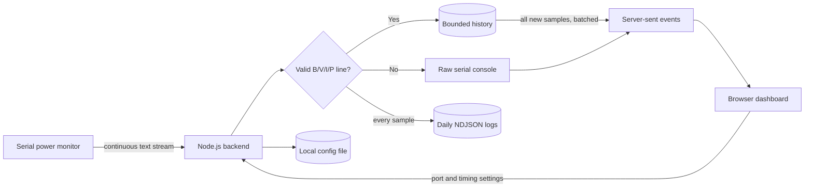

# Benchline Power Monitor

Benchline is a local time-series analysis dashboard for a serial power monitor. The Node.js backend keeps ownership of the serial port, records parsed telemetry, and serves a linked set of analysis views to the browser.

## Features

- Scan serial ports reported by the host operating system
- Select a port and baud rate from the browser
- Continue reading in the Node.js backend when the dashboard is closed
- Parse `B`, `V`, `I`, and `P` values for any numbered channel
- Plot channel 0 and channel 1 on linked, unit-correct battery, voltage, current, and power charts
- Zoom, pan, pause live following, use time presets, or drag the navigator to isolate an analysis range
- Calculate energy in mWh with trapezoidal integration while excluding detected data gaps
- Compare average/peak power, current, minimum voltage, battery drop, sample coverage, and gaps by channel
- Group configurable power and current threshold crossings into events
- Inspect the selected range as a telemetry table and export it as CSV
- Persist every parsed reading in daily NDJSON files under `data/telemetry/`
- Batch all new readings to the dashboard without dropping intermediate samples
- Persist settings and optionally reconnect every five seconds after a failure
- Stream status, readings, and raw serial lines with server-sent events

## How it works



The serial device can write faster than the configured dashboard interval. The backend parses and records every complete reading, then sends all new samples as one server-sent event batch on each interval. The configured history limit bounds working memory and browser load; daily log files are not truncated by that setting.

## Expected serial format

Each measurement must occupy one complete line. Whitespace may vary, and channel numbers must match within the line.

```text
B0 = 4.122 V, V0 = 4.150 V, I0 = -138.275 mA, P0 = 0.002 W
B1 = 0.000 V, V1 = 0.000 V, I1 = 0.000 mA, P1 = 0.000 W
------------------------
```

Separator and unrelated lines remain visible in the serial console but are not plotted.

## Quick start

### Prerequisites

- Node.js 22 or newer
- npm
- A serial device and permission to open its device path

### 1. Install dependencies

From this application directory, install the serial-port package:

```bash
cd myprojects/monitor-application/power-monitor
npm install
```

`serialport` includes native components. If installation fails, confirm that the installed Node.js version is supported and that platform build tools are available.

### 2. Start the backend

```bash
npm start
```

Expected output:

```text
Power Monitor is running at http://127.0.0.1:3100
```

Open [http://127.0.0.1:3100](http://127.0.0.1:3100).

### 3. Configure the serial input

1. Select **Configure input**.
2. Select **Scan ports**.
3. Choose the power monitor device path.
4. Choose the device baud rate.
5. Set the dashboard publish interval and working history size.
6. Select **Save & connect**.

The status changes to **Reading serial** after the backend opens the port. If no device appears, reconnect it and scan again. On macOS, the suitable path commonly begins with `/dev/cu.`; on Linux it commonly begins with `/dev/ttyUSB` or `/dev/ttyACM`.

## Configuration

Browser settings are stored in `data/config.json`. Parsed readings are appended to `data/telemetry/telemetry-YYYY-MM-DD.ndjson`, one JSON object per line. The `data/` directory is local runtime state and should remain ignored by Git. No secret or device data is required.

| Setting | Default | Allowed range | Behavior |
| --- | ---: | ---: | --- |
| Serial port | Empty | OS device path | Port owned by the backend |
| Baud rate | `115200` | 300–4,000,000 | Must match the device |
| Publish every | `1.0 s` | 0.1–60 s | How often the backend batches all new samples to the browser |
| Working history | `600` | 50–5,000 samples | Maximum readings retained in memory and restored at startup |
| Reconnect automatically | Enabled | On/off | Retries the saved port every five seconds |

Optional server environment variables:

| Variable | Default | Purpose |
| --- | --- | --- |
| `HOST` | `127.0.0.1` | HTTP bind address |
| `PORT` | `3100` | HTTP listen port |
| `DATA_DIR` | `./data` | Saved configuration directory |

Example:

```bash
HOST=0.0.0.0 PORT=3200 npm start
```

Binding to `0.0.0.0` exposes the dashboard to the local network. This application has no authentication, so use that setting only on a trusted network or behind an authenticated proxy.

## Commands

```bash
npm start       # Run the backend and dashboard
npm run dev     # Restart after backend file changes
npm test        # Run parser and configuration tests
```

## HTTP API

- `GET /api/status` — connection state and saved settings
- `GET /api/ports` — serial ports currently reported by the OS
- `GET /api/readings?limit=600` — recent parsed readings and console messages
- `GET /api/events` — live status, reading, and log event stream
- `PUT /api/config` — validate, persist, and apply settings
- `POST /api/connect` — open the saved port
- `POST /api/disconnect` — close the current port

## Verification boundaries

Automated tests verify parsing, channel matching, negative values, ignored separator lines, configuration limits, lossless sample batching, persisted history restore, energy integration, data-gap handling, threshold grouping, and CSV output. They do not verify serial permissions, USB-driver behavior, the selected device baud rate, disconnect/reconnect behavior on real hardware, or the electrical accuracy of incoming measurements. Those checks require the physical power monitor.
