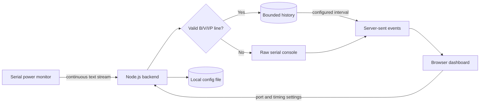

# Benchline Power Monitor

Benchline is a local web application that keeps reading a serial power monitor in the backend while a browser configures the connection, plots measurements, and displays the raw serial output.

## Features

- Scan serial ports reported by the host operating system
- Select a port and baud rate from the browser
- Continue reading in the Node.js backend when the dashboard is closed
- Parse `B`, `V`, `I`, and `P` values for any numbered channel
- Plot channel 0 and channel 1 on separate, unit-correct battery, voltage, current, and power charts
- Configure how often the backend publishes the newest readings to the dashboard
- Persist settings and optionally reconnect every five seconds after a failure
- Stream status, readings, and raw serial lines with server-sent events

## How it works



The serial device can write faster than the configured dashboard interval. The backend parses every complete reading and keeps bounded history, but sends only the latest value for each channel on each interval. This keeps the graph responsive without pausing serial input.

## Expected serial format

Each measurement must occupy one complete line. Whitespace may vary, and channel numbers must match within the line.

```text
B0 = 4.122 V, V0 = 4.150 V, I0 = -138.275 mA, P0 = 0.002 W
B1 = 0.000 V, V1 = 0.000 V, I1 = 0.000 mA, P1 = 0.000 W
------------------------
```

Separator and unrelated lines remain visible in the serial console but are not plotted.

## Quick start

### Prerequisites

- Node.js 22 or newer
- npm
- A serial device and permission to open its device path

### 1. Install dependencies

From this application directory, install the serial-port package:

```bash
cd myprojects/power-monitor
npm install
```

`serialport` includes native components. If installation fails, confirm that the installed Node.js version is supported and that platform build tools are available.

### 2. Start the backend

```bash
npm start
```

Expected output:

```text
Power Monitor is running at http://127.0.0.1:3100
```

Open [http://127.0.0.1:3100](http://127.0.0.1:3100).

### 3. Configure the serial input

1. Select **Configure input**.
2. Select **Scan ports**.
3. Choose the power monitor device path.
4. Choose the device baud rate.
5. Set the dashboard update interval and plot history size.
6. Select **Save & connect**.

The status changes to **Reading serial** after the backend opens the port. If no device appears, reconnect it and scan again. On macOS, the suitable path commonly begins with `/dev/cu.`; on Linux it commonly begins with `/dev/ttyUSB` or `/dev/ttyACM`.

## Configuration

Browser settings are stored in `data/config.json`, which is ignored by Git. No secret or device data is required.

| Setting | Default | Allowed range | Behavior |
| --- | ---: | ---: | --- |
| Serial port | Empty | OS device path | Port owned by the backend |
| Baud rate | `115200` | 300–4,000,000 | Must match the device |
| Update every | `1.0 s` | 0.1–60 s | How often the backend sends the latest channel values |
| Plot history | `600` | 50–5,000 samples | Maximum parsed readings retained in memory |
| Reconnect automatically | Enabled | On/off | Retries the saved port every five seconds |

Optional server environment variables:

| Variable | Default | Purpose |
| --- | --- | --- |
| `HOST` | `127.0.0.1` | HTTP bind address |
| `PORT` | `3100` | HTTP listen port |
| `DATA_DIR` | `./data` | Saved configuration directory |

Example:

```bash
HOST=0.0.0.0 PORT=3200 npm start
```

Binding to `0.0.0.0` exposes the dashboard to the local network. This application has no authentication, so use that setting only on a trusted network or behind an authenticated proxy.

## Commands

```bash
npm start       # Run the backend and dashboard
npm run dev     # Restart after backend file changes
npm test        # Run parser and configuration tests
```

## HTTP API

- `GET /api/status` — connection state and saved settings
- `GET /api/ports` — serial ports currently reported by the OS
- `GET /api/readings?limit=600` — recent parsed readings and console messages
- `GET /api/events` — live status, reading, and log event stream
- `PUT /api/config` — validate, persist, and apply settings
- `POST /api/connect` — open the saved port
- `POST /api/disconnect` — close the current port

## Verification boundaries

Automated tests verify parsing, channel matching, negative values, ignored separator lines, and configuration limits. They do not verify serial permissions, USB-driver behavior, the selected device baud rate, disconnect/reconnect behavior on real hardware, or the electrical accuracy of incoming measurements. Those checks require the physical power monitor.
